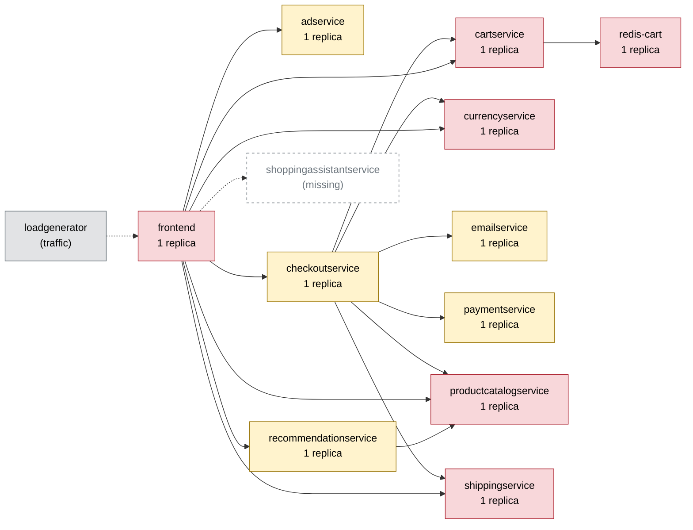

# Chaos Engineering Findings Report — Online Boutique

Generated 2026-10-10T17:45:07+00:00 · scope: `all` · 41 experiments · analyst model: gpt-6-luna · score version 1

## 1. Summary

- **Resilience score: 61 / 100 (grade D)** — given by the AI analyst against a fixed rubric, combined by code; code anchor: 62.
- Experiments: 41 · types: cpu_stress, memory_stress, network_delay, network_loss, pod_failure, pod_kill, traffic_spike · failure classes: errors, recovery, resource exhaustion, slowdown.
- Planner predictions: 6 confirmed, 3 partly, 2 refuted.
- Safety: 17 experiment(s) stopped automatically or manually; baseline p95 14 ms, 0.0% errors.

*(AI analyst)* Baseline traffic was healthy (0% errors; overall p95 13.8 ms), but faults exposed severe weaknesses in critical shared services and the single-replica frontend. Cartservice and productcatalogservice disruptions caused widespread failures, while frontend CPU throttling under load drove user-flow p95 into seconds. Injected delay and packet loss also produced extreme tail latency without necessarily causing errors. The scores reflect the measured impacts, the limited size of several probes, and the mostly single-replica posture.

## 2. Findings, ranked by severity

### F1. [CRITICAL] Cartservice loss causes broad shopping failure with slow recovery

- **Services:** cartservice, frontend, checkoutservice
- **Evidence:** `20261010-171948-pod_kill-cartservice`, `20261010-173035-memory_stress-cartservice` — During the cartservice pod kill, peak error rate was 100%, impact error rate 90.08%, and user-flow recovery took 31.1 s; individual flow error rates were 83.3–100%. During 110 MB memory stress, impact error rate was 97.19%, cartservice restarted once, and recovery took 42 s. The service is a single replica and reaches all five flows.
- **Root cause:** Cartservice is a shared, single-replica dependency for frontend and checkoutservice. When its only pod is unavailable or impaired, there is no serving replica to contain the disruption, so cart, browsing, and checkout requests fail together.
- **Fix (`scale_replicas` on cartservice):** Cartservice is stateless and can be scaled. A second replica gives callers a serving endpoint during a single-pod kill or restart, reducing the all-flows outage and dependence on replacement readiness.

```
kubectl -n boutique scale deployment/cartservice --replicas=2
```
- **Expected improvement:** A single cartservice pod disruption should no longer make most requests across all flows fail; user-flow recovery should be materially faster than the measured 31–42 s.
- **Verify by re-running:** `chaos-agent run --type pod_kill --target cartservice -p grace_period_s=0 --duration 30`

### F2. [HIGH] Product catalog pod loss breaks core flows and spreads to a dependent pod

- **Services:** productcatalogservice, frontend, checkoutservice, recommendationservice
- **Evidence:** `20261010-101701-pod_kill-productcatalogservice`, `20261010-171530-pod_failure-productcatalogservice` — In the pod-kill run, peak error rate was 100%; view_cart and checkout each had 100% flow errors and about 5,003 ms p95, while recovery took 21.1 s. The guard also reported a recommendationservice pod as NotReady. In the later pod-failure run, impact error rate was 59.09%, home and product each had at least 83.3% errors in the sampled requests, and the run aborted on a 60% error rate.
- **Root cause:** Productcatalogservice is a single replica shared by frontend, checkoutservice, and recommendationservice. Loss of that only replica leaves dependent flows without a catalog endpoint; observed disruption also coincided with a non-target recommendationservice pod becoming NotReady.
- **Fix (`scale_replicas` on productcatalogservice):** This stateless service can be replicated. Keeping another catalog pod available should prevent one pod's loss from removing the shared dependency from every caller while Kubernetes replaces it.

```
kubectl -n boutique scale deployment/productcatalogservice --replicas=2
```
- **Expected improvement:** A single catalog pod kill should cause fewer failed home, product, cart, and checkout requests, avoid a prolonged user-flow recovery, and reduce the chance that the disruption propagates to recommendationservice.
- **Verify by re-running:** `chaos-agent run --type pod_kill --target productcatalogservice -p grace_period_s=0 --duration 30`

### F3. [HIGH] Frontend CPU throttling makes all flows extremely slow under load

- **Services:** frontend
- **Evidence:** `20261010-080318-traffic_spike-frontend`, `20261010-080822-traffic_spike-frontend`, `20261010-093538-traffic_spike-frontend` — At 100 users, frontend CPU reached 97.6% of its 200m limit with 96.6% peak throttling; home p95 was 484.7 ms and checkout p95 395.8 ms. At 500 users, home p95 reached 3,973 ms and checkout 2,105 ms, while frontend CPU was at its limit with 100% throttling. At 300 users, repeated runs approached or breached the 1,500 ms guard threshold across flows.
- **Root cause:** The single frontend replica is the entrypoint for every request and its 200m CPU limit is the measured bottleneck. CPU saturation and throttling queue requests at the entrypoint, spreading latency across all user flows even though VM CPU remained around 30% at peak in the cited 500-user run.
- **Fix (`set_resources` on frontend):** The fix catalog identifies frontend CPU throttling as a capacity bottleneck. Raising its CPU limit gives the entrypoint room to process bursts rather than spending most of the run throttled; the memory limit is left unchanged because these runs did not show memory pressure.

```
kubectl -n boutique set resources deployment/frontend -c server --limits=cpu=800m,memory=128Mi
```
- **Expected improvement:** Frontend CPU throttling should fall substantially under the same load, with lower p95 across home, product, cart, and checkout and fewer runs reaching the latency guard.
- **Verify by re-running:** `chaos-agent run --type traffic_spike --target frontend -p users=100 -p ramp_s=30 -p think_ms=1000 -p checkout_pct=20 --duration 90`

### F4. [HIGH] Redis cart outage can leave the entrypoint unresponsive

- **Services:** redis-cart, cartservice, frontend
- **Evidence:** `20261010-172943-pod_failure-redis-cart` — The run aborted after 4.6 s of fault because the frontend was unresponsive for 4.2 s. Peak error rate was 66.7%, peak p95 was 5,003.7 ms, and the observed home-flow sample had 100% errors. The experiment did not collect requests for add_to_cart, view_cart, or checkout during the fault, so the observed impact is narrower than the dependency map's potential reach.
- **Root cause:** Redis-cart is a single stateful dependency behind cartservice. When it is unavailable, a cart-dependent call can hold up the frontend long enough to make the entrypoint unresponsive rather than failing quickly and isolating the affected cart function.
- **Fix (`code_change` on frontend):** A bounded call prevents Redis unavailability from holding frontend requests for several seconds. Explicitly limiting the fallback to cart behavior preserves correct cart-write semantics while containing the stall.

```
# code change in frontend: Set a 250 ms gRPC deadline on frontend-to-cartservice calls; on deadline, return an explicit retryable cart-unavailable response and keep unrelated page content responsive. Do not report timed-out cart writes as successful.
```
- **Expected improvement:** The frontend should stop becoming unresponsive for multiple seconds during a Redis outage; cart operations may fail visibly and retryably, while unaffected page content should remain responsive.
- **Verify by re-running:** `chaos-agent run --type pod_failure --target redis-cart --duration 15`

### F5. [HIGH] Loss and delay on critical RPC paths amplify user-facing tail latency

- **Services:** frontend, productcatalogservice, currencyservice, shippingservice, cartservice
- **Evidence:** `20261010-171613-network_delay-productcatalogservice`, `20261010-095223-network_delay-currencyservice`, `20261010-173902-network_delay-shippingservice`, `20261010-171055-network_loss-cartservice` — A 100 ms productcatalogservice delay produced p95 up to 756.8 ms (70.5x baseline) across all five flows. A 50 ms currencyservice delay produced home p95 521.3 ms (40.41x) and checkout p95 168.8 ms (9.93x). A 40 ms shippingservice delay produced checkout p95 141.0 ms (9.34x). With 20% cartservice packet loss, add_to_cart p95 reached 1,378 ms and view_cart 1,480.9 ms; the run aborted at 6.6 s after the p95 guard was breached.
- **Root cause:** User-facing requests wait on synchronous downstream RPCs. When a dependency is slow or packets are lost, that waiting amplifies the impairment into very large tail latency rather than bounding the call and containing the effect to the affected feature.
- **Fix (`code_change` on frontend):** The change bounds how long the entrypoint waits on these dependencies and prevents slow calls from consuming the user-facing request indefinitely. The explicit fallback behavior makes the timeout a containment mechanism rather than silently returning incorrect cart results.

```
# code change in frontend: Apply a 500 ms end-to-end budget to frontend calls to productcatalogservice, currencyservice, shippingservice, and cartservice; cancel calls when the budget expires, and render a bounded degraded response for optional product, currency, or shipping content. For cart operations, return a retryable failure rather than claiming success.
```
- **Expected improvement:** Under the same delay and loss injections, frontend request p95 should be bounded near the configured budget instead of reaching 700–1,500 ms; optional-content degradation should not stall unrelated page rendering.
- **Verify by re-running:** `chaos-agent run --type network_delay --target productcatalogservice -p latency_ms=100 -p jitter_ms=0 --duration 45`

### F6. [HIGH] Paymentservice unavailability makes checkout fail for most sampled checkout requests

- **Services:** paymentservice, checkoutservice
- **Evidence:** `20261010-170944-pod_failure-paymentservice` — During the 30 s paymentservice failure, checkout flow error rate was 83.3% over 24 requests; impact error rate was 16.67% and peak error rate 21%. Checkout p95 was 19.6 ms, so the dominant measured problem was failed checkout responses, not latency.
- **Root cause:** Paymentservice is a single-replica dependency on the revenue path. When its only pod is unavailable, checkoutservice has no alternate payment endpoint and checkout requests fail.
- **Fix (`scale_replicas` on paymentservice):** Paymentservice is stateless and can be replicated. A second pod provides an endpoint during a single-pod disruption and addresses the measured single-replica failure mode.

```
kubectl -n boutique scale deployment/paymentservice --replicas=2
```
- **Expected improvement:** A single paymentservice pod failure should produce substantially fewer checkout errors while the remaining replica serves requests.
- **Verify by re-running:** `chaos-agent run --type pod_failure --target paymentservice --duration 30`

_Findings text: *(AI analyst)*. Numbers: measured by the probe / Prometheus._

## 3. Resilience score per service (worst first)

| Service | Score (AI) | Code anchor | Grade | Availability | Latency | Recovery | Containment | Posture | Weight | Tested | Justification (AI) |
|---|---|---|---|---|---|---|---|---|---|---|---|
| cartservice | **21** | 24 | F | 0 | 8 | 55 | 20 | 60 | 3 | yes | Cartservice pod loss caused 90.08% impact errors and 31.1 s recovery, and 110 MB memory stress caused 97.19% impact errors with 42 s recovery (20261010-171948-pod_kill-cartservice; 20261010-173035-memory_stress-cartservice). These findings reinforce the anchor's very low availability and containment scores on an all-flows checkout-path service. |
| productcatalogservice | **25** | 27 | F | 0 | 0 | 75 | 40 | 60 | 3 | yes | A 100 ms delay produced up to 756.8 ms p95, while a pod kill caused 100% peak errors and roughly 5 s p95 in view_cart and checkout; one run also observed a non-target recommendationservice pod NotReady (20261010-171613-network_delay-productcatalogservice; 20261010-101701-pod_kill-productcatalogservice). User-flow recovery was 21.1 s in the pod-kill run. |
| redis-cart | **34** | 34 | F | 0 | 7 | 98 | 70 | 60 | 3 | yes | The short pod-failure run caused 100% home-flow errors in the observed sample, 5,003.7 ms peak p95, and a frontend unresponsive guard breach; recovery after fault removal was quick (20261010-172943-pod_failure-redis-cart). Cart-operation flows had no requests during the fault, so broader user impact is not directly measured. |
| frontend | **66** | 68 | D | 100 | 4 | 95 | 45 | 60 | 3 | yes | Traffic runs retained zero reported errors but showed severe latency: at 500 users home p95 was 3,973 ms, with frontend at its CPU limit and 100% peak throttling (20261010-080822-traffic_spike-frontend). All flows pass through this single-replica entrypoint, so its latency and containment scores are low. |
| recommendationservice | **72** | 60 | C | 75 | 75 | 70 | 65 | 60 | 1.5 | no | This service has no direct experiment anchor; scores are estimated from its single-replica posture and dependency on productcatalogservice. A productcatalogservice pod-kill run reported recommendationservice NotReady, but no direct recommendation-flow measurements were supplied (20261010-101701-pod_kill-productcatalogservice). |
| paymentservice | **75** | 79 | C | 55 | 100 | 100 | 50 | 60 | 2.8 | yes | During paymentservice failure, 83.3% of sampled checkout requests failed, despite low checkout p95 (20261010-170944-pod_failure-paymentservice). Availability is adjusted slightly below its anchor to reflect the severe checkout-flow error rate; other dimensions remain near the anchor. |
| currencyservice | **80** | 82 | C | 100 | 38 | 100 | 90 | 60 | 2.8 | yes | The 50 ms delay caused no errors but raised home p95 to 521.3 ms and checkout p95 to 168.8 ms (20261010-095223-network_delay-currencyservice). Latency is close to the anchor; containment is slightly lower because multiple user flows slowed. |
| shippingservice | **84** | 86 | B | 100 | 65 | 100 | 70 | 60 | 2 | yes | Memory stress caused no errors and only 1.6x checkout p95; injected delay caused checkout p95 of 141.0 ms at 40 ms latency and 81.9 ms at 20 ms latency (20261010-173550-memory_stress-shippingservice; 20261010-173902-network_delay-shippingservice; 20261010-174035-network_delay-shippingservice). Impact was concentrated on checkout and view_cart, so containment is modestly below the anchor. |
| checkoutservice | **94** | 96 | A | 95 | 100 | 100 | 95 | 60 | 2.8 | yes | The checkoutservice pod-kill run reported no errors or latency impact, but collected zero checkout requests, so it is weak evidence for checkout availability (20261010-173821-pod_kill-checkoutservice). Scores stay close to the high anchor, with a caveat for that missing flow sample. |
| adservice | **96** | 96 | A | 100 | 99 | 100 | 100 | 60 | 0.8 | yes | The pod-kill run had no flow errors and at most a 1.56x home p95 increase (20261010-074206-pod_kill-adservice). It is a single replica, but ads are optional and the measured user impact was minor. |
| emailservice | **96** | 96 | A | 100 | 100 | 100 | 100 | 60 | 1 | yes | The 30 s pod-failure test had no flow errors and checkout p95 was 19.4 ms (20261010-173649-pod_failure-emailservice). Email is checkout-path infrastructure, but this run showed no measured shopper impact. |

Rubric weights: availability 35%, latency 25%, recovery 20%, containment 10%, posture 10%. AI dimension scores are limited to ±15 of the code anchor; the overall score is the criticality-weighted mean of the tested services.

*(AI analyst)* Scores remain within 15 points of the supplied anchors. I weighted the entrypoint and shared checkout/cart dependencies most heavily, while assigning less weight to ads, email, and recommendations because their measured or expected shopper impact is narrower. Untested recommendationservice dimensions are estimates based on its single-replica posture, optional-flow role, and dependency on productcatalogservice; checkoutservice's apparently clean pod-kill result is also treated cautiously because that run collected no checkout requests. Posture is 60 for each anchored service because each has one replica, probes, and configured resource limits.

## 4. Experiments

| Run | Type | Target | Params | Origin | Status | Peak errors | Peak p95 | Worst slowdown | Affected flows | Recovery | Prediction |
|---|---|---|---|---|---|---|---|---|---|---|---|
| `20261010-073737-network_delay-productcatalogservice` | network_delay | productcatalogservice | {'latency_ms': 100} | manual | COMPLETED | 0.0% | 722 ms | 71.3x | none | 0 s | - |
| `20261010-073913-network_delay-productcatalogservice` | network_delay | productcatalogservice | {'latency_ms': 500} | manual | ABORTED (guard: p95 519ms > 300ms) | 0.0% | 519 ms | 47.5x | none | 5 s | - |
| `20261010-074007-cpu_stress-cartservice` | cpu_stress | cartservice | {'workers': 1, 'load': 80} | manual | ABORTED (kill switch: chaos resource was deleted externally) | 0.0% | 82 ms | 16.1x | none | 0 s | - |
| `20261010-074206-pod_kill-adservice` | pod_kill | adservice | - | manual | COMPLETED | 0.0% | 20 ms | 1.6x | none | 0 s (pod Ready 32 s) | - |
| `20261010-080318-traffic_spike-frontend` | traffic_spike | frontend | {'users': 100, 'ramp_s': 30} | manual | COMPLETED | 0.0% | 1000 ms | 38.8x | none | 0 s | - |
| `20261010-080539-traffic_spike-frontend` | traffic_spike | frontend | {'users': 300, 'ramp_s': 60} | manual | ABORTED (guard: p95 1686ms > 1500ms) | 0.0% | 1686 ms | 114.0x | none | 1 s | - |
| `20261010-080723-traffic_spike-frontend` | traffic_spike | frontend | {'users': 50, 'ramp_s': 10} | manual | ABORTED (kill switch: load generator stopped before its scheduled end) | 0.0% | 88 ms | 5.4x | none | 0 s | - |
| `20261010-080822-traffic_spike-frontend` | traffic_spike | frontend | {'users': 500, 'ramp_s': 90} | manual | COMPLETED | 0.0% | 4170 ms | 317.8x | none | 0 s | - |
| `20261010-081700-traffic_spike-frontend` | traffic_spike | frontend | {'users': 150, 'ramp_s': 20} | manual | COMPLETED | 0.0% | 1014 ms | 110.5x | none | 0 s | - |
| `20261010-091723-network_delay-productcatalogservice` | network_delay | productcatalogservice | {'latency_ms': 100} | manual | COMPLETED | 0.0% | 718 ms | 66.5x | none | 0 s | - |
| `20261010-092840-network_delay-productcatalogservice` | network_delay | productcatalogservice | {'latency_ms': 100} | manual | COMPLETED | 0.0% | 718 ms | 66.7x | none | 0 s | - |
| `20261010-093014-network_delay-productcatalogservice` | network_delay | productcatalogservice | {'latency_ms': 500} | manual | ABORTED (guard: p95 622ms > 300ms) | 0.0% | 1368 ms | 144.0x | none | 0 s | - |
| `20261010-093052-traffic_spike-frontend` | traffic_spike | frontend | {'users': 300, 'ramp_s': 60} | manual | ABORTED (guard: p95 1518ms > 1500ms) | 0.0% | 1518 ms | 104.7x | none | 0 s | - |
| `20261010-093222-traffic_spike-frontend` | traffic_spike | frontend | {'users': 300, 'ramp_s': 60} | manual | ABORTED (guard: p95 1641ms > 1500ms) | 0.0% | 1641 ms | 96.3x | none | 5 s | - |
| `20261010-093357-traffic_spike-frontend` | traffic_spike | frontend | {'users': 300, 'ramp_s': 60} | manual | ABORTED (guard: p95 1580ms > 1500ms) | 0.0% | 1580 ms | 108.7x | none | 4 s | - |
| `20261010-093538-traffic_spike-frontend` | traffic_spike | frontend | {'users': 300, 'ramp_s': 60} | manual | ABORTED (guard: p95 1626ms > 1500ms) | 0.0% | 1626 ms | 127.6x | none | 6 s | - |
| `20261010-093715-traffic_spike-frontend` | traffic_spike | frontend | {'users': 300, 'ramp_s': 60} | manual | ABORTED (manual abort (Ctrl-C)) | 0.0% | 787 ms | 46.3x | none | - | - |
| `20261010-093819-network_delay-productcatalogservice` | network_delay | productcatalogservice | {'latency_ms': 100} | manual | COMPLETED | 0.0% | 717 ms | 66.6x | none | 0 s | - |
| `20261010-094605-traffic_spike-frontend` | traffic_spike | frontend | {'users': 300, 'ramp_s': 60} | manual | ABORTED (guard: p95 1532ms > 1500ms) | 0.0% | 1535 ms | 137.5x | none | 1 s | - |
| `20261010-095223-network_delay-currencyservice` | network_delay | currencyservice | {'latency_ms': 50} | manual | COMPLETED | 0.0% | 528 ms | 40.4x | none | 0 s | - |
| `20261010-095651-traffic_spike-frontend` | traffic_spike | frontend | {'users': 300, 'ramp_s': 60} | manual | ABORTED (guard: p95 1576ms > 1500ms) | 0.0% | 1599 ms | 77.6x | none | 1 s | - |
| `20261010-100804-traffic_spike-frontend` | traffic_spike | frontend | {'users': 300, 'ramp_s': 60} | manual | ABORTED (guard: p95 1541ms > 1500ms) | 0.0% | 1554 ms | 114.9x | none | 0 s | - |
| `20261010-101701-pod_kill-productcatalogservice` | pod_kill | productcatalogservice | - | manual | COMPLETED | 100.0% | 5004 ms | 467.6x | none | 21 s (pod Ready 2 s) | - |
| `20261010-101838-pod_kill-productcatalogservice` | pod_kill | productcatalogservice | - | manual | COMPLETED | 60.0% | 14 ms | 0.7x | none | 23 s (pod Ready 2 s) | - |
| `20261010-102446-pod_kill-productcatalogservice` | pod_kill | productcatalogservice | - | manual | COMPLETED | 60.0% | 13 ms | 0.8x | none | 4 s (pod Ready 2 s) | - |
| `20261010-102712-pod_kill-productcatalogservice` | pod_kill | productcatalogservice | - | manual | COMPLETED | 50.0% | 14 ms | 1.2x | none | 3 s (pod Ready 2 s) | - |
| `20261010-112233-pod_kill-productcatalogservice` | pod_kill | productcatalogservice | - | manual | COMPLETED | 0.0% | 13 ms | 1.0x | none | 0 s (pod Ready 2 s) | - |
| `20261010-170944-pod_failure-paymentservice` | pod_failure | paymentservice | - | manual | COMPLETED | 21.1% | 24 ms | 1.2x | checkout | 0 s | - |
| `20261010-171055-network_loss-cartservice` | network_loss | cartservice | {'loss_pct': 20} | manual | ABORTED (guard: p95 1564ms > 1500ms) | 0.0% | 1571 ms | 320.5x | home, product, add_to_cart, view_cart | 0 s | - |
| `20261010-171142-memory_stress-productcatalogservice` | memory_stress | productcatalogservice | {'size_mb': 64} | manual | COMPLETED | 0.0% | 22 ms | 2.1x | none | 0 s | - |
| `20261010-171530-pod_failure-productcatalogservice` | pod_failure | productcatalogservice | - | fallback | ABORTED (guard: error rate 60% > 20%) | 60.0% | 14 ms | 0.7x | home, product, add_to_cart | 2 s | confirmed |
| `20261010-171613-network_delay-productcatalogservice` | network_delay | productcatalogservice | {'latency_ms': 100} | fallback | COMPLETED | 0.0% | 757 ms | 70.5x | home, product, add_to_cart, view_cart, checkout | 0 s | confirmed |
| `20261010-171736-traffic_spike-frontend` | traffic_spike | frontend | {'users': 150, 'ramp_s': 30} | fallback | COMPLETED | 0.0% | 1094 ms | 84.3x | home, product, add_to_cart, view_cart, checkout | 0 s | confirmed |
| `20261010-171948-pod_kill-cartservice` | pod_kill | cartservice | - | fallback | COMPLETED | 100.0% | 936 ms | 84.0x | home, product, add_to_cart, view_cart, checkout | 31 s (pod Ready 24 s) | partly |
| `20261010-172943-pod_failure-redis-cart` | pod_failure | redis-cart | - | planner | ABORTED (guard: frontend unresponsive for 4.2s) | 66.7% | 5004 ms | 314.7x | home | 2 s | partly |
| `20261010-173035-memory_stress-cartservice` | memory_stress | cartservice | {'size_mb': 110, 'workers': 1} | planner | ABORTED (guard: error rate 55% > 20%) | 100.0% | 915 ms | 53.3x | home, product, add_to_cart, view_cart, checkout | 42 s | confirmed |
| `20261010-173550-memory_stress-shippingservice` | memory_stress | shippingservice | {'size_mb': 100, 'workers': 1} | planner | COMPLETED | 0.0% | 24 ms | 1.6x | none | 0 s | refuted |
| `20261010-173649-pod_failure-emailservice` | pod_failure | emailservice | - | planner | COMPLETED | 0.0% | 20 ms | 1.3x | none | 0 s | partly |
| `20261010-173821-pod_kill-checkoutservice` | pod_kill | checkoutservice | {'grace_period_s': 0} | planner | COMPLETED | 0.0% | 13 ms | 1.0x | none | 0 s (pod Ready 2 s) | refuted |
| `20261010-173902-network_delay-shippingservice` | network_delay | shippingservice | {'latency_ms': 40, 'jitter_ms': 5} | planner | COMPLETED | 0.0% | 140 ms | 9.3x | checkout | 0 s | confirmed |
| `20261010-174035-network_delay-shippingservice` | network_delay | shippingservice | {'latency_ms': 20, 'jitter_ms': 5} | adapter | COMPLETED | 0.0% | 80 ms | 5.4x | checkout | 0 s | confirmed |

## 5. How the AI decided

*(AI analyst)* The planner correctly predicted the broad impact, severe slowdown, and completion outcome for the productcatalogservice delay run (20261010-171613-network_delay-productcatalogservice), and correctly predicted the high-error abort for the productcatalogservice pod-failure run (20261010-171530-pod_failure-productcatalogservice) and the 150-user frontend traffic spike (20261010-171736-traffic_spike-frontend). Predictions were only partial for cartservice pod kill and Redis failure: affected flows matched for cartservice, but error and slowdown severity were underestimated; Redis impact was limited to the observed home sample rather than all predicted flows (20261010-171948-pod_kill-cartservice; 20261010-172943-pod_failure-redis-cart). The shippingservice memory-stress prediction was refuted because no affected flows or errors were observed, and the emailservice failure produced no checkout errors (20261010-173550-memory_stress-shippingservice; 20261010-173649-pod_failure-emailservice). Overall, dependency reach helped predict which areas could be affected, but severity estimates and sparse flow sampling remain important sources of uncertainty.

## 6. Safety record

Guard (deterministic code, checked every 1 s): abort when the error rate > 20% or p95 > max(3× baseline, 1500 ms) for 2 checks in a row, the frontend is silent for 3 s, or a non-target pod becomes NotReady. Every fault is validated against hard caps (and the AI policy for AI-proposed ones), dry-run by the Kubernetes API server, and carries a Chaos Mesh `duration` (auto-revert).

| Run | Reason | Fault active | Kill switch |
|---|---|---|---|
| `20261010-073913-network_delay-productcatalogservice` | guard: p95 519ms > 300ms | 2.5 s | kill switch took 0.5s from decision to fault removed |
| `20261010-074007-cpu_stress-cartservice` | kill switch: chaos resource was deleted externally | 16.0 s | kill switch took 0.0s from decision to fault removed |
| `20261010-080539-traffic_spike-frontend` | guard: p95 1686ms > 1500ms | 57.5 s | kill switch took 0.4s from decision to fault removed |
| `20261010-080723-traffic_spike-frontend` | kill switch: load generator stopped before its scheduled end (exit code 105) | 17.0 s | kill switch took 0.0s from decision to fault removed |
| `20261010-093014-network_delay-productcatalogservice` | guard: p95 622ms > 300ms | 3.6 s | kill switch took 0.5s from decision to fault removed |
| `20261010-093052-traffic_spike-frontend` | guard: p95 1518ms > 1500ms | 55.5 s | kill switch took 0.4s from decision to fault removed |
| `20261010-093222-traffic_spike-frontend` | guard: p95 1641ms > 1500ms | 55.5 s | kill switch took 0.4s from decision to fault removed |
| `20261010-093357-traffic_spike-frontend` | guard: p95 1580ms > 1500ms | 63.5 s | kill switch took 0.4s from decision to fault removed |
| `20261010-093538-traffic_spike-frontend` | guard: p95 1626ms > 1500ms | 56.5 s | kill switch took 0.4s from decision to fault removed |
| `20261010-093715-traffic_spike-frontend` | manual abort (Ctrl-C) | 18.5 s | kill switch took 0.4s from decision to fault removed |
| `20261010-094605-traffic_spike-frontend` | guard: p95 1532ms > 1500ms | 60.5 s | kill switch took 0.4s from decision to fault removed |
| `20261010-095651-traffic_spike-frontend` | guard: p95 1576ms > 1500ms | 35.5 s | kill switch took 0.4s from decision to fault removed |
| `20261010-100804-traffic_spike-frontend` | guard: p95 1541ms > 1500ms | 62.5 s | kill switch took 0.4s from decision to fault removed |
| `20261010-171055-network_loss-cartservice` | guard: p95 1564ms > 1500ms | 6.6 s | kill switch took 0.5s from decision to fault removed |
| `20261010-171530-pod_failure-productcatalogservice` | guard: error rate 60% > 20% | 3.6 s | kill switch took 0.5s from decision to fault removed |
| `20261010-172943-pod_failure-redis-cart` | guard: frontend unresponsive for 4.2s | 4.6 s | kill switch took 0.5s from decision to fault removed |
| `20261010-173035-memory_stress-cartservice` | guard: error rate 55% > 20% | 3.6 s | kill switch took 0.5s from decision to fault removed |

## 7. Dependency map

Red = high risk (single replica and critical), yellow = medium, green = low.



| Service | Replicas | Risk | Reach (share of user flows) | Dependents |
|---|---|---|---|---|
| cartservice | 1 | high | 100% (home, product, add_to_cart, view_cart, checkout) | checkoutservice, frontend |
| frontend | 1 | high | 100% (home, product, add_to_cart, view_cart, checkout) | - |
| productcatalogservice | 1 | high | 100% (home, product, add_to_cart, view_cart, checkout) | checkoutservice, frontend, recommendationservice |
| redis-cart | 1 | high | 100% (home, product, add_to_cart, view_cart, checkout) | cartservice, checkoutservice, frontend |
| currencyservice | 1 | high | 80% (home, product, view_cart, checkout) | checkoutservice, frontend |
| recommendationservice | 1 | medium | 60% (product, view_cart, checkout) | frontend |
| adservice | 1 | medium | 40% (home, product) | frontend |
| shippingservice | 1 | high | 40% (view_cart, checkout) | checkoutservice, frontend |
| checkoutservice | 1 | medium | 20% (checkout) | frontend |
| emailservice | 1 | medium | 20% (checkout) | checkoutservice, frontend |
| paymentservice | 1 | medium | 20% (checkout) | checkoutservice, frontend |

## 8. Method and limitations

- Users are simulated by a 4-user probe (home, product, add to cart, view cart, checkout) measured in rolling 5 s windows; resources come from Prometheus.
- Rubric: **availability** — Did users keep getting successful responses? 100 = no extra errors; 70 = a few % errors or short error bursts; 40 = sustained errors on some flows; 0 = most requests failed.; **latency** — How much slower did user flows get (worst p95 vs baseline)? 100 = < 1.5x; 80 = ~3x; 60 = ~10x; 30 = ~50x; 0 = several seconds / timeouts.; **recovery** — How fast were users back to normal after the fault ended? 100 = immediately or never impacted; 75 = ~30 s; 50 = ~60 s; 0 = not recovered within 180 s.; **containment** — Did the failure stay contained? 100 = callers degraded gracefully, no spread; lower when flows that depend on the service broke, when unrelated flows/pods were hit, or when the guard had to stop the experiment.; **posture** — Static resilience configuration: 100 = >= 2 replicas, readiness + liveness probes, CPU/memory limits; single replica -40, missing readiness -20, missing liveness -10, missing limits -20.
- *(AI analyst)* The system ran on a single-node Kubernetes VM; these results do not establish multi-node or zone-failure resilience.
- *(AI analyst)* Baseline and per-flow probe volumes were small, and several disruption runs collected only a handful of requests or none for the flow of interest.
- *(AI analyst)* Experiments were short, and abrupt pod-kill tests can produce sampling variability; repeated productcatalogservice pod-kill outcomes differed substantially.
- *(AI analyst)* Traffic tests and failure injections were not a comprehensive capacity sweep, and some traffic runs ended by manual or guard abort.
- *(AI analyst)* The dependency map reports shoppingassistantservice as missing, so its behavior and contribution to user flows could not be assessed.
