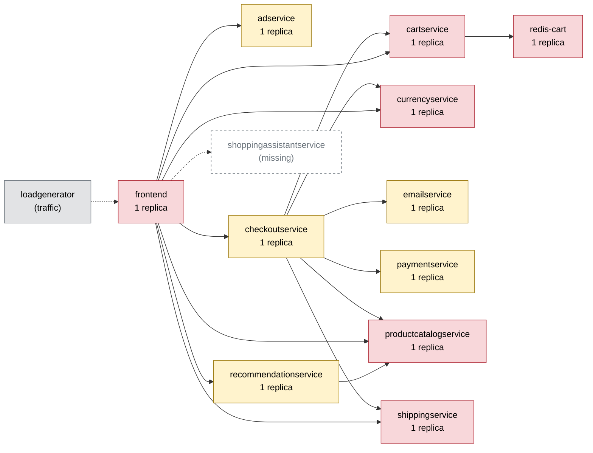

# Chaos Engineering Findings Report — Online Boutique

Generated 2026-10-10T17:21:13+00:00 · scope: `20261010-171530-campaign` · 4 experiments · analyst model: none (AI unavailable — code anchors only) · score version 1

## 1. Summary

- **Resilience score: 47 / 100 (grade F)** — code anchors only (AI analyst unavailable); code anchor: 47.
- Experiments: 4 · types: network_delay, pod_failure, pod_kill, traffic_spike · failure classes: errors, recovery, resource exhaustion, slowdown.
- Planner predictions: 3 confirmed, 1 partly, 0 refuted.
- Safety: 1 experiment(s) stopped automatically or manually; baseline p95 14 ms, 0.0% errors.

## 2. Findings, ranked by severity

_No AI findings (analyst unavailable). See the scores and experiments below._

## 3. Resilience score per service (worst first)

| Service | Score (anchors) | Code anchor | Grade | Availability | Latency | Recovery | Containment | Posture | Weight | Tested | Justification (anchors) |
|---|---|---|---|---|---|---|---|---|---|---|---|
| cartservice | **33** | 33 | F | 0 | 30 | 74 | 50 | 60 | 3.5 | yes |  |
| productcatalogservice | **39** | 39 | F | 0 | 33 | 98 | 50 | 60 | 3.5 | yes |  |
| adservice | **60** | 60 | D | - | - | - | - | 60 | 1.8 | no |  |
| checkoutservice | **60** | 60 | D | - | - | - | - | 60 | 1.9 | no |  |
| currencyservice | **60** | 60 | D | - | - | - | - | 60 | 3.1 | no |  |
| emailservice | **60** | 60 | D | - | - | - | - | 60 | 1.9 | no |  |
| paymentservice | **60** | 60 | D | - | - | - | - | 60 | 1.9 | no |  |
| recommendationservice | **60** | 60 | D | - | - | - | - | 60 | 2.2 | no |  |
| redis-cart | **60** | 60 | D | - | - | - | - | 60 | 4 | no |  |
| shippingservice | **60** | 60 | D | - | - | - | - | 60 | 2.3 | no |  |
| frontend | **74** | 74 | C | 100 | 30 | 100 | 50 | 60 | 3 | yes |  |

Rubric weights: availability 35%, latency 25%, recovery 20%, containment 10%, posture 10%. AI dimension scores are limited to ±15 of the code anchor; the overall score is the criticality-weighted mean of the tested services.

## 4. Experiments

| Run | Type | Target | Params | Origin | Status | Peak errors | Peak p95 | Worst slowdown | Affected flows | Recovery | Prediction |
|---|---|---|---|---|---|---|---|---|---|---|---|
| `20261010-171530-pod_failure-productcatalogservice` | pod_failure | productcatalogservice | - | fallback | ABORTED (guard: error rate 60% > 20%) | 60.0% | 14 ms | 0.7x | home, product, add_to_cart | 2 s | confirmed |
| `20261010-171613-network_delay-productcatalogservice` | network_delay | productcatalogservice | {'latency_ms': 100} | fallback | COMPLETED | 0.0% | 757 ms | 70.5x | home, product, add_to_cart, view_cart, checkout | 0 s | confirmed |
| `20261010-171736-traffic_spike-frontend` | traffic_spike | frontend | {'users': 150, 'ramp_s': 30} | fallback | COMPLETED | 0.0% | 1094 ms | 84.3x | home, product, add_to_cart, view_cart, checkout | 0 s | confirmed |
| `20261010-171948-pod_kill-cartservice` | pod_kill | cartservice | - | fallback | COMPLETED | 100.0% | 936 ms | 84.0x | home, product, add_to_cart, view_cart, checkout | 31 s (pod Ready 24 s) | partly |

## 5. How the AI decided

**Plan `20261010-171249-plan`** (fallback). Strategy: Deterministic fallback (no AI): highest risk/reach services first, one experiment per failure class.

| Rank | Experiment | Reason | Prediction |
|---|---|---|---|
| 1 | pod_failure on productcatalogservice 30s | highest risk + reach (100% of flows) | flows home, product, add_to_cart, view_cart, checkout; errors high; slowdown none; ABORTED |
| 2 | network_delay on productcatalogservice {'latency_ms': 100} 45s | shared dependency of 3 services | flows home, product, add_to_cart, view_cart, checkout; errors none; slowdown severe; COMPLETED |
| 3 | traffic_spike on frontend {'users': 150, 'ramp_s': 30} 90s | every request passes through the entrypoint | flows home, product, add_to_cart, view_cart, checkout; errors none; slowdown severe; COMPLETED |
| 4 | pod_kill on cartservice 30s | single replica, risk high | flows home, product, add_to_cart, view_cart, checkout; errors low; slowdown none; COMPLETED |

Rejected plan candidates (validation / AI policy / budget):

- network_loss on cartservice {'loss_pct': 20}: over budget (4 experiments)
- cpu_stress on redis-cart {'workers': 1, 'load': 80}: over budget (4 experiments)

## 6. Safety record

Guard (deterministic code, checked every 1 s): abort when the error rate > 20% or p95 > max(3× baseline, 1500 ms) for 2 checks in a row, the frontend is silent for 3 s, or a non-target pod becomes NotReady. Every fault is validated against hard caps (and the AI policy for AI-proposed ones), dry-run by the Kubernetes API server, and carries a Chaos Mesh `duration` (auto-revert).

| Run | Reason | Fault active | Kill switch |
|---|---|---|---|
| `20261010-171530-pod_failure-productcatalogservice` | guard: error rate 60% > 20% | 3.6 s | kill switch took 0.5s from decision to fault removed |

## 7. Dependency map

Red = high risk (single replica and critical), yellow = medium, green = low.

| Service | Replicas | Risk | Reach (share of user flows) | Dependents |
|---|---|---|---|---|
| cartservice | 1 | high | 100% (home, product, add_to_cart, view_cart, checkout) | checkoutservice, frontend |
| frontend | 1 | high | 100% (home, product, add_to_cart, view_cart, checkout) | - |
| productcatalogservice | 1 | high | 100% (home, product, add_to_cart, view_cart, checkout) | checkoutservice, frontend, recommendationservice |
| redis-cart | 1 | high | 100% (home, product, add_to_cart, view_cart, checkout) | cartservice, checkoutservice, frontend |
| currencyservice | 1 | high | 80% (home, product, view_cart, checkout) | checkoutservice, frontend |
| recommendationservice | 1 | medium | 60% (product, view_cart, checkout) | frontend |
| adservice | 1 | medium | 40% (home, product) | frontend |
| shippingservice | 1 | high | 40% (view_cart, checkout) | checkoutservice, frontend |
| checkoutservice | 1 | medium | 20% (checkout) | frontend |
| emailservice | 1 | medium | 20% (checkout) | checkoutservice, frontend |
| paymentservice | 1 | medium | 20% (checkout) | checkoutservice, frontend |

## 8. Method and limitations

- Users are simulated by a 4-user probe (home, product, add to cart, view cart, checkout) measured in rolling 5 s windows; resources come from Prometheus.
- Rubric: **availability** — Did users keep getting successful responses? 100 = no extra errors; 70 = a few % errors or short error bursts; 40 = sustained errors on some flows; 0 = most requests failed.; **latency** — How much slower did user flows get (worst p95 vs baseline)? 100 = < 1.5x; 80 = ~3x; 60 = ~10x; 30 = ~50x; 0 = several seconds / timeouts.; **recovery** — How fast were users back to normal after the fault ended? 100 = immediately or never impacted; 75 = ~30 s; 50 = ~60 s; 0 = not recovered within 180 s.; **containment** — Did the failure stay contained? 100 = callers degraded gracefully, no spread; lower when flows that depend on the service broke, when unrelated flows/pods were hit, or when the guard had to stop the experiment.; **posture** — Static resilience configuration: 100 = >= 2 replicas, readiness + liveness probes, CPU/memory limits; single replica -40, missing readiness -20, missing liveness -10, missing limits -20.
