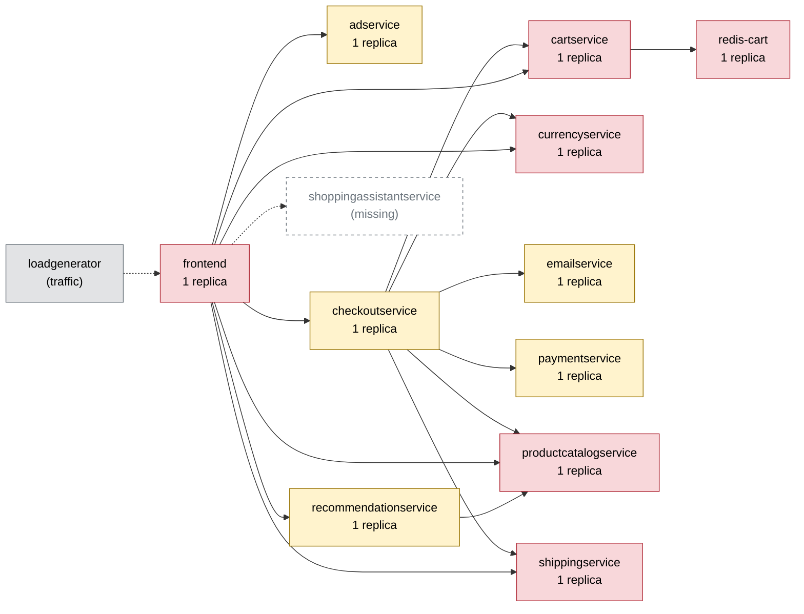

# Chaos Engineering Findings Report — Online Boutique

Generated 2026-10-10T20:55:02+00:00 · scope: `all` · 63 experiments · analyst model: gpt-6-luna · score version 1

## 1. Summary

- **Resilience score: 56 / 100 (grade F)** — given by the AI analyst against a fixed rubric, combined by code; code anchor: 56.
- Experiments: 62 · types: cpu_stress, memory_stress, network_delay, network_loss, pod_failure, pod_kill, traffic_spike · failure classes: errors, recovery, resource exhaustion, slowdown.
- Planner predictions: 10 confirmed, 5 partly, 6 refuted.
- Safety: 26 experiment(s) stopped automatically or manually; baseline p95 14 ms, 0.0% errors.

*(AI analyst)* Experiments reveal significant weaknesses in the shared cart and catalog paths, where a single service failure can disrupt multiple shopping flows and recovery may take tens of seconds. Traffic spikes also expose frontend CPU throttling: p95 latency reached several seconds while the frontend was throttled at nearly 100%. Currency and payment failures impaired checkout or other dependent flows, while the tested ad, email, and shipping failures showed little or no measured user impact. These findings are based on short experiments with small per-flow samples, so the observed impact is evidence of risk rather than a precise production failure-rate estimate.

## 2. Findings, ranked by severity

### F1. [HIGH] Cartservice pod loss disrupts every shopping flow and recovery is slow

- **Services:** cartservice, frontend, checkoutservice
- **Evidence:** `20261010-171948-pod_kill-cartservice`, `20261010-183547-pod_kill-cartservice`, `20261010-184247-pod_kill-cartservice` — Across these pod-kill runs, all five flows were affected; peak error rate was 100%, with impact error rates of 90.08%, 83.33%, and 92.66%. In the latter two runs the replacement pod became ready in 23.1–23.2 s and user-facing recovery took 28.2–31.2 s. The service has one replica and is shared by frontend and checkoutservice.
- **Root cause:** Cartservice is a single-replica shared dependency. When its pod is killed, there is no serving replica during replacement, so requests across dependent flows fail or wait until the new pod becomes ready.
- **Fix (`scale_replicas` on cartservice):** Cartservice is stateless in the dependency map, so a second replica can continue serving while Kubernetes replaces a failed pod and reduce the single-pod outage.

```
kubectl -n boutique scale deployment/cartservice --replicas=2
```
- **Expected improvement:** During a repeat pod kill, requests should continue through the surviving replica, reducing the broad error burst and avoiding a roughly 23-second wait for replacement before service is available again.
- **Verify by re-running:** `chaos-agent run --type pod_kill --target cartservice -p grace_period_s=0 --duration 30`

### F2. [HIGH] Redis-cart unavailability stalls cart-dependent requests instead of failing fast

- **Services:** redis-cart, cartservice, frontend
- **Evidence:** `20261010-172943-pod_failure-redis-cart`, `20261010-185925-pod_failure-redis-cart`, `20261010-171055-network_loss-cartservice` — Redis pod-failure runs were aborted after frontend unresponsiveness of 4.2–4.6 s; peak p95 reached 5003.7 and 5002.5 ms, with peak error rates of 66.7% and 100%. The first run observed only the home flow before the abort, so its other flows were not adequately sampled. Separately, 20% packet loss on cartservice was aborted at p95 1571.4 ms; add_to_cart reached 1378.0 ms and view_cart 1480.9 ms.
- **Root cause:** The cart request path synchronously depends on the single stateful Redis service. The long request stalls under Redis unavailability and high cartservice packet loss indicate insufficiently bounded waits and isolation for cart operations.
- **Fix (`code_change` on cartservice):** Bounded calls limit how long Redis faults can hold requests open, and separating optional cart display from core page rendering can contain cart-backend failure without pretending cart mutations succeeded.

```
# code change in cartservice: Set a 200 ms deadline on cartservice-to-redis-cart calls and return a typed cart-unavailable result on timeout. Make frontend handlers avoid blocking home and product rendering on optional cart reads; fail cart mutations and checkout explicitly rather than waiting for the request timeout.
```
- **Expected improvement:** Redis failure or cartservice packet loss should no longer leave frontend requests stalled for several seconds; cart-dependent operations may still be unavailable, but unrelated page rendering should remain responsive and affected requests should fail promptly.
- **Verify by re-running:** `chaos-agent run --type pod_failure --target redis-cart --duration 15`

### F3. [HIGH] Product catalog pod loss causes broad errors, long tail latency, and observed blast radius beyond the target

- **Services:** productcatalogservice, frontend, recommendationservice, checkoutservice
- **Evidence:** `20261010-101701-pod_kill-productcatalogservice`, `20261010-184354-pod_kill-productcatalogservice`, `20261010-171530-pod_failure-productcatalogservice` — The first pod-kill run recorded 100% peak error rate, peak p95 5003.9 ms, and recovery in 21.1 s; the guard reported frontend unresponsive for 3.2 s and a non-target recommendationservice pod NotReady. Another kill reached 5002.9 ms p95 and recovery in 23.6 s, with a recommendationservice pod also reported NotReady. The fallback pod-failure run aborted at 60% error rate, with impact error rate 59.09%.
- **Root cause:** Productcatalogservice is a single-replica dependency with reach across all flows and callers including frontend, checkoutservice, and recommendationservice. Losing its only pod causes dependent calls to fail or wait for timeouts while Kubernetes replaces it; the observed NotReady recommendation pod indicates potential blast-radius spillover.
- **Fix (`scale_replicas` on productcatalogservice):** The service is stateless in the dependency map. A second replica can maintain catalog availability while a failed pod is replaced and reduce reliance on a single pod for every flow.

```
kubectl -n boutique scale deployment/productcatalogservice --replicas=2
```
- **Expected improvement:** A repeat pod kill should produce fewer catalog-related request failures and less multi-flow interruption; monitor recommendationservice readiness as well as catalog and frontend responses.
- **Verify by re-running:** `chaos-agent run --type pod_kill --target productcatalogservice -p grace_period_s=0 --duration 30`

### F4. [HIGH] Memory pressure can restart cartservice and make most shopping requests fail

- **Services:** cartservice, frontend, checkoutservice
- **Evidence:** `20261010-173035-memory_stress-cartservice` — A 110 MB allocation against cartservice's 128 MiB memory limit produced a 97.19% impact error rate, peak error rate 100%, errors across all five flows, one cartservice restart, and 42 s recovery. The worst-flow p95 was 634.0 ms; the run was aborted after the error-rate guard fired.
- **Root cause:** The single cartservice container has little memory headroom for the tested allocation. Memory stress caused a restart and disrupted the shared cart path, so failures propagated across flows that depend on cartservice.
- **Fix (`set_resources` on cartservice):** Increasing the memory limit provides more headroom for allocation spikes and reduces the likelihood that memory pressure will restart the only cartservice pod. The CPU limit is also raised as a concrete resource adjustment, although the cited run chiefly demonstrates memory-related impact.

```
kubectl -n boutique set resources deployment/cartservice -c server --limits=cpu=500m,memory=256Mi
```
- **Expected improvement:** The same 110 MB stress should be less likely to restart cartservice; if requests remain healthy, broad errors and the 42-second recovery interval should be avoided.
- **Verify by re-running:** `chaos-agent run --type memory_stress --target cartservice -p size_mb=110 -p workers=1 --duration 15`

### F5. [HIGH] Frontend CPU throttling makes all flows extremely slow under traffic spikes

- **Services:** frontend
- **Evidence:** `20261010-080318-traffic_spike-frontend`, `20261010-080822-traffic_spike-frontend`, `20261010-202852-traffic_spike-frontend` — At 100 users, all flows were affected and peak p95 was 999.9 ms; frontend CPU peaked at 97.6% of its 200m limit with 96.6% peak throttling. At 500 users, all flows were affected and peak p95 reached 4170.0 ms; frontend CPU reached its 200m limit with 100% throttling. A 300-user run was aborted after p95 crossed 1500 ms.
- **Root cause:** Every request passes through the single frontend replica, whose 200m CPU limit is saturated and heavily throttled under load. That entrypoint bottleneck raises latency across all flows even though the VM-level CPU peaks reported in the runs were substantially lower.
- **Fix (`set_resources` on frontend):** The measured bottleneck is CPU throttling at the frontend's 200m limit, while measured memory use remained below the 128 MiB limit. Raising the CPU limit directly addresses that quota bottleneck; the single-node environment still limits the total capacity available.

```
kubectl -n boutique set resources deployment/frontend -c server --limits=cpu=1000m,memory=128Mi
```
- **Expected improvement:** At the same traffic levels, frontend throttling should fall and the multi-second p95 tail should improve. The rerun should establish whether node capacity, rather than the container limit, becomes the next bottleneck.
- **Verify by re-running:** `chaos-agent run --type traffic_spike --target frontend -p users=300 -p ramp_s=60 -p think_ms=1000 -p checkout_pct=10 --duration 120`

### F6. [HIGH] Currencyservice delay, loss, and failure propagate to core flows

- **Services:** currencyservice, frontend, checkoutservice
- **Evidence:** `20261010-095223-network_delay-currencyservice`, `20261010-190226-network_loss-currencyservice`, `20261010-194328-network_loss-currencyservice`, `20261010-203618-pod_failure-currencyservice` — With 50 ms added latency, home p95 was 521.3 ms and checkout p95 168.8 ms. At 5% packet loss, checkout p95 was 219.6 ms; at 20% loss, product p95 reached 3153.7 ms and the run was aborted. During pod failure, peak error rate was 80%, impact error rate 50%, and home, product, view_cart, and checkout were affected.
- **Root cause:** Currencyservice is a single-replica dependency shared by frontend and checkoutservice. Slow or unavailable currency RPCs propagate into several flows; under higher packet loss, the observed tail latency suggests callers wait too long for responses.
- **Fix (`code_change` on frontend):** A bounded deadline limits latency propagation during slow or lossy calls, and avoiding retries prevents the configured caller behavior from extending the wait. This bounds waiting; it does not make a required currency conversion succeed when the service is unavailable.

```
# code change in frontend: Set a 200 ms end-to-end deadline on frontend and checkoutservice gRPC calls to currencyservice, and do not retry after the deadline. Return an explicit conversion-unavailable result rather than holding the user request open.
```
- **Expected improvement:** Currency-related tails should be bounded below the several-second range seen at 20% packet loss. Requests that require conversion may still return an explicit error during an outage, but should not remain stalled for an extended timeout.
- **Verify by re-running:** `chaos-agent run --type network_loss --target currencyservice -p loss_pct=5 -p correlation_pct=0 --duration 30`

### F7. [HIGH] Paymentservice failure breaks most checkout requests

- **Services:** paymentservice, checkoutservice
- **Evidence:** `20261010-170944-pod_failure-paymentservice`, `20261010-184709-pod_failure-paymentservice`, `20261010-203207-pod_failure-paymentservice` — Checkout error rates were 83.3%, 75%, and 90% in these runs, while non-checkout flows reported zero errors. Peak aggregate error rate reached 21% in the first and third runs; the third run recorded 6 s recovery. Paymentservice has one replica and is on the checkout path.
- **Root cause:** The sole paymentservice replica is required by checkoutservice. When it is unavailable, most sampled checkout requests fail; the narrow impact is contained to checkout rather than spreading to the other observed flows.
- **Fix (`scale_replicas` on paymentservice):** Paymentservice is stateless in the dependency map, so a second replica can maintain payment capacity during a single-pod failure and reduce the checkout interruption.

```
kubectl -n boutique scale deployment/paymentservice --replicas=2
```
- **Expected improvement:** A repeat pod-failure test should show fewer failed checkout requests while the affected pod is replaced; other flows should remain unaffected as in the evidence runs.
- **Verify by re-running:** `chaos-agent run --type pod_failure --target paymentservice --duration 30`

### F8. [HIGH] Productcatalogservice latency is amplified across dependent flows

- **Services:** productcatalogservice, frontend, checkoutservice, recommendationservice
- **Evidence:** `20261010-171613-network_delay-productcatalogservice`, `20261010-202642-network_delay-productcatalogservice`, `20261010-073913-network_delay-productcatalogservice`, `20261010-093014-network_delay-productcatalogservice` — With 100 ms added catalog latency, repeated runs measured product p95 around 711–715 ms, view_cart around 712–713 ms, checkout around 717–732 ms, and add_to_cart around 104–105 ms, with no measured errors. A 500 ms delay run was aborted; product p95 reached 1612.6 ms and overall peak p95 was 1368.3 ms.
- **Root cause:** Productcatalogservice is called by several services and reaches every flow. The large end-to-end increase from a 100 ms injected delay is consistent with latency amplification through dependent calls without sufficiently tight call deadlines.
- **Fix (`code_change` on frontend):** Deadlines cap how long a slow catalog call can hold dependent requests open, while graceful fallback for optional recommendation data avoids turning an optional feature into a blocking dependency.

```
# code change in frontend: Set a 250 ms gRPC deadline for productcatalogservice calls in frontend, recommendationservice, and checkoutservice call sites. For optional recommendation data, return without recommendations on timeout; fail required catalog or checkout work promptly rather than waiting through an unbounded call.
```
- **Expected improvement:** The same 100 ms injected delay should produce a substantially lower end-to-end p95 than the measured roughly 700 ms on several flows. Calls that exceed the deadline may fail promptly, so error rates and successful-response rates must be checked alongside latency.
- **Verify by re-running:** `chaos-agent run --type network_delay --target productcatalogservice -p latency_ms=100 -p jitter_ms=0 --duration 45`

_Findings text: *(AI analyst)*. Numbers: measured by the probe / Prometheus._

## 3. Resilience score per service (worst first)

| Service | Score (AI) | Code anchor | Grade | Availability | Latency | Recovery | Containment | Posture | Weight | Tested | Justification (AI) |
|---|---|---|---|---|---|---|---|---|---|---|---|
| cartservice | **23** | 24 | F | 5 | 8 | 58 | 20 | 60 | 3 | yes | Runs 20261010-171948-pod_kill-cartservice, 20261010-183547-pod_kill-cartservice, and 20261010-173035-memory_stress-cartservice show 83–100% peak errors, broad flow impact, and up to 42 s recovery. The service is a single-replica dependency of all flows. |
| productcatalogservice | **24** | 25 | F | 4 | 2 | 72 | 18 | 60 | 3 | yes | Runs 20261010-101701-pod_kill-productcatalogservice and 20261010-171613-network_delay-productcatalogservice show broad errors and roughly 700 ms p95 on multiple flows under catalog delay; pod-kill runs also report 5 s p95 and about 21–24 s recovery. Its single-replica, all-flow reach and observed recommendationservice NotReady event lower containment. |
| redis-cart | **27** | 27 | F | 5 | 5 | 78 | 20 | 60 | 3 | yes | Runs 20261010-172943-pod_failure-redis-cart and 20261010-185925-pod_failure-redis-cart recorded frontend unresponsiveness, roughly 5000 ms p95, and high peak error rates before abort. Its one stateful replica holds cart data and is shared across the shopping path. |
| currencyservice | **31** | 30 | F | 8 | 7 | 90 | 25 | 60 | 2.8 | yes | Runs 20261010-194328-network_loss-currencyservice and 20261010-203618-pod_failure-currencyservice show p95 of 3153.7 ms under 20% loss and 50% impact error rate during pod failure across four flows. Recovery was relatively quick, but the shared single replica has broad flow reach. |
| frontend | **66** | 66 | D | 100 | 8 | 99 | 30 | 60 | 3 | yes | Runs 20261010-080822-traffic_spike-frontend and 20261010-202852-traffic_spike-frontend measured p95 of 4170 ms and 1664.6 ms, respectively, with frontend CPU at or near its 200m limit and severe throttling. Reported request error rates stayed at zero, but every flow slowed and the entrypoint is a single replica. |
| paymentservice | **75** | 74 | C | 63 | 96 | 93 | 40 | 60 | 2.5 | yes | Runs 20261010-170944-pod_failure-paymentservice and 20261010-203207-pod_failure-paymentservice show 83–90% checkout errors while the other measured flows remained error-free. The impact is severe for checkout but confined to that flow, and the single replica limits posture. |
| recommendationservice | **84** | 84 | B | 100 | 70 | 100 | 50 | 60 | 1.4 | yes | Run 20261010-203716-network_delay-recommendationservice had zero errors but p95 factors of 7.36x on product, 6.55x on view_cart, and 5.38x on checkout; its pod-kill run reported no flow errors. It remains a single replica, and observed latency affects several dependent flows. |
| shippingservice | **86** | 86 | B | 100 | 68 | 100 | 75 | 60 | 1.8 | yes | Run 20261010-173902-network_delay-shippingservice showed checkout p95 141.0 ms and view_cart p95 55.0 ms with no errors; 20261010-190144-pod_kill-shippingservice measured no errors, though it sampled zero checkout or view_cart requests. Evidence supports a latency sensitivity, not a demonstrated outage. |
| adservice | **96** | 96 | A | 100 | 99 | 100 | 100 | 60 | 0.8 | yes | In 20261010-074206-pod_kill-adservice, no flow errors were measured and home p95 was 19.5 ms versus a 12.5 ms run baseline; other flows were near baseline. The single replica limits posture despite the measured containment. |
| checkoutservice | **96** | 96 | A | 100 | 100 | 100 | 100 | 60 | 2.8 | yes | In 20261010-173821-pod_kill-checkoutservice and 20261010-190036-memory_stress-checkoutservice, no errors or material measured slowdown were reported. The kill run sampled zero checkout requests, so checkout availability during the kill is not demonstrated; posture remains limited by one replica. |
| emailservice | **96** | 96 | A | 100 | 100 | 100 | 100 | 60 | 1.2 | yes | In 20261010-173649-pod_failure-emailservice, all sampled flows had zero errors and checkout p95 was 19.4 ms; the run reported no affected flows. The single replica is a static weakness, but no user impact was measured. |

Rubric weights: availability 35%, latency 25%, recovery 20%, containment 10%, posture 10%. AI dimension scores are limited to ±15 of the code anchor; the overall score is the criticality-weighted mean of the tested services.

*(AI analyst)* Scores start from the supplied anchors and remain within 15 points of each anchor. Higher criticality weights go to the entrypoint and checkout/cart path; optional advertising, recommendations, and email receive lower weights. The anchors already encode measured flow impact, so scores remain close to them except where a specific result warrants a bounded adjustment, such as the very small checkoutservice kill sample, the checkout-only scope of payment failure, and the observed recommendationservice NotReady spillover during catalog pod kills. All services have measured experiments in the supplied anchors table; posture scores remain at the anchored 60 because each listed deployment has one replica despite probes and limits.

## 4. Experiments

| Run | Type | Target | Params | Origin | Status | Peak errors | Peak p95 | Worst slowdown | Affected flows | Recovery | Prediction |
|---|---|---|---|---|---|---|---|---|---|---|---|
| `20261010-073737-network_delay-productcatalogservice` | network_delay | productcatalogservice | {'latency_ms': 100} | manual | COMPLETED | 0.0% | 722 ms | 71.3x | none | 0 s | - |
| `20261010-073913-network_delay-productcatalogservice` | network_delay | productcatalogservice | {'latency_ms': 500} | manual | ABORTED (guard: p95 519ms > 300ms) | 0.0% | 519 ms | 47.5x | none | 5 s | - |
| `20261010-074007-cpu_stress-cartservice` | cpu_stress | cartservice | {'workers': 1, 'load': 80} | manual | ABORTED (kill switch: chaos resource was deleted externally) | 0.0% | 82 ms | 16.1x | none | 0 s | - |
| `20261010-074206-pod_kill-adservice` | pod_kill | adservice | - | manual | COMPLETED | 0.0% | 20 ms | 1.6x | none | 0 s (pod Ready 32 s) | - |
| `20261010-080318-traffic_spike-frontend` | traffic_spike | frontend | {'users': 100, 'ramp_s': 30} | manual | COMPLETED | 0.0% | 1000 ms | 38.8x | none | 0 s | - |
| `20261010-080539-traffic_spike-frontend` | traffic_spike | frontend | {'users': 300, 'ramp_s': 60} | manual | ABORTED (guard: p95 1686ms > 1500ms) | 0.0% | 1686 ms | 114.0x | none | 1 s | - |
| `20261010-080723-traffic_spike-frontend` | traffic_spike | frontend | {'users': 50, 'ramp_s': 10} | manual | ABORTED (kill switch: load generator stopped before its scheduled end) | 0.0% | 88 ms | 5.4x | none | 0 s | - |
| `20261010-080822-traffic_spike-frontend` | traffic_spike | frontend | {'users': 500, 'ramp_s': 90} | manual | COMPLETED | 0.0% | 4170 ms | 317.8x | none | 0 s | - |
| `20261010-081700-traffic_spike-frontend` | traffic_spike | frontend | {'users': 150, 'ramp_s': 20} | manual | COMPLETED | 0.0% | 1014 ms | 110.5x | none | 0 s | - |
| `20261010-091723-network_delay-productcatalogservice` | network_delay | productcatalogservice | {'latency_ms': 100} | manual | COMPLETED | 0.0% | 718 ms | 66.5x | none | 0 s | - |
| `20261010-092840-network_delay-productcatalogservice` | network_delay | productcatalogservice | {'latency_ms': 100} | manual | COMPLETED | 0.0% | 718 ms | 66.7x | none | 0 s | - |
| `20261010-093014-network_delay-productcatalogservice` | network_delay | productcatalogservice | {'latency_ms': 500} | manual | ABORTED (guard: p95 622ms > 300ms) | 0.0% | 1368 ms | 144.0x | none | 0 s | - |
| `20261010-093052-traffic_spike-frontend` | traffic_spike | frontend | {'users': 300, 'ramp_s': 60} | manual | ABORTED (guard: p95 1518ms > 1500ms) | 0.0% | 1518 ms | 104.7x | none | 0 s | - |
| `20261010-093222-traffic_spike-frontend` | traffic_spike | frontend | {'users': 300, 'ramp_s': 60} | manual | ABORTED (guard: p95 1641ms > 1500ms) | 0.0% | 1641 ms | 96.3x | none | 5 s | - |
| `20261010-093357-traffic_spike-frontend` | traffic_spike | frontend | {'users': 300, 'ramp_s': 60} | manual | ABORTED (guard: p95 1580ms > 1500ms) | 0.0% | 1580 ms | 108.7x | none | 4 s | - |
| `20261010-093538-traffic_spike-frontend` | traffic_spike | frontend | {'users': 300, 'ramp_s': 60} | manual | ABORTED (guard: p95 1626ms > 1500ms) | 0.0% | 1626 ms | 127.6x | none | 6 s | - |
| `20261010-093715-traffic_spike-frontend` | traffic_spike | frontend | {'users': 300, 'ramp_s': 60} | manual | ABORTED (manual abort (Ctrl-C)) | 0.0% | 787 ms | 46.3x | none | - | - |
| `20261010-093819-network_delay-productcatalogservice` | network_delay | productcatalogservice | {'latency_ms': 100} | manual | COMPLETED | 0.0% | 717 ms | 66.6x | none | 0 s | - |
| `20261010-094605-traffic_spike-frontend` | traffic_spike | frontend | {'users': 300, 'ramp_s': 60} | manual | ABORTED (guard: p95 1532ms > 1500ms) | 0.0% | 1535 ms | 137.5x | none | 1 s | - |
| `20261010-095223-network_delay-currencyservice` | network_delay | currencyservice | {'latency_ms': 50} | manual | COMPLETED | 0.0% | 528 ms | 40.4x | none | 0 s | - |
| `20261010-095651-traffic_spike-frontend` | traffic_spike | frontend | {'users': 300, 'ramp_s': 60} | manual | ABORTED (guard: p95 1576ms > 1500ms) | 0.0% | 1599 ms | 77.6x | none | 1 s | - |
| `20261010-100804-traffic_spike-frontend` | traffic_spike | frontend | {'users': 300, 'ramp_s': 60} | manual | ABORTED (guard: p95 1541ms > 1500ms) | 0.0% | 1554 ms | 114.9x | none | 0 s | - |
| `20261010-101701-pod_kill-productcatalogservice` | pod_kill | productcatalogservice | - | manual | COMPLETED | 100.0% | 5004 ms | 467.6x | none | 21 s (pod Ready 2 s) | - |
| `20261010-101838-pod_kill-productcatalogservice` | pod_kill | productcatalogservice | - | manual | COMPLETED | 60.0% | 14 ms | 0.7x | none | 23 s (pod Ready 2 s) | - |
| `20261010-102446-pod_kill-productcatalogservice` | pod_kill | productcatalogservice | - | manual | COMPLETED | 60.0% | 13 ms | 0.8x | none | 4 s (pod Ready 2 s) | - |
| `20261010-102712-pod_kill-productcatalogservice` | pod_kill | productcatalogservice | - | manual | COMPLETED | 50.0% | 14 ms | 1.2x | none | 3 s (pod Ready 2 s) | - |
| `20261010-112233-pod_kill-productcatalogservice` | pod_kill | productcatalogservice | - | manual | COMPLETED | 0.0% | 13 ms | 1.0x | none | 0 s (pod Ready 2 s) | - |
| `20261010-170944-pod_failure-paymentservice` | pod_failure | paymentservice | - | manual | COMPLETED | 21.1% | 24 ms | 1.2x | checkout | 0 s | - |
| `20261010-171055-network_loss-cartservice` | network_loss | cartservice | {'loss_pct': 20} | manual | ABORTED (guard: p95 1564ms > 1500ms) | 0.0% | 1571 ms | 320.5x | home, product, add_to_cart, view_cart | 0 s | - |
| `20261010-171142-memory_stress-productcatalogservice` | memory_stress | productcatalogservice | {'size_mb': 64} | manual | COMPLETED | 0.0% | 22 ms | 2.1x | none | 0 s | - |
| `20261010-171530-pod_failure-productcatalogservice` | pod_failure | productcatalogservice | - | fallback | ABORTED (guard: error rate 60% > 20%) | 60.0% | 14 ms | 0.7x | home, product, add_to_cart | 2 s | confirmed |
| `20261010-171613-network_delay-productcatalogservice` | network_delay | productcatalogservice | {'latency_ms': 100} | fallback | COMPLETED | 0.0% | 757 ms | 70.5x | home, product, add_to_cart, view_cart, checkout | 0 s | confirmed |
| `20261010-171736-traffic_spike-frontend` | traffic_spike | frontend | {'users': 150, 'ramp_s': 30} | fallback | COMPLETED | 0.0% | 1094 ms | 84.3x | home, product, add_to_cart, view_cart, checkout | 0 s | confirmed |
| `20261010-171948-pod_kill-cartservice` | pod_kill | cartservice | - | fallback | COMPLETED | 100.0% | 936 ms | 84.0x | home, product, add_to_cart, view_cart, checkout | 31 s (pod Ready 24 s) | partly |
| `20261010-172943-pod_failure-redis-cart` | pod_failure | redis-cart | - | planner | ABORTED (guard: frontend unresponsive for 4.2s) | 66.7% | 5004 ms | 314.7x | home | 2 s | partly |
| `20261010-173035-memory_stress-cartservice` | memory_stress | cartservice | {'size_mb': 110, 'workers': 1} | planner | ABORTED (guard: error rate 55% > 20%) | 100.0% | 915 ms | 53.3x | home, product, add_to_cart, view_cart, checkout | 42 s | confirmed |
| `20261010-173550-memory_stress-shippingservice` | memory_stress | shippingservice | {'size_mb': 100, 'workers': 1} | planner | COMPLETED | 0.0% | 24 ms | 1.6x | none | 0 s | refuted |
| `20261010-173649-pod_failure-emailservice` | pod_failure | emailservice | - | planner | COMPLETED | 0.0% | 20 ms | 1.3x | none | 0 s | partly |
| `20261010-173821-pod_kill-checkoutservice` | pod_kill | checkoutservice | {'grace_period_s': 0} | planner | COMPLETED | 0.0% | 13 ms | 1.0x | none | 0 s (pod Ready 2 s) | refuted |
| `20261010-173902-network_delay-shippingservice` | network_delay | shippingservice | {'latency_ms': 40, 'jitter_ms': 5} | planner | COMPLETED | 0.0% | 140 ms | 9.3x | checkout | 0 s | confirmed |
| `20261010-174035-network_delay-shippingservice` | network_delay | shippingservice | {'latency_ms': 20, 'jitter_ms': 5} | adapter | COMPLETED | 0.0% | 80 ms | 5.4x | checkout | 0 s | confirmed |
| `20261010-183547-pod_kill-cartservice` | pod_kill | cartservice | {'grace_period_s': 0} | manual | COMPLETED | 100.0% | 792 ms | 56.2x | home, product, add_to_cart, view_cart, checkout | 31 s (pod Ready 23 s) | - |
| `20261010-184247-pod_kill-cartservice` | pod_kill | cartservice | {'grace_period_s': 0} | manual | COMPLETED | 100.0% | 1093 ms | 85.0x | home, product, add_to_cart, view_cart, checkout | 28 s (pod Ready 23 s) | - |
| `20261010-184354-pod_kill-productcatalogservice` | pod_kill | productcatalogservice | {'grace_period_s': 0} | manual | COMPLETED | 100.0% | 5003 ms | 450.7x | home, product, view_cart, checkout | 24 s (pod Ready 2 s) | - |
| `20261010-184456-traffic_spike-frontend` | traffic_spike | frontend | {'users': 150, 'ramp_s': 30} | manual | COMPLETED | 0.0% | 1157 ms | 66.2x | home, product, add_to_cart, view_cart, checkout | 1 s | - |
| `20261010-184709-pod_failure-paymentservice` | pod_failure | paymentservice | - | manual | ABORTED (guard: error rate 21% > 20%) | 21.1% | 16 ms | 1.4x | checkout | 2 s | - |
| `20261010-185925-pod_failure-redis-cart` | pod_failure | redis-cart | - | planner | ABORTED (guard: frontend unresponsive for 4.6s) | 100.0% | 5002 ms | 379.3x | home, product, add_to_cart, view_cart, checkout | 19 s | confirmed |
| `20261010-190036-memory_stress-checkoutservice` | memory_stress | checkoutservice | {'size_mb': 112, 'workers': 1} | planner | COMPLETED | 0.0% | 16 ms | 1.3x | none | 0 s | refuted |
| `20261010-190144-pod_kill-shippingservice` | pod_kill | shippingservice | {'grace_period_s': 0} | planner | COMPLETED | 0.0% | 21 ms | 1.3x | none | 0 s (pod Ready 2 s) | refuted |
| `20261010-190226-network_loss-currencyservice` | network_loss | currencyservice | {'loss_pct': 5, 'correlation_pct': 0} | planner | COMPLETED | 0.0% | 219 ms | 14.5x | home, checkout | 0 s | partly |
| `20261010-190339-network_delay-recommendationservice` | network_delay | recommendationservice | {'latency_ms': 40, 'jitter_ms': 10} | planner | ABORTED (manual abort (Ctrl-C) (before injection)) | 0.0% | - | 1.0x | none | - | - |
| `20261010-194328-network_loss-currencyservice` | network_loss | currencyservice | {'loss_pct': 20} | manual | ABORTED (guard: p95 3086ms > 1500ms) | 0.0% | 3109 ms | 312.2x | none | 0 s | - |
| `20261010-200232-pod_failure-paymentservice` | pod_failure | paymentservice | - | manual | ABORTED (guard: error rate 21% > 20%) | 21.1% | 19 ms | 1.3x | checkout | 2 s | - |
| `20261010-202642-network_delay-productcatalogservice` | network_delay | productcatalogservice | {'latency_ms': 100} | manual | COMPLETED | 0.0% | 756 ms | 70.8x | home, product, add_to_cart, view_cart, checkout | 0 s | - |
| `20261010-202808-network_delay-productcatalogservice` | network_delay | productcatalogservice | {'latency_ms': 500} | manual | ABORTED (guard: p95 528ms > 300ms) | 0.0% | 557 ms | 52.0x | home, product | 0 s | - |
| `20261010-202852-traffic_spike-frontend` | traffic_spike | frontend | {'users': 300, 'ramp_s': 60} | manual | ABORTED (guard: p95 1658ms > 1500ms) | 0.0% | 1665 ms | 92.1x | home, product, add_to_cart, view_cart, checkout | 0 s | - |
| `20261010-203207-pod_failure-paymentservice` | pod_failure | paymentservice | - | manual | COMPLETED | 21.1% | 22 ms | 1.9x | checkout | 6 s | - |
| `20261010-203523-memory_stress-productcatalogservice` | memory_stress | productcatalogservice | {'size_mb': 110, 'workers': 1} | planner | COMPLETED | 0.0% | 18 ms | 1.3x | none | 0 s | refuted |
| `20261010-203618-pod_failure-currencyservice` | pod_failure | currencyservice | - | planner | ABORTED (guard: error rate 40% > 20%) | 80.0% | 16 ms | 1.0x | home, product, view_cart, checkout | 6 s | confirmed |
| `20261010-203716-network_delay-recommendationservice` | network_delay | recommendationservice | {'latency_ms': 30, 'jitter_ms': 5} | planner | COMPLETED | 0.0% | 83 ms | 7.4x | product, view_cart, checkout | 0 s | confirmed |
| `20261010-203842-pod_kill-recommendationservice` | pod_kill | recommendationservice | {'grace_period_s': 0} | planner | COMPLETED | 0.0% | 79 ms | 3.6x | none | 0 s (pod Ready 8 s) | partly |
| `20261010-203939-memory_stress-productcatalogservice` | memory_stress | productcatalogservice | {'size_mb': 112, 'workers': 1} | adapter | COMPLETED | 0.0% | 22 ms | 1.3x | none | 0 s | refuted |
| `20261010-204104-memory_stress-productcatalogservice` | memory_stress | productcatalogservice | {'size_mb': 124, 'workers': 1} | adapter | ABORTED (guard: error rate 55% > 20%) | 55.0% | 24 ms | 4.2x | home, product, add_to_cart | 0 s | confirmed |

## 5. How the AI decided

*(AI analyst)* Planner predictions were strong for several high-impact tests: productcatalogservice pod failure, productcatalogservice 100 ms delay, cartservice 110 MB memory stress, currencyservice pod failure, and recommendationservice 30 ms delay were marked confirmed. The planner correctly anticipated broad cart and Redis impact, but the Redis prediction for the first run overstated the observed flow coverage; early guard aborts and very small samples make that mismatch hard to interpret. Predictions were refuted for shippingservice memory stress, checkoutservice pod kill, and productcatalogservice memory stress at 110–112 MB; later 124 MB product-catalog stress did trigger errors, illustrating the importance of dose. Some partial misses also concern effect-size or flow scope: currencyservice 5% loss caused severe checkout latency without errors, and the checkoutservice kill sampled no checkout requests, so its apparent lack of impact is not a strong prediction validation.

## 6. Safety record

Guard (deterministic code, checked every 1 s): abort when the error rate > 20% or p95 > max(3× baseline, 1500 ms) for 2 checks in a row, the frontend is silent for 3 s, or a non-target pod becomes NotReady. Every fault is validated against hard caps (and the AI policy for AI-proposed ones), dry-run by the Kubernetes API server, and carries a Chaos Mesh `duration` (auto-revert).

| Run | Reason | Fault active | Kill switch |
|---|---|---|---|
| `20261010-073913-network_delay-productcatalogservice` | guard: p95 519ms > 300ms | 2.5 s | kill switch took 0.5s from decision to fault removed |
| `20261010-074007-cpu_stress-cartservice` | kill switch: chaos resource was deleted externally | 16.0 s | kill switch took 0.0s from decision to fault removed |
| `20261010-080539-traffic_spike-frontend` | guard: p95 1686ms > 1500ms | 57.5 s | kill switch took 0.4s from decision to fault removed |
| `20261010-080723-traffic_spike-frontend` | kill switch: load generator stopped before its scheduled end (exit code 105) | 17.0 s | kill switch took 0.0s from decision to fault removed |
| `20261010-093014-network_delay-productcatalogservice` | guard: p95 622ms > 300ms | 3.6 s | kill switch took 0.5s from decision to fault removed |
| `20261010-093052-traffic_spike-frontend` | guard: p95 1518ms > 1500ms | 55.5 s | kill switch took 0.4s from decision to fault removed |
| `20261010-093222-traffic_spike-frontend` | guard: p95 1641ms > 1500ms | 55.5 s | kill switch took 0.4s from decision to fault removed |
| `20261010-093357-traffic_spike-frontend` | guard: p95 1580ms > 1500ms | 63.5 s | kill switch took 0.4s from decision to fault removed |
| `20261010-093538-traffic_spike-frontend` | guard: p95 1626ms > 1500ms | 56.5 s | kill switch took 0.4s from decision to fault removed |
| `20261010-093715-traffic_spike-frontend` | manual abort (Ctrl-C) | 18.5 s | kill switch took 0.4s from decision to fault removed |
| `20261010-094605-traffic_spike-frontend` | guard: p95 1532ms > 1500ms | 60.5 s | kill switch took 0.4s from decision to fault removed |
| `20261010-095651-traffic_spike-frontend` | guard: p95 1576ms > 1500ms | 35.5 s | kill switch took 0.4s from decision to fault removed |
| `20261010-100804-traffic_spike-frontend` | guard: p95 1541ms > 1500ms | 62.5 s | kill switch took 0.4s from decision to fault removed |
| `20261010-171055-network_loss-cartservice` | guard: p95 1564ms > 1500ms | 6.6 s | kill switch took 0.5s from decision to fault removed |
| `20261010-171530-pod_failure-productcatalogservice` | guard: error rate 60% > 20% | 3.6 s | kill switch took 0.5s from decision to fault removed |
| `20261010-172943-pod_failure-redis-cart` | guard: frontend unresponsive for 4.2s | 4.6 s | kill switch took 0.5s from decision to fault removed |
| `20261010-173035-memory_stress-cartservice` | guard: error rate 55% > 20% | 3.6 s | kill switch took 0.5s from decision to fault removed |
| `20261010-184709-pod_failure-paymentservice` | guard: error rate 21% > 20% | 18.6 s | kill switch took 0.5s from decision to fault removed |
| `20261010-185925-pod_failure-redis-cart` | guard: frontend unresponsive for 4.6s | 5.6 s | kill switch took 0.5s from decision to fault removed |
| `20261010-190339-network_delay-recommendationservice` | manual abort (Ctrl-C) (before injection) | None s | - |
| `20261010-194328-network_loss-currencyservice` | guard: p95 3086ms > 1500ms | 6.6 s | kill switch took 0.5s from decision to fault removed |
| `20261010-200232-pod_failure-paymentservice` | guard: error rate 21% > 20% | 18.6 s | kill switch took 0.5s from decision to fault removed |
| `20261010-202808-network_delay-productcatalogservice` | guard: p95 528ms > 300ms | 2.6 s | kill switch took 0.5s from decision to fault removed |
| `20261010-202852-traffic_spike-frontend` | guard: p95 1658ms > 1500ms | 57.5 s | kill switch took 0.4s from decision to fault removed |
| `20261010-203618-pod_failure-currencyservice` | guard: error rate 40% > 20% | 8.6 s | kill switch took 0.5s from decision to fault removed |
| `20261010-204104-memory_stress-productcatalogservice` | guard: error rate 55% > 20% | 3.6 s | kill switch took 0.5s from decision to fault removed |

## 7. Dependency map

Red = high risk (single replica and critical), yellow = medium, green = low.



| Service | Replicas | Risk | Reach (share of user flows) | Dependents |
|---|---|---|---|---|
| cartservice | 1 | high | 100% (home, product, add_to_cart, view_cart, checkout) | checkoutservice, frontend |
| frontend | 1 | high | 100% (home, product, add_to_cart, view_cart, checkout) | - |
| productcatalogservice | 1 | high | 100% (home, product, add_to_cart, view_cart, checkout) | checkoutservice, frontend, recommendationservice |
| redis-cart | 1 | high | 100% (home, product, add_to_cart, view_cart, checkout) | cartservice, checkoutservice, frontend |
| currencyservice | 1 | high | 80% (home, product, view_cart, checkout) | checkoutservice, frontend |
| recommendationservice | 1 | medium | 60% (product, view_cart, checkout) | frontend |
| adservice | 1 | medium | 40% (home, product) | frontend |
| shippingservice | 1 | high | 40% (view_cart, checkout) | checkoutservice, frontend |
| checkoutservice | 1 | medium | 20% (checkout) | frontend |
| emailservice | 1 | medium | 20% (checkout) | checkoutservice, frontend |
| paymentservice | 1 | medium | 20% (checkout) | checkoutservice, frontend |

## 8. Method and limitations

- Users are simulated by a 4-user probe (home, product, add to cart, view cart, checkout) measured in rolling 5 s windows; resources come from Prometheus.
- Rubric: **availability** — Did users keep getting successful responses? 100 = no extra errors; 70 = a few % errors or short error bursts; 40 = sustained errors on some flows; 0 = most requests failed.; **latency** — How much slower did user flows get (worst p95 vs baseline)? 100 = < 1.5x; 80 = ~3x; 60 = ~10x; 30 = ~50x; 0 = several seconds / timeouts.; **recovery** — How fast were users back to normal after the fault ended? 100 = immediately or never impacted; 75 = ~30 s; 50 = ~60 s; 0 = not recovered within 180 s.; **containment** — Did the failure stay contained? 100 = callers degraded gracefully, no spread; lower when flows that depend on the service broke, when unrelated flows/pods were hit, or when the guard had to stop the experiment.; **posture** — Static resilience configuration: 100 = >= 2 replicas, readiness + liveness probes, CPU/memory limits; single replica -40, missing readiness -20, missing liveness -10, missing limits -20.
- *(AI analyst)* The system runs on a single-node Kubernetes environment, so these runs do not test node failure, multi-node placement, or real cluster-level redundancy.
- *(AI analyst)* Many flow-level samples are small (often 4–24 requests), especially in aborted pod-failure and pod-kill runs; zero observed errors or absent flow measurements should not be treated as proof of resilience.
- *(AI analyst)* Experiments are short, and safety guards truncate some of the most severe network, resource, and pod-failure tests; long-duration degradation and repeated-failure behavior remain uncertain.
- *(AI analyst)* Traffic tests share one VM with the application and load generator. The reported VM CPU stayed substantially below 100%, but single-node resource contention still limits extrapolation to production capacity.
- *(AI analyst)* Run baselines and flow sample counts vary across experiments, so comparisons use the supplied run-specific measurements and should not be interpreted as a controlled long-term benchmark.
