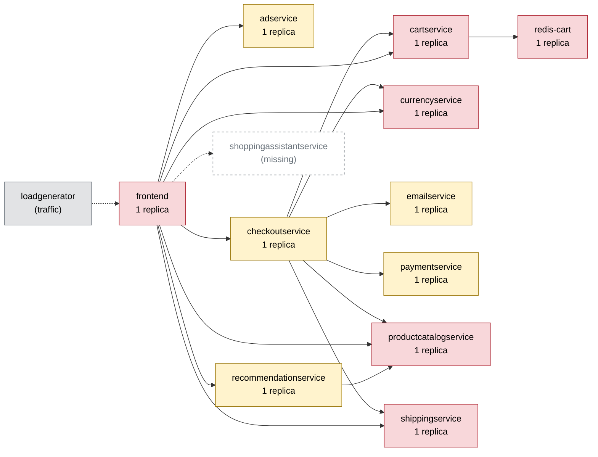

# Chaos Engineering Findings Report — Online Boutique

Generated 2026-10-11T04:29:18+00:00 · scope: `20261011-042647-campaign` · 2 experiments · analyst model: gpt-6-luna · score version 1

## 1. Summary

- **Resilience score: 60 / 100 (grade D)** — given by the AI analyst against a fixed rubric, combined by code; code anchor: 66.
- Experiments: 2 · types: memory_stress, pod_failure · failure classes: errors, resource exhaustion.
- Planner predictions: 0 confirmed, 2 partly, 0 refuted.
- Safety: 2 experiment(s) stopped automatically or manually; baseline p95 16 ms, 0.0% errors.

*(AI analyst)* Both experiments exposed a checkout availability weakness in the single-replica checkoutservice: checkout errors reached 87.5% during pod failure and 100% during memory stress, while other measured flows remained error-free. The failures were limited to checkout, and the 15% error-rate guard removed each fault after 6.6 seconds, so this is a high-severity core-flow failure rather than an uncontained system-wide outage. Adding a second checkoutservice replica is the most direct catalog fix for the demonstrated single point of failure. All other service resilience scores are estimates based on their posture and dependency reach because they were not directly tested.

## 2. Findings, ranked by severity

### F1. [HIGH] Single checkoutservice replica makes checkout unavailable during pod loss or memory pressure

- **Services:** checkoutservice
- **Evidence:** `20261011-042647-pod_failure-checkoutservice`, `20261011-042745-memory_stress-checkoutservice` — Baseline checkout p95 was 21.6 ms with 0% errors. In the pod-failure run, checkout error rate reached 87.5% (8 requests), checkout p95 was 173.5 ms (8.03x baseline), and the service restarted twice; impact error rate was 17.07%, peak error rate 20%, and reported recovery was 4 s. In the memory-stress run (124 MB, one worker), checkout error rate reached 100% (12 requests), checkout p95 was 2.5 ms, and checkoutservice restarted once; impact error rate was 19.35%, peak error rate 21%, and reported recovery was 9 s. Both runs were aborted by the 15% error-rate guard after 6.6 s of fault activity; home, product, add_to_cart, and view_cart had 0% errors in both runs.
- **Root cause:** checkoutservice is on the revenue path but has only one replica. Pod unavailability removes the only instance serving checkout, while memory pressure caused a restart of that instance; either event leaves no service capacity for checkout requests. The unaffected flows and checkoutservice's limited reach show the observed impact was scoped to checkout.
- **Fix (`scale_replicas` on checkoutservice):** The catalog identifies replica scaling as the remedy for single points of failure and outages during pod failure. checkoutservice is stateless, so a second replica can continue serving requests when one instance is unavailable or restarting.

```
kubectl -n boutique scale deployment/checkoutservice --replicas=2
```
- **Expected improvement:** With one replica remaining available, checkout errors should stay below the guard threshold during a single-pod failure or restart, the experiment should not abort for checkout errors, and checkout p95 should remain much closer to its 21.6 ms baseline. This does not address failure of the single Kubernetes node.
- **Verify by re-running:** `chaos-agent run --type pod_failure --target checkoutservice --duration 15`

_Findings text: *(AI analyst)*. Numbers: measured by the probe / Prometheus._

## 3. Resilience score per service (worst first)

| Service | Score (AI) | Code anchor | Grade | Availability | Latency | Recovery | Containment | Posture | Weight | Tested | Justification (AI) |
|---|---|---|---|---|---|---|---|---|---|---|---|
| cartservice | **58** | 60 | F | 58 | 60 | 58 | 55 | 60 | 3 | no | Untested directly; the map shows a single replica, a Redis dependency, and reach across all flows including checkout. Scores reflect that broad dependency role and posture, not measured failure impact. |
| redis-cart | **58** | 60 | F | 58 | 60 | 58 | 55 | 60 | 3 | no | Untested directly. The map identifies it as a single-replica stateful cart-data dependency with reach across all flows, so estimates reflect its broad business impact and posture. |
| currencyservice | **60** | 60 | F | 60 | 60 | 60 | 55 | 60 | 2.6 | no | Untested directly. It is a single-replica shared dependency of frontend and checkoutservice and is on the checkout path, so the scores are estimates from its posture and dependency reach. |
| frontend | **60** | 60 | F | 60 | 60 | 60 | 55 | 60 | 3 | no | Untested as a target, though it is the single-replica entrypoint for all flows. In both checkoutservice runs the other measured flows remained error-free; the score otherwise reflects frontend's single-replica posture and full user-request reach. |
| productcatalogservice | **60** | 60 | F | 60 | 60 | 60 | 55 | 60 | 3 | no | Untested in the listed experiments. The map shows a single replica with dependencies spanning checkoutservice, frontend, and recommendationservice and reach across all flows, so estimates reflect its broad reach and posture. |
| emailservice | **60** | 60 | D | 60 | 60 | 60 | 60 | 60 | 1.4 | no | Untested. It has one replica and is used by checkoutservice on the checkout path, but its map reach is limited to checkout; scores are posture- and dependency-based estimates. |
| paymentservice | **60** | 60 | D | 60 | 60 | 60 | 60 | 60 | 2.5 | no | Untested. It has one replica and is a checkoutservice dependency; scores are estimates based on its posture and checkout-only dependency reach. |
| recommendationservice | **60** | 60 | D | 60 | 60 | 60 | 60 | 60 | 1.2 | no | Untested. It has one replica but is not on the checkout path; its scores are posture- and dependency-based estimates, with lower business weight for its recommendation feature. |
| shippingservice | **60** | 60 | D | 60 | 60 | 60 | 60 | 60 | 2.3 | no | Untested. It is a single-replica dependency for checkout and view_cart; scores are estimates from posture and its more limited flow reach. |
| checkoutservice | **60** | 66 | D | 50 | 60 | 88 | 40 | 60 | 3 | yes | In 20261011-042647-pod_failure-checkoutservice checkout had 87.5% errors and 8.03x p95; in 20261011-042745-memory_stress-checkoutservice it had 100% errors. Recovery was reported at 4 s and 9 s, while other measured flows remained error-free and the guard stopped both runs. |
| adservice | **60** | 60 | D | 60 | 60 | 60 | 65 | 60 | 0.8 | no | Untested. Its single replica gives no redundancy, but its map reach is limited to home and product and it is not on the checkout path; scores are posture- and reach-based estimates. |

Rubric weights: availability 35%, latency 25%, recovery 20%, containment 10%, posture 10%. AI dimension scores are limited to ±15 of the code anchor; the overall score is the criticality-weighted mean of the tested services.

*(AI analyst)* The tested checkoutservice dimensions stay within 15 points of their anchors: availability 50 versus 60.4, latency 60 versus 70.9, recovery 88 versus 92.5, containment 40 versus 30, and posture 60. Availability and latency reflect the checkout-flow errors and the 8.03x p95 observed during pod failure; recovery remains high because recovery was reported at 4–9 seconds. Containment is above the anchor because other measured flows stayed error-free and the guard removed the faults, though checkout itself was severely affected. All services have one replica, readiness and liveness probes, and CPU and memory limits in the supplied map, yielding posture 60 under the stated rubric. For untested services, availability, latency, recovery, and containment are dependency-informed estimates rather than observed measurements. Criticality weights emphasize the entrypoint, checkout, and broad checkout/cart dependencies, while keeping all weights within the requested 0.5–3 range and assigning less weight to optional recommendations and ads.

## 4. Experiments

| Run | Type | Target | Params | Origin | Status | Peak errors | Peak p95 | Worst slowdown | Affected flows | Recovery | Prediction |
|---|---|---|---|---|---|---|---|---|---|---|---|
| `20261011-042647-pod_failure-checkoutservice` | pod_failure | checkoutservice | - | planner | ABORTED (guard: error rate 20% > 15%) | 20.0% | 47 ms | 8.0x | checkout | 4 s | partly |
| `20261011-042745-memory_stress-checkoutservice` | memory_stress | checkoutservice | {'size_mb': 124, 'workers': 1} | planner | ABORTED (guard: error rate 20% > 15%) | 21.1% | 16 ms | 0.9x | checkout | 9 s | partly |

## 5. How the AI decided

**Plan `20261011-042352-plan`** (ai, model gpt-6-luna). Strategy: First, test a brief sustained checkout-service outage: it isolates the revenue flow and the stricter error guard bounds the blast radius. Next, probe checkout-service near its 128 Mi limit, since the 112 MB run was uneventful while a near-limit test can reveal an OOM threshold; finish with a low-latency cartservice slowdown that should remain well below the p95 guard. This covers outage errors, resource exhaustion, and slowdown without repeating the already well-characterized product-catalog latency or frontend load tests.

| Rank | Experiment | Reason | Prediction |
|---|---|---|---|
| 1 | pod_failure on checkoutservice 15s | checkoutservice is a single replica on the checkout revenue path, and its reach is limited to checkout. A previous pod_kill had no observed user impact, but that tests rapid replacement rather than a sustained outage; the 15-second pod_failure fills that gap. The stricter 15% error guard limits exposure if checkout requests fail. | flows checkout; errors high; slowdown none; ABORTED |
| 2 | memory_stress on checkoutservice {'size_mb': 124, 'workers': 1} 20s | checkoutservice has a 128 Mi memory limit and is a single replica on the revenue path. A prior 112 MB stress run completed without impact, leaving the near-limit behavior untested; productcatalogservice did OOM at 124 MB, showing that near-limit allocation can reveal a sharp threshold. The stricter error guard bounds the impact if checkoutservice is OOM-killed. | flows checkout; errors high; slowdown moderate; ABORTED |
| 3 | network_delay on cartservice {'latency_ms': 20, 'jitter_ms': 0} 30s | cartservice is a single replica, has 1.0 reach across all listed flows, and is shared by frontend and checkoutservice. A prior 20% packet-loss run on cartservice tripped the p95 guard, while the prior CPU-stress run was externally aborted; a modest pure-latency test fills a safer slowdown gap. | flows product, add_to_cart; errors none; slowdown moderate; COMPLETED |

Ideas the planner considered and dropped:

- Repeat 100 ms network delay on productcatalogservice — Many past runs already showed a consistent roughly 700–757 ms p95 impact across all flows with no errors; this would repeat a well-established result.
- Run another 300-user traffic spike against frontend — Repeated runs reached or exceeded the 1500 ms p95 guard, so this is a known high-impact test and adds little to the current resilience gaps.
- Repeat pod_failure on redis-cart — Prior runs already showed severe shop-wide impact and rapid guard intervention, including frontend unresponsiveness; repeating it would be overly destructive for this budget.

**Adapter decisions** (campaign `20261011-042647-campaign`, stopped: guard aborted 2 runs in a row on checkoutservice):

- after `20261011-042647-pod_failure-checkoutservice`: **continue** — The 15-second checkoutservice outage was aborted when aggregate error rate reached 20%, above the 15% guard; impact stayed confined to checkout, where errors were 87.5% and p95 slowdown was 8.03×. This supports the isolation hypothesis, though the predicted error band was too high. The planned 124 MB checkoutservice memory test remains a useful, distinct resource-exhaustion probe and passed validation with the stricter 15% error guard. _(plan unchanged)_

*(AI analyst)* Both planner predictions were partly correct. For both runs, the predicted affected flow (checkout) and outcome (ABORTED) matched observations. For pod failure, the supplied prediction check marked the error-band and slowdown-band predictions as misses; the run nevertheless recorded 87.5% checkout errors, 8.03x checkout p95, and a 20% peak error rate before the guard stopped it. For memory stress, the high-error prediction matched, but the predicted moderate slowdown did not: the run's reported p95 slowdown factor was 0.93 despite 100% checkout errors. The experiments support the planner's scope hypothesis, but show that p95 slowdown alone may not represent outage severity when requests fail quickly.

## 6. Safety record

Guard (deterministic code, checked every 1 s): abort when the error rate > 20% or p95 > max(3× baseline, 1500 ms) for 2 checks in a row, the frontend is silent for 3 s, or a non-target pod becomes NotReady. Every fault is validated against hard caps (and the AI policy for AI-proposed ones), dry-run by the Kubernetes API server, and carries a Chaos Mesh `duration` (auto-revert).

| Run | Reason | Fault active | Kill switch |
|---|---|---|---|
| `20261011-042647-pod_failure-checkoutservice` | guard: error rate 20% > 15% | 6.6 s | kill switch took 0.5s from decision to fault removed |
| `20261011-042745-memory_stress-checkoutservice` | guard: error rate 20% > 15% | 6.6 s | kill switch took 0.5s from decision to fault removed |

## 7. Dependency map

Red = high risk (single replica and critical), yellow = medium, green = low.



| Service | Replicas | Risk | Reach (share of user flows) | Dependents |
|---|---|---|---|---|
| cartservice | 1 | high | 100% (home, product, add_to_cart, view_cart, checkout) | checkoutservice, frontend |
| frontend | 1 | high | 100% (home, product, add_to_cart, view_cart, checkout) | - |
| productcatalogservice | 1 | high | 100% (home, product, add_to_cart, view_cart, checkout) | checkoutservice, frontend, recommendationservice |
| redis-cart | 1 | high | 100% (home, product, add_to_cart, view_cart, checkout) | cartservice, checkoutservice, frontend |
| currencyservice | 1 | high | 80% (home, product, view_cart, checkout) | checkoutservice, frontend |
| recommendationservice | 1 | medium | 60% (product, view_cart, checkout) | frontend |
| adservice | 1 | medium | 40% (home, product) | frontend |
| shippingservice | 1 | high | 40% (view_cart, checkout) | checkoutservice, frontend |
| checkoutservice | 1 | medium | 20% (checkout) | frontend |
| emailservice | 1 | medium | 20% (checkout) | checkoutservice, frontend |
| paymentservice | 1 | medium | 20% (checkout) | checkoutservice, frontend |

## 8. Method and limitations

- Users are simulated by a 4-user probe (home, product, add to cart, view cart, checkout) measured in rolling 5 s windows; resources come from Prometheus.
- Rubric: **availability** — Did users keep getting successful responses? 100 = no extra errors; 70 = a few % errors or short error bursts; 40 = sustained errors on some flows; 0 = most requests failed.; **latency** — How much slower did user flows get (worst p95 vs baseline)? 100 = < 1.5x; 80 = ~3x; 60 = ~10x; 30 = ~50x; 0 = several seconds / timeouts.; **recovery** — How fast were users back to normal after the fault ended? 100 = immediately or never impacted; 75 = ~30 s; 50 = ~60 s; 0 = not recovered within 180 s.; **containment** — Did the failure stay contained? 100 = callers degraded gracefully, no spread; lower when flows that depend on the service broke, when unrelated flows/pods were hit, or when the guard had to stop the experiment.; **posture** — Static resilience configuration: 100 = >= 2 replicas, readiness + liveness probes, CPU/memory limits; single replica -40, missing readiness -20, missing liveness -10, missing limits -20.
- *(AI analyst)* The system runs on a single Kubernetes node, so these experiments do not establish resilience to node or host failure.
- *(AI analyst)* The flow samples were small (8–14 requests in the affected run windows), limiting precision in error-rate and latency estimates.
- *(AI analyst)* The guard aborted both experiments after 6.6 seconds of fault activity, shorter than their configured 15- and 20-second durations.
- *(AI analyst)* Only checkoutservice was directly targeted; other service scores are posture- and dependency-based estimates, not experimental measurements.
- *(AI analyst)* Coverage included pod failure and memory stress only; traffic spikes, network faults, and other failure classes were not tested.
