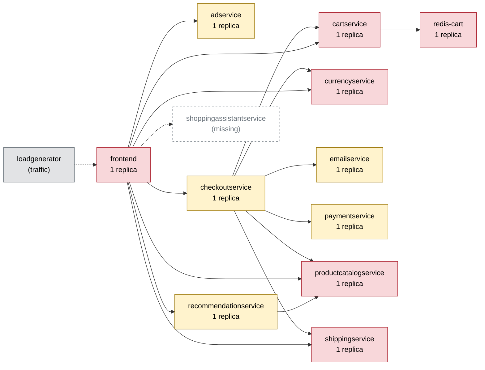

# Chaos Engineering Findings Report — Online Boutique

Generated 2026-10-11T04:37:07+00:00 · scope: `20261011-042647-campaign` · 2 experiments · analyst model: gpt-6-luna · score version 1

## 1. Summary

- **Resilience score: 64 / 100 (grade D)** — given by the AI analyst against a fixed rubric, combined by code; code anchor: 66.
- Experiments: 2 · types: memory_stress, pod_failure · failure classes: errors, resource exhaustion.
- Planner predictions: 0 confirmed, 2 partly, 0 refuted.
- Safety: 2 experiment(s) stopped automatically or manually; baseline p95 16 ms, 0.0% errors.

*(AI analyst)* Both experiments exposed checkoutservice as a single point of failure: checkout requests failed heavily during a sustained pod outage and during near-limit memory stress. The impact was confined to checkout, while the other measured flows remained error-free; the guard stopped both experiments after 6.6 seconds of fault exposure. Adding a second checkoutservice replica addresses the availability weakness, while increasing its memory limit addresses the separate restart observed under memory stress. All services are single-replica deployments, but only checkoutservice was exercised in these runs, so scores for the other services are posture- and dependency-based estimates.

## 2. Findings, ranked by severity

### F1. [HIGH] A single checkoutservice replica makes checkout unavailable during a pod outage

- **Services:** checkoutservice, frontend
- **Evidence:** `20261011-042647-pod_failure-checkoutservice` — Baseline checkout p95 was 21.6 ms with 0% errors. During the run, checkout had 87.5% errors (7/8 requests) and a p95 of 173.5 ms (8.03x baseline); the run-level impact error rate was 17.07%, with a 20% peak. The fault was active for 6.6 s before the 15% error guard aborted it; checkoutservice restarted twice and recovery was 4 s. Home, product, add_to_cart, and view_cart each had 0% errors.
- **Root cause:** checkoutservice has one replica and is the sole service handling the checkout RPC path. When that pod is unavailable, frontend checkout calls have no alternate instance, so checkout fails even though unrelated flows remain available.
- **Fix (`scale_replicas` on checkoutservice):** A second stateless checkoutservice replica provides an alternate instance if one pod becomes unavailable, addressing the single point of failure shown by the pod-failure run.

```
kubectl -n boutique scale deployment/checkoutservice --replicas=2
```
- **Expected improvement:** On rerun, a failure affecting one replica should no longer cause most checkout requests to fail; checkout error rate should fall substantially and ideally remain below the 15% guard, with less checkout latency impact. Other flows should remain unaffected.
- **Verify by re-running:** `chaos-agent run --type pod_failure --target checkoutservice --duration 15`

### F2. [HIGH] Near-limit memory stress restarts the only checkoutservice pod and interrupts checkout

- **Services:** checkoutservice, frontend
- **Evidence:** `20261011-042745-memory_stress-checkoutservice` — checkoutservice had a 128 Mi memory limit. With 124 MB stress allocation and one worker, checkout had 100% errors (12/12 requests), one checkoutservice restart, and 9 s recovery; the fault was active for 6.6 s before the 15% error guard aborted it. Run-level impact error rate was 19.35%, with a 21% peak. The reported checkout p95 was 2.5 ms, but this was alongside 100% checkout errors and is not evidence of successful low-latency checkout. Other measured flows had 0% errors.
- **Root cause:** The stress allocation was close to the pod's 128 Mi memory limit and coincided with a restart. Because checkoutservice has only one replica, that restart removed all checkout capacity for the interval. The run supports a memory-headroom weakness, though it does not independently confirm the exact termination reason.
- **Fix (`set_resources` on checkoutservice):** Raising the memory limit from 128 Mi to 256 Mi gives the service additional headroom for the tested allocation, reducing the likelihood that near-limit memory use restarts the pod. The CPU limit stays at its current 200m because these runs did not indicate CPU pressure.

```
kubectl -n boutique set resources deployment/checkoutservice -c server --limits=cpu=200m,memory=256Mi
```
- **Expected improvement:** With the same 124 MB stress, checkoutservice should avoid a memory-related restart and checkout errors should decrease substantially; the other flows should remain unaffected.
- **Verify by re-running:** `chaos-agent run --type memory_stress --target checkoutservice -p size_mb=124 -p workers=1 --duration 20`

_Findings text: *(AI analyst)*. Numbers: measured by the probe / Prometheus._

## 3. Resilience score per service (worst first)

| Service | Score (AI) | Code anchor | Grade | Availability | Latency | Recovery | Containment | Posture | Weight | Tested | Justification (AI) |
|---|---|---|---|---|---|---|---|---|---|---|---|
| adservice | **60** | 60 | D | 60 | 60 | 60 | 60 | 60 | 0.7 | no | Untested. Its single replica implies limited redundancy, but its reach is limited to home and product and it is not on the checkout path. Scores are held near the posture anchor in the absence of measured impact. |
| cartservice | **60** | 60 | D | 60 | 60 | 60 | 60 | 60 | 3 | no | Untested. It is a single replica on all listed flows and is shared by frontend and checkoutservice, making it business-critical; no run measured its behavior, so impact dimensions remain estimates near the anchor. |
| currencyservice | **60** | 60 | D | 60 | 60 | 60 | 60 | 60 | 2.5 | no | Untested. It is a single replica called by both frontend and checkoutservice and is on the checkout path. Its broad dependency role raises its business importance, but there are no direct impact measurements. |
| emailservice | **60** | 60 | D | 60 | 60 | 60 | 60 | 60 | 1.2 | no | Untested. It is a single replica used by checkoutservice, with listed reach limited to checkout. Impact dimensions are estimates near the anchor, not measured outcomes. |
| frontend | **60** | 60 | D | 60 | 60 | 60 | 60 | 60 | 3 | no | Untested directly, but it is the single-replica entrypoint for every user flow. Checkout errors during the checkoutservice runs demonstrate user-visible flow impact, not a measured frontend failure; other dimensions remain near the anchor. |
| paymentservice | **60** | 60 | D | 60 | 60 | 60 | 60 | 60 | 2.5 | no | Untested. It is a single replica on the checkout path, but the experiments targeted checkoutservice and provide no direct paymentservice impact measurements. |
| productcatalogservice | **60** | 60 | D | 60 | 60 | 60 | 60 | 60 | 3 | no | Untested in the supplied runs. It is a single replica and a shared dependency across the listed flows, including checkout; its scores therefore remain estimates near the anchor. |
| recommendationservice | **60** | 60 | D | 60 | 60 | 60 | 60 | 60 | 1.2 | no | Untested. It is a single replica and is not on the checkout path according to the dependency map. No user impact was measured for this service. |
| redis-cart | **60** | 60 | D | 60 | 60 | 60 | 60 | 60 | 3 | no | Untested. It is a single stateful replica holding cart data and lies on the checkout path, so its dependency risk is high; no experiment measured its availability or recovery. |
| shippingservice | **60** | 60 | D | 60 | 60 | 60 | 60 | 60 | 2 | no | Untested. It is a single replica used by checkoutservice and frontend for listed flows. Scores for impact dimensions are estimates near the anchor. |
| checkoutservice | **64** | 66 | D | 60 | 65 | 90 | 30 | 60 | 3 | yes | Runs 20261011-042647-pod_failure-checkoutservice and 20261011-042745-memory_stress-checkoutservice showed severe checkout errors, with 8.03x checkout p95 in the pod-failure run and recovery in 4 s and 9 s respectively. Scores stay within 15 points of the anchors; containment remains at the low 30 anchor because checkout broke, although other measured flows were unaffected. |

Rubric weights: availability 35%, latency 25%, recovery 20%, containment 10%, posture 10%. AI dimension scores are limited to ±15 of the code anchor; the overall score is the criticality-weighted mean of the tested services.

*(AI analyst)* All services have one replica, readiness and liveness probes, and CPU and memory limits, giving a posture score of 60 under the stated rubric. For untested impact dimensions, scores are kept at 60 because the experiments provide no service-specific evidence to justify further deviation; dependency reach and business role are reflected primarily in criticality weights. checkoutservice scores reflect its measured checkout errors, 8.03x worst flow p95 in the pod-failure run, short 4–9 s recovery, and the fact that other measured flows stayed error-free. Weights are capped at 3.0: the entrypoint, cart and product/catalog paths, and checkout-critical services receive higher weight, while optional or limited-reach services such as ads and recommendations receive lower weight.

## 4. Experiments

| Run | Type | Target | Params | Origin | Status | Peak errors | Peak p95 | Worst slowdown | Affected flows | Recovery | Prediction |
|---|---|---|---|---|---|---|---|---|---|---|---|
| `20261011-042647-pod_failure-checkoutservice` | pod_failure | checkoutservice | - | planner | ABORTED (guard: error rate 20% > 15%) | 20.0% | 47 ms | 8.0x | checkout | 4 s | partly |
| `20261011-042745-memory_stress-checkoutservice` | memory_stress | checkoutservice | {'size_mb': 124, 'workers': 1} | planner | ABORTED (guard: error rate 20% > 15%) | 21.1% | 16 ms | 0.9x | checkout | 9 s | partly |

## 5. How the AI decided

**Plan `20261011-042352-plan`** (ai, model gpt-6-luna). Strategy: First, test a brief sustained checkout-service outage: it isolates the revenue flow and the stricter error guard bounds the blast radius. Next, probe checkout-service near its 128 Mi limit, since the 112 MB run was uneventful while a near-limit test can reveal an OOM threshold; finish with a low-latency cartservice slowdown that should remain well below the p95 guard. This covers outage errors, resource exhaustion, and slowdown without repeating the already well-characterized product-catalog latency or frontend load tests.

| Rank | Experiment | Reason | Prediction |
|---|---|---|---|
| 1 | pod_failure on checkoutservice 15s | checkoutservice is a single replica on the checkout revenue path, and its reach is limited to checkout. A previous pod_kill had no observed user impact, but that tests rapid replacement rather than a sustained outage; the 15-second pod_failure fills that gap. The stricter 15% error guard limits exposure if checkout requests fail. | flows checkout; errors high; slowdown none; ABORTED |
| 2 | memory_stress on checkoutservice {'size_mb': 124, 'workers': 1} 20s | checkoutservice has a 128 Mi memory limit and is a single replica on the revenue path. A prior 112 MB stress run completed without impact, leaving the near-limit behavior untested; productcatalogservice did OOM at 124 MB, showing that near-limit allocation can reveal a sharp threshold. The stricter error guard bounds the impact if checkoutservice is OOM-killed. | flows checkout; errors high; slowdown moderate; ABORTED |
| 3 | network_delay on cartservice {'latency_ms': 20, 'jitter_ms': 0} 30s | cartservice is a single replica, has 1.0 reach across all listed flows, and is shared by frontend and checkoutservice. A prior 20% packet-loss run on cartservice tripped the p95 guard, while the prior CPU-stress run was externally aborted; a modest pure-latency test fills a safer slowdown gap. | flows product, add_to_cart; errors none; slowdown moderate; COMPLETED |

Ideas the planner considered and dropped:

- Repeat 100 ms network delay on productcatalogservice — Many past runs already showed a consistent roughly 700–757 ms p95 impact across all flows with no errors; this would repeat a well-established result.
- Run another 300-user traffic spike against frontend — Repeated runs reached or exceeded the 1500 ms p95 guard, so this is a known high-impact test and adds little to the current resilience gaps.
- Repeat pod_failure on redis-cart — Prior runs already showed severe shop-wide impact and rapid guard intervention, including frontend unresponsiveness; repeating it would be overly destructive for this budget.

**Adapter decisions** (campaign `20261011-042647-campaign`, stopped: guard aborted 2 runs in a row on checkoutservice):

- after `20261011-042647-pod_failure-checkoutservice`: **continue** — The 15-second checkoutservice outage was aborted when aggregate error rate reached 20%, above the 15% guard; impact stayed confined to checkout, where errors were 87.5% and p95 slowdown was 8.03×. This supports the isolation hypothesis, though the predicted error band was too high. The planned 124 MB checkoutservice memory test remains a useful, distinct resource-exhaustion probe and passed validation with the stricter 15% error guard. _(plan unchanged)_

*(AI analyst)* The planner correctly identified checkout as the affected flow and predicted that both experiments would abort; both runs did abort after the error guard was breached. For pod failure, its error-band prediction was recorded as a miss, even though the observed checkout flow had 87.5% errors and the run reached a 20% peak error rate; the planner also missed the observed slowdown. For memory stress, it correctly predicted high errors and the affected flow, but predicted moderate slowdown when the reported p95 did not show one; that p95 coincided with 100% checkout errors. Overall, predictions captured the scope and guarded outcome, but were inconsistent on the severity and latency signals.

## 6. Safety record

Guard (deterministic code, checked every 1 s): abort when the error rate > 20% or p95 > max(3× baseline, 1500 ms) for 2 checks in a row, the frontend is silent for 3 s, or a non-target pod becomes NotReady. Every fault is validated against hard caps (and the AI policy for AI-proposed ones), dry-run by the Kubernetes API server, and carries a Chaos Mesh `duration` (auto-revert).

| Run | Reason | Fault active | Kill switch |
|---|---|---|---|
| `20261011-042647-pod_failure-checkoutservice` | guard: error rate 20% > 15% | 6.6 s | kill switch took 0.5s from decision to fault removed |
| `20261011-042745-memory_stress-checkoutservice` | guard: error rate 20% > 15% | 6.6 s | kill switch took 0.5s from decision to fault removed |

## 7. Dependency map

Red = high risk (single replica and critical), yellow = medium, green = low.



| Service | Replicas | Risk | Reach (share of user flows) | Dependents |
|---|---|---|---|---|
| cartservice | 1 | high | 100% (home, product, add_to_cart, view_cart, checkout) | checkoutservice, frontend |
| frontend | 1 | high | 100% (home, product, add_to_cart, view_cart, checkout) | - |
| productcatalogservice | 1 | high | 100% (home, product, add_to_cart, view_cart, checkout) | checkoutservice, frontend, recommendationservice |
| redis-cart | 1 | high | 100% (home, product, add_to_cart, view_cart, checkout) | cartservice, checkoutservice, frontend |
| currencyservice | 1 | high | 80% (home, product, view_cart, checkout) | checkoutservice, frontend |
| recommendationservice | 1 | medium | 60% (product, view_cart, checkout) | frontend |
| adservice | 1 | medium | 40% (home, product) | frontend |
| shippingservice | 1 | high | 40% (view_cart, checkout) | checkoutservice, frontend |
| checkoutservice | 1 | medium | 20% (checkout) | frontend |
| emailservice | 1 | medium | 20% (checkout) | checkoutservice, frontend |
| paymentservice | 1 | medium | 20% (checkout) | checkoutservice, frontend |

## 8. Method and limitations

- Users are simulated by a 4-user probe (home, product, add to cart, view cart, checkout) measured in rolling 5 s windows; resources come from Prometheus.
- Rubric: **availability** — Did users keep getting successful responses? 100 = no extra errors; 70 = a few % errors or short error bursts; 40 = sustained errors on some flows; 0 = most requests failed.; **latency** — How much slower did user flows get (worst p95 vs baseline)? 100 = < 1.5x; 80 = ~3x; 60 = ~10x; 30 = ~50x; 0 = several seconds / timeouts.; **recovery** — How fast were users back to normal after the fault ended? 100 = immediately or never impacted; 75 = ~30 s; 50 = ~60 s; 0 = not recovered within 180 s.; **containment** — Did the failure stay contained? 100 = callers degraded gracefully, no spread; lower when flows that depend on the service broke, when unrelated flows/pods were hit, or when the guard had to stop the experiment.; **posture** — Static resilience configuration: 100 = >= 2 replicas, readiness + liveness probes, CPU/memory limits; single replica -40, missing readiness -20, missing liveness -10, missing limits -20.
- *(AI analyst)* The system runs on a single-node Kubernetes environment, so results do not establish resilience to node or cluster failure.
- *(AI analyst)* Only checkoutservice was targeted; other service scores' impact dimensions are estimates based on posture and dependencies, not measured resilience.
- *(AI analyst)* Experiments were short, and the guard stopped each fault after 6.6 seconds, limiting evidence about longer outages and sustained recovery.
- *(AI analyst)* Checkout flow samples were small (8 requests in the pod-failure run and 12 in the memory-stress run); percentages and p95 values are therefore sensitive to individual requests.
- *(AI analyst)* The memory-stress run showed a restart during near-limit allocation, but the supplied measurements do not independently establish the precise termination cause.
