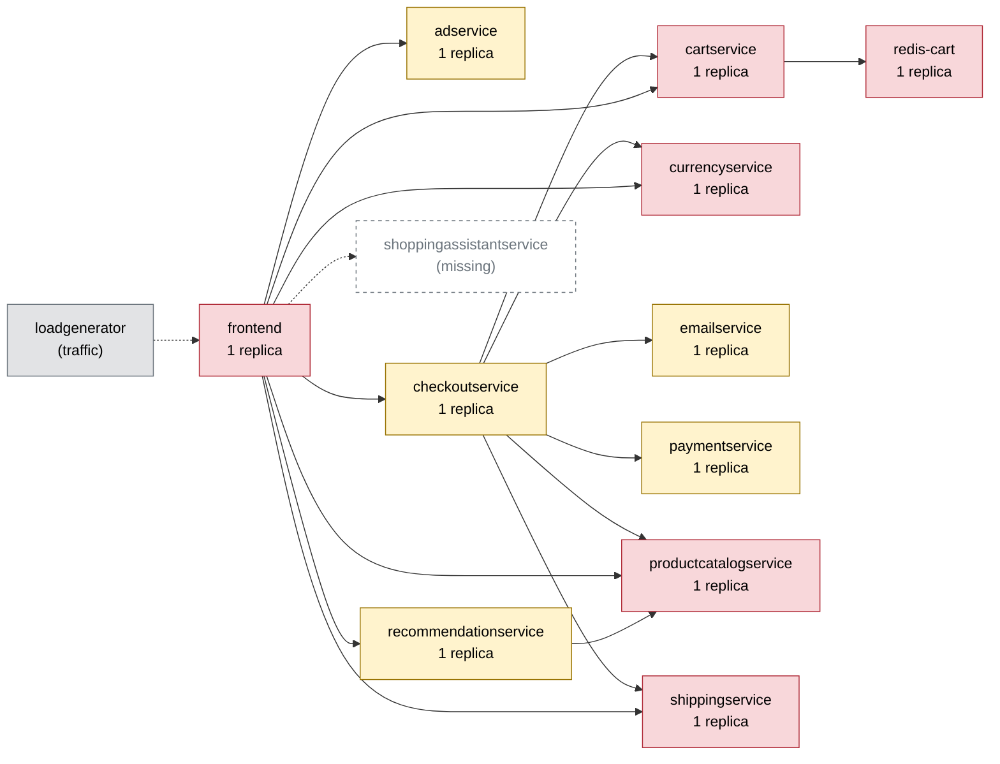

# Chaos Engineering Findings Report — Online Boutique

Generated 2026-10-11T04:53:24+00:00 · scope: `20261011-044550-campaign` · 5 experiments · analyst model: gpt-6-luna · score version 1

## 1. Summary

- **Resilience score: 60 / 100 (grade F)** — given by the AI analyst against a fixed rubric, combined by code; code anchor: 62.
- Experiments: 5 · types: memory_stress, network_delay, network_loss, pod_kill · failure classes: errors, recovery, resource exhaustion, slowdown.
- Planner predictions: 0 confirmed, 4 partly, 1 refuted.
- Safety: 0 experiment(s) stopped automatically or manually; baseline p95 16 ms, 0.0% errors.

*(AI analyst)* The clearest user-impacting weakness is currencyservice’s single-replica failure mode: a pod kill produced 100% errors in sampled view-cart and checkout requests and high errors in home and product. Delaying currencyservice also caused substantial, error-free tail latency, while 5% packet loss to cartservice slowed add-to-cart and checkout. A near-limit memory test on currencyservice caused measurable but sub-74 ms p95 latency without errors or restarts. Recommendations focus on adding currencyservice redundancy and bounding dependency-call latency; results are limited to five short experiments on a single node.

## 2. Findings, ranked by severity

### F1. [HIGH] Currencyservice pod loss interrupts checkout and other dependent flows

- **Services:** currencyservice, frontend, checkoutservice
- **Evidence:** `20261011-044800-pod_kill-currencyservice` — With the sole currencyservice pod killed, impact_error_rate was 66.67% and peak_error_rate reached 80%. Sampled error rates were 100% for view_cart (8/8) and checkout (8/8), 66.7% for home and product (8/12 each), and 0% for add_to_cart. The replacement pod became ready in 12.2 s; the timeline showed 40–80% errors from t+5.2 s through t+12.2 s, and the guard reported a 40% error-rate breach. The run's recovery_s field is 0.0, so pod readiness should not be treated as a measured user-recovery time.
- **Root cause:** currencyservice is a single-replica dependency shared by frontend and checkoutservice. When that only pod is unavailable, requests on dependent flows fail rather than being served by a healthy replica.
- **Fix (`scale_replicas` on currencyservice):** A second stateless currencyservice replica removes the single-pod availability point of failure and gives callers another instance during a pod restart, provided the disruption is scoped to one replica.

```
kubectl -n boutique scale deployment/currencyservice --replicas=2
```
- **Expected improvement:** During a repeat pod-kill test, checkout and other currency-dependent flows should have substantially fewer failed requests while the killed pod is replaced; readiness of the replacement should no longer determine whether all currency requests can succeed.
- **Verify by re-running:** `chaos-agent run --type pod_kill --target currencyservice -p grace_period_s=0 --duration 30`

### F2. [MEDIUM] Currencyservice delay is amplified into severe user-facing tail latency

- **Services:** currencyservice, frontend, checkoutservice
- **Evidence:** `20261011-044857-network_delay-currencyservice`, `20261011-045041-network_delay-currencyservice` — With 10 ms added latency for 45 s, the run peak p95 was 912.1 ms and the worst flow, add_to_cart, reached 894.1 ms (135.47x its 6.6 ms baseline); home reached 471.1 ms, product 460.8 ms, and view_cart 242.8 ms. Checkout reached 59.2 ms. There were no errors and recovery_s was 7 s. At 5 ms added latency, there were also no errors; home reached 67.0 ms (3.92x baseline), while checkout reached 32.8 ms. The 10 ms run timeline shows p95 rising from about 112 ms early in the fault to 570.6 ms at t+40.1 s and 912.1 ms during recovery.
- **Root cause:** The observed user-flow latency grows far beyond the injected delay when calls traverse currencyservice. This is consistent with latency amplification in dependent request paths, but the experiment did not include traces that establish whether serialization, retries, or another call-path behavior is responsible.
- **Fix (`code_change` on frontend):** The catalog identifies deadlines, bounded retries, and graceful degradation as mitigations for latency amplification. A bounded budget and display-only fallback should keep slow currency responses from consuming excessive time in user-facing flows without silently using stale values for checkout.

```
# code change in frontend: Set an explicit 250 ms end-to-end deadline for frontend calls to currencyservice, do not retry beyond that budget, and use a cached exchange rate for display-only currency formatting when the deadline expires; keep checkout conversion fail-fast rather than using a stale rate.
```
- **Expected improvement:** On rerun, display flows should avoid the near-second p95 tail and use cached formatting when currencyservice exceeds the budget. Checkout should return a bounded response rather than waiting through an excessive tail; a controlled timeout may replace some slow successes.
- **Verify by re-running:** `chaos-agent run --type network_delay --target currencyservice -p latency_ms=10 -p jitter_ms=0 --duration 45`

### F3. [MEDIUM] Cartservice packet loss substantially slows cart updates and checkout

- **Services:** cartservice, frontend, checkoutservice
- **Evidence:** `20261011-044550-network_loss-cartservice` — At 5% packet loss for 30 s, add_to_cart p95 was 71.5 ms versus a 6.6 ms baseline (10.83x), and checkout p95 was 200.9 ms versus 21.6 ms (9.3x). Product p95 was 47.1 ms (3.36x); no flow recorded errors, the run peak p95 was 123.7 ms, and recovery_s was 0.
- **Root cause:** Cart operations depend on cartservice, and packet loss on its traffic produced large latency increases in cart-dependent flows. The run does not establish whether retries or another client-side behavior contributed to the tail.
- **Fix (`code_change` on frontend):** A bounded client-call budget addresses the catalog's latency-amplification and missing-timeout weakness, limiting how long cartservice packet loss can delay the frontend.

```
# code change in frontend: Set a 250 ms gRPC deadline on frontend calls to cartservice and stop retries when that budget is exhausted.
```
- **Expected improvement:** On repeat, add_to_cart and checkout p95 should remain bounded by the call budget rather than growing into a long tail; any deadline-triggered failures should be explicit and bounded instead of slow responses.
- **Verify by re-running:** `chaos-agent run --type network_loss --target cartservice -p loss_pct=5 -p correlation_pct=0 --duration 30`

### F4. [LOW] Near-limit currencyservice memory stress causes moderate latency increase

- **Services:** currencyservice, frontend, checkoutservice
- **Evidence:** `20261011-044700-memory_stress-currencyservice` — A 112 MB allocation for 15 s against currencyservice's 128 Mi limit completed without errors, pod restarts, or guard breaches. Run peak p95 was 73.9 ms (4.24x the 17.5 ms implied by the run's slowdown factor); flow p95s were 54.4 ms for home, 59.4 ms for product, 37.0 ms for view_cart, and 43.9 ms for checkout. The run reported no affected_flows and recovery_s was 0.
- **Root cause:** The near-limit memory allocation coincided with moderate latency increases, consistent with reduced memory headroom under pressure. The run did not report currencyservice's measured memory peak, so it does not establish that the service approached its limit or that memory pressure alone caused the latency.
- **Fix (`set_resources` on currencyservice):** Increasing the memory limit gives the service more headroom during memory pressure; the catalog identifies resource increases as a mitigation for memory-pressure effects. This is a cautious mitigation rather than a demonstrated OOM correction, since no OOM or restart occurred.

```
kubectl -n boutique set resources deployment/currencyservice -c server --limits=cpu=200m,memory=256Mi
```
- **Expected improvement:** The same allocation should produce less latency impact and continue without errors or restarts. Confirm the change does not create unacceptable memory pressure on the single-node host.
- **Verify by re-running:** `chaos-agent run --type memory_stress --target currencyservice -p size_mb=112 -p workers=1 --duration 15`

_Findings text: *(AI analyst)*. Numbers: measured by the probe / Prometheus._

## 3. Resilience score per service (worst first)

| Service | Score (AI) | Code anchor | Grade | Availability | Latency | Recovery | Containment | Posture | Weight | Tested | Justification (AI) |
|---|---|---|---|---|---|---|---|---|---|---|---|
| currencyservice | **35** | 34 | F | 0 | 22 | 94 | 43 | 60 | 3 | yes | Scores follow the supplied anchors. In 20261011-044800-pod_kill-currencyservice, sampled checkout and view_cart errors were 100% and peak error rate was 80%; in 20261011-044857-network_delay-currencyservice, add_to_cart p95 reached 894.1 ms with no errors. |
| adservice | **60** | 60 | D | 60 | 60 | 60 | 60 | 60 | 0.8 | no | Untested. Scores are estimates near the posture anchor: it has one replica but readiness/liveness probes and resource limits; its mapped reach is limited to home and product. |
| checkoutservice | **60** | 60 | D | 60 | 60 | 60 | 60 | 60 | 2.8 | no | Untested directly. Estimates stay at the posture anchor; the service is a single-replica checkout-path service with probes and resource limits, and its dependencies include currencyservice and cartservice. |
| emailservice | **60** | 60 | D | 60 | 60 | 60 | 60 | 60 | 1.3 | no | Untested. Scores are estimates near the posture anchor; it is a single-replica service with probes and limits, and the dependency map places it on the checkout path. |
| frontend | **60** | 60 | D | 60 | 60 | 60 | 60 | 60 | 3 | no | Untested as a fault target. Scores are estimates near the posture anchor; it is the single-replica entrypoint with probes and limits, and currencyservice and cartservice faults affected its user-facing flows. |
| paymentservice | **60** | 60 | D | 60 | 60 | 60 | 60 | 60 | 2 | no | Untested. Scores are estimates near the posture anchor; it is a single-replica checkout-path dependency with probes and resource limits. |
| productcatalogservice | **60** | 60 | D | 60 | 60 | 60 | 60 | 60 | 3 | no | Untested as a fault target. Estimates stay near the posture anchor; it is a single-replica service with probes and limits and is mapped across all five flows. |
| recommendationservice | **60** | 60 | D | 60 | 60 | 60 | 60 | 60 | 1.2 | no | Untested. Scores are estimates near the posture anchor; it is single-replica with probes and limits, and its mapped reach is less than the core cart and product services. |
| redis-cart | **60** | 60 | D | 60 | 60 | 60 | 60 | 60 | 3 | no | Untested. Scores are estimates near the posture anchor; it is a single-replica stateful cart dependency with probes and limits, but no direct Redis fault was run. |
| shippingservice | **60** | 60 | D | 60 | 60 | 60 | 60 | 60 | 2 | no | Untested. Scores are estimates near the posture anchor; it is single-replica with probes and limits, and the dependency map places it in view-cart and checkout flows. |
| cartservice | **85** | 85 | B | 100 | 65 | 100 | 80 | 60 | 3 | yes | In 20261011-044550-network_loss-cartservice, no errors occurred and recovery_s was 0, but add_to_cart and checkout p95 reached 10.83x and 9.3x baseline. Scores follow the supplied anchors; its single-replica posture remains 60. |

Rubric weights: availability 35%, latency 25%, recovery 20%, containment 10%, posture 10%. AI dimension scores are limited to ±15 of the code anchor; the overall score is the criticality-weighted mean of the tested services.

*(AI analyst)* For tested dimensions, scores stay at or within rounding distance of the supplied anchors; posture is 60 for every scored service because each has one replica, probes, and resource limits. All untested dimensions are estimated at 60, close to their anchor posture score, rather than presented as measured resilience. Criticality weights emphasize the entrypoint and revenue/cart path (frontend, cartservice, currencyservice, productcatalogservice, and redis-cart) and reduce weight for optional or narrower-reach services such as ads and recommendations. Weights are capped at 3 as requested, even where the anchor defaults were higher.

## 4. Experiments

| Run | Type | Target | Params | Origin | Status | Peak errors | Peak p95 | Worst slowdown | Affected flows | Recovery | Prediction |
|---|---|---|---|---|---|---|---|---|---|---|---|
| `20261011-044550-network_loss-cartservice` | network_loss | cartservice | {'loss_pct': 5, 'correlation_pct': 0} | planner | COMPLETED | 0.0% | 124 ms | 10.8x | add_to_cart, checkout | 0 s | partly |
| `20261011-044700-memory_stress-currencyservice` | memory_stress | currencyservice | {'size_mb': 112, 'workers': 1} | planner | COMPLETED | 0.0% | 74 ms | 4.2x | none | 0 s | refuted |
| `20261011-044800-pod_kill-currencyservice` | pod_kill | currencyservice | {'grace_period_s': 0} | planner | COMPLETED | 80.0% | 15 ms | 0.9x | home, product, view_cart, checkout | 0 s (pod Ready 12 s) | partly |
| `20261011-044857-network_delay-currencyservice` | network_delay | currencyservice | {'latency_ms': 10, 'jitter_ms': 0} | planner | COMPLETED | 0.0% | 912 ms | 135.5x | home, product, add_to_cart, view_cart | 7 s | partly |
| `20261011-045041-network_delay-currencyservice` | network_delay | currencyservice | {'latency_ms': 5, 'jitter_ms': 0} | adapter | COMPLETED | 0.0% | 65 ms | 3.9x | none | 0 s | partly |

## 5. How the AI decided

**Plan `20261011-044550-plan`** (ai, model gpt-6-luna). Strategy: Start with a lower-intensity packet-loss test on cartservice: it reaches every flow, and the prior 20% loss run hit the p95 guard quickly. Then probe currencyservice’s untested memory and pod-replacement behavior, followed by a low-latency currencyservice test to measure slowdown without expecting a guard trip. This covers errors, resource exhaustion, recovery, and slowdown while keeping the highest-risk injections brief.

| Rank | Experiment | Reason | Prediction |
|---|---|---|---|
| 1 | network_loss on cartservice {'loss_pct': 5, 'correlation_pct': 0} 30s | Ranked first because cartservice is a single-replica, high-risk dependency shared by frontend and checkoutservice, with reach across all five flows. A prior 20% loss test caused p95 to reach 1571 ms and was stopped by the guard after 6.6 seconds, with no errors; 5% probes whether a milder loss rate degrades flows below that threshold. | flows home, product, add_to_cart, view_cart; errors none; slowdown moderate; COMPLETED |
| 2 | memory_stress on currencyservice {'size_mb': 112, 'workers': 1} 15s | currencyservice is a single-replica, high-risk shared dependency on the checkout path, reaching home, product, view_cart, and checkout; its memory limit is 128Mi. There are no currencyservice memory-stress results, and prior tests varied by service: 110 MB caused cartservice OOM behavior, while 110 MB on productcatalogservice did not. This short near-limit test probes the service-specific exhaustion threshold. | flows home, product, view_cart, checkout; errors high; slowdown moderate; ABORTED |
| 3 | pod_kill on currencyservice {'grace_period_s': 0} 30s | currencyservice has one replica, serves four flows, and is on the checkout path. A prior 15-second pod_failure test on this service reached a 40% peak error rate and was aborted; pod_kill is a distinct recovery test that measures replacement and the user impact during the restart. | flows home, product, view_cart, checkout; errors high; slowdown none; ABORTED |
| 4 | network_delay on currencyservice {'latency_ms': 10, 'jitter_ms': 0} 45s | currencyservice is a single-replica shared dependency with reach 0.8, including the checkout path. A prior 50 ms delay produced a 528 ms peak p95 and affected home, product, view_cart, and checkout; 10 ms tests a substantially milder intensity expected to reveal propagation without simply repeating the severe slowdown. | flows home, product, view_cart, checkout; errors none; slowdown moderate; COMPLETED |

Ideas the planner considered and dropped:

- Repeat a traffic spike on frontend at 100–300 users — Past runs already show broad slowdown at 100–150 users and repeated p95 guard trips around 300 users, so another similar run is unlikely to add useful resilience evidence.
- pod_failure on redis-cart — Prior runs became severe and were aborted within seconds, including frontend unresponsiveness; repeating this would mostly reproduce an already-known, highly disruptive blast radius.
- Repeat a 100 ms network delay on productcatalogservice — Multiple past runs already established severe slowdown across all five flows at this intensity.
- pod_kill or pod_failure on frontend — The AI policy explicitly prohibits pod outages on the entrypoint because they amount to a total shop outage.

**Adapter decisions** (campaign `20261011-044550-campaign`, stopped: adapter: The 5 ms currencyservice delay completed with 0% errors and no guard breaches, but home p95 remained around 62–64 ms in the timeline (67 ms overall, 3.92× baseline); the predicted affected-flow set was also missed. Together with the prior 10 ms run’s 912.1 ms peak, this answers the slowdown probe, and there are no planned experiments left that justify using the remaining follow-up.):

- after `20261011-044550-network_loss-cartservice`: **continue** — The 5% cartservice packet-loss run completed with no errors or guard breaches, but slowdown was severe: add_to_cart reached 10.83× baseline p95 and checkout 9.3×, contrary to the predicted moderate slowdown and flow spread. The planned 15-second currencyservice memory-stress test remains a useful, distinct probe of resource exhaustion. _(plan unchanged)_
- after `20261011-044700-memory_stress-currencyservice`: **continue** — The 112 MB memory stress completed without errors, restarts, or guard breaches, refuting the predicted exhaustion/abort; it did produce a 4.24× worst-flow slowdown (product). The planned pod_kill remains a distinct recovery test for single-replica currencyservice, and its impact is worth measuring despite the prior pod_failure abort. _(plan unchanged)_
- after `20261011-044800-pod_kill-currencyservice`: **continue** — The currencyservice pod kill caused high errors across home, product, view_cart, and checkout (80% peak; 66.7% impact), with the pod ready in 12.2 s; the guard breach was reported because an instantaneous kill cannot be undone. The planned 10 ms delay is a distinct, lower-intensity probe of slowdown propagation, and it passed the validator. _(plan unchanged)_
- after `20261011-044857-network_delay-currencyservice`: **insert_followup** — The 10 ms currencyservice delay caused no errors or guard breach, but contradicted the predicted moderate slowdown: add_to_cart reached 894.1 ms p95 (135.47× baseline), and the run peaked at 912.1 ms. A 5 ms probe will test whether this severe tail-latency amplification persists at lower intensity; the shop has since recovered. _(follow-up inserted: network_delay on currencyservice {'latency_ms': 5, 'jitter_ms': 0})_
- after `20261011-045041-network_delay-currencyservice`: **stop** — The 5 ms currencyservice delay completed with 0% errors and no guard breaches, but home p95 remained around 62–64 ms in the timeline (67 ms overall, 3.92× baseline); the predicted affected-flow set was also missed. Together with the prior 10 ms run’s 912.1 ms peak, this answers the slowdown probe, and there are no planned experiments left that justify using the remaining follow-up. _(campaign stopped by the adapter)_

*(AI analyst)* The planner correctly anticipated broad currencyservice impact and high errors for pod kill, but predicted the run would abort; the instant pod kill completed and the guard instead reported breaches during recovery. It predicted the direction of currencyservice latency effects, but underestimated the 10 ms delay's severity: add_to_cart reached 894.1 ms p95, while the 5 ms follow-up showed lower but still noticeable latency. The cartservice packet-loss prediction matched the absence of errors and completion, but missed which flows were affected and underestimated the slowdown. The currencyservice memory-stress prediction was refuted on errors and abort outcome: there were no errors or restarts, although moderate slowdown occurred.

## 6. Safety record

Guard (deterministic code, checked every 1 s): abort when the error rate > 20% or p95 > max(3× baseline, 1500 ms) for 2 checks in a row, the frontend is silent for 3 s, or a non-target pod becomes NotReady. Every fault is validated against hard caps (and the AI policy for AI-proposed ones), dry-run by the Kubernetes API server, and carries a Chaos Mesh `duration` (auto-revert).

## 7. Dependency map

Red = high risk (single replica and critical), yellow = medium, green = low.



| Service | Replicas | Risk | Reach (share of user flows) | Dependents |
|---|---|---|---|---|
| cartservice | 1 | high | 100% (home, product, add_to_cart, view_cart, checkout) | checkoutservice, frontend |
| frontend | 1 | high | 100% (home, product, add_to_cart, view_cart, checkout) | - |
| productcatalogservice | 1 | high | 100% (home, product, add_to_cart, view_cart, checkout) | checkoutservice, frontend, recommendationservice |
| redis-cart | 1 | high | 100% (home, product, add_to_cart, view_cart, checkout) | cartservice, checkoutservice, frontend |
| currencyservice | 1 | high | 80% (home, product, view_cart, checkout) | checkoutservice, frontend |
| recommendationservice | 1 | medium | 60% (product, view_cart, checkout) | frontend |
| adservice | 1 | medium | 40% (home, product) | frontend |
| shippingservice | 1 | high | 40% (view_cart, checkout) | checkoutservice, frontend |
| checkoutservice | 1 | medium | 20% (checkout) | frontend |
| emailservice | 1 | medium | 20% (checkout) | checkoutservice, frontend |
| paymentservice | 1 | medium | 20% (checkout) | checkoutservice, frontend |

## 8. Method and limitations

- Users are simulated by a 4-user probe (home, product, add to cart, view cart, checkout) measured in rolling 5 s windows; resources come from Prometheus.
- Rubric: **availability** — Did users keep getting successful responses? 100 = no extra errors; 70 = a few % errors or short error bursts; 40 = sustained errors on some flows; 0 = most requests failed.; **latency** — How much slower did user flows get (worst p95 vs baseline)? 100 = < 1.5x; 80 = ~3x; 60 = ~10x; 30 = ~50x; 0 = several seconds / timeouts.; **recovery** — How fast were users back to normal after the fault ended? 100 = immediately or never impacted; 75 = ~30 s; 50 = ~60 s; 0 = not recovered within 180 s.; **containment** — Did the failure stay contained? 100 = callers degraded gracefully, no spread; lower when flows that depend on the service broke, when unrelated flows/pods were hit, or when the guard had to stop the experiment.; **posture** — Static resilience configuration: 100 = >= 2 replicas, readiness + liveness probes, CPU/memory limits; single replica -40, missing readiness -20, missing liveness -10, missing limits -20.
- *(AI analyst)* The system runs on a single Kubernetes node, so results do not establish resilience to node, network, or storage failure and resource changes may compete for host capacity.
- *(AI analyst)* Experiments were brief and used small flow samples; per-flow counts ranged from 8 to 40 in the fault runs, so tail percentiles and error rates are uncertain.
- *(AI analyst)* Only five experiments were provided, concentrated on currencyservice and cartservice; most services and fault types remain untested.
- *(AI analyst)* No distributed traces or complete target-service resource measurements were available to identify the internal cause of latency amplification or confirm memory headroom during the stress run.
- *(AI analyst)* The pod-kill run reports pod readiness at 12.2 s but recovery_s as 0.0; timeline observations show errors during that interval, so exact user recovery time is not established.
