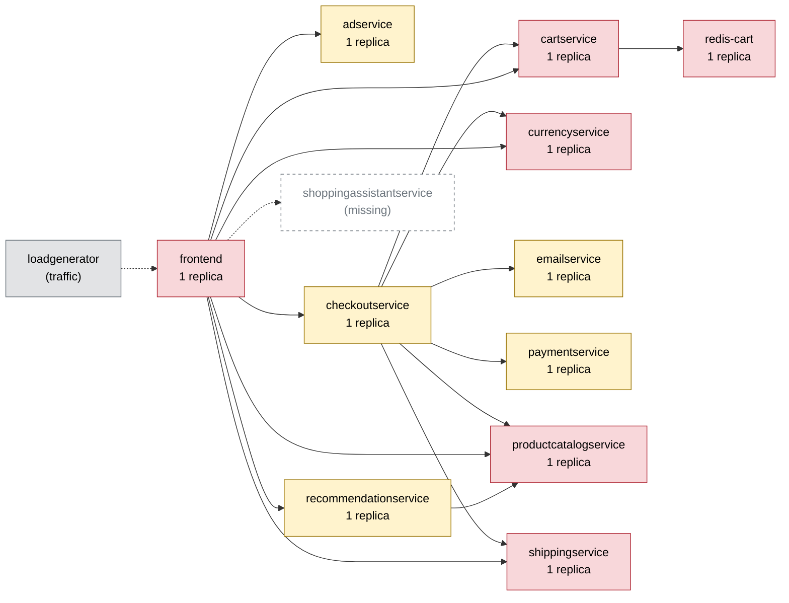

# Chaos Engineering Findings Report — Online Boutique

Generated 2026-10-11T05:31:53+00:00 · scope: `20261011-052531-campaign` · 5 experiments · analyst model: gpt-6-luna · score version 1

## 1. Summary

- **Resilience score: 77 / 100 (grade C)** — given by the AI analyst against a fixed rubric, combined by code; code anchor: 78.
- Experiments: 5 · types: cpu_stress, memory_stress, network_loss, pod_failure · failure classes: errors, resource exhaustion, slowdown.
- Planner predictions: 1 confirmed, 3 partly, 1 refuted.
- Safety: 1 experiment(s) stopped automatically or manually; baseline p95 16 ms, 0.0% errors.

*(AI analyst)* The most serious measured weakness is shippingservice unavailability: checkout failed on every sampled request, home latency rose sharply, and the run was stopped by the error-rate guard. Separate tests showed checkout latency increasing about 3–4× under paymentservice network loss and checkoutservice CPU saturation, without errors. Paymentservice memory-stress tests did not cause OOMs or errors, though checkout latency also rose during those runs. Eight of the eleven application services were not directly tested, so their scores are cautious estimates based on configuration and dependency reach.

## 2. Findings, ranked by severity

### F1. [HIGH] Shippingservice failure breaks checkout and produces severe latency spillover

- **Services:** shippingservice, checkoutservice, frontend
- **Evidence:** `20261011-052737-pod_failure-shippingservice` — The run was aborted after 2.6 s of fault when the error-rate guard measured 24% errors (impact error rate 25%). Checkout had 100% errors across 4 requests. Home p95 was 512.0 ms versus a 17.1 ms baseline (29.94×); overall peak p95 was 779.3 ms. The guard stopped the run, and the timeline returned to OK by 9.6 s after injection.
- **Root cause:** shippingservice is a single replica on the checkout path and is also called by frontend. When it is unavailable, the dependency failure is not contained: checkout fails and even home requests experience a large latency increase. The guard limited the duration of the outage, but did not prevent the user impact.
- **Fix (`scale_replicas` on shippingservice):** A second stateless shippingservice replica reduces the single-pod failure risk and provides another serving instance if one pod becomes unavailable.

```
kubectl -n boutique scale deployment/shippingservice --replicas=2
```
- **Expected improvement:** On rerun, a single shippingservice pod failure should no longer make checkout uniformly fail; checkout errors and the home-flow latency spike should be substantially reduced. The experiment may still expose limits from running both replicas on one node.
- **Verify by re-running:** `chaos-agent run --type pod_failure --target shippingservice --duration 15`

### F2. [MEDIUM] Paymentservice faults propagate as checkout latency

- **Services:** paymentservice, checkoutservice, frontend
- **Evidence:** `20261011-052532-memory_stress-paymentservice`, `20261011-052639-memory_stress-paymentservice`, `20261011-052825-network_loss-paymentservice` — Checkout p95 was 40.2 ms (1.86× its 21.6 ms baseline) during 124 MB memory stress, 63.9 ms (2.96×) during 128 MB stress, and 83.1 ms (3.85×) during 5% uncorrelated packet loss. All three runs had 0% errors and no paymentservice restarts. In the 128 MB run, paymentservice memory peaked at 67.3 MiB against a 128 MiB limit.
- **Root cause:** Paymentservice is a direct checkout dependency, and the measured delay under stress and packet loss is visible in the checkout flow. The experiments do not establish the exact RPC retry or deadline behavior, but they show that paymentservice-related delay is not fully isolated from checkout latency.
- **Fix (`code_change` on checkoutservice):** A bounded RPC budget prevents slow payment calls and retries from extending checkout latency without limit during worse transport or service faults. This is an advisory code change and should be checked for its error-versus-latency tradeoff.

```
# code change in checkoutservice: Set a 300 ms end-to-end gRPC deadline for checkoutservice calls to paymentservice; ensure any retry shares the remaining deadline and is capped at one attempt.
```
- **Expected improvement:** The rerun should keep the same fault from causing unbounded checkout waits and should preserve the observed zero-error behavior if calls complete within the deadline. Confirm both checkout p95 and error rate, since a deadline can turn slow responses into explicit failures.
- **Verify by re-running:** `chaos-agent run --type network_loss --target paymentservice -p loss_pct=5 -p correlation_pct=0 --duration 30`

### F3. [MEDIUM] Checkoutservice CPU limit is fully saturated under CPU stress

- **Services:** checkoutservice, frontend
- **Evidence:** `20261011-052935-cpu_stress-checkoutservice` — Checkout p95 was 70.6 ms versus a 21.6 ms baseline (3.27×), with 0% errors. checkoutservice reached 100.2% of its 200m CPU limit and 100% peak CPU throttling. The other measured flows had no errors.
- **Root cause:** The single checkoutservice pod is constrained by a 200m CPU limit. Under the tested CPU stress, it reached that limit and was fully throttled, increasing latency on the checkout path.
- **Fix (`set_resources` on checkoutservice):** Increasing the CPU limit gives checkoutservice more headroom and directly addresses the measured CPU saturation and throttling; memory remains at its existing limit because this run did not indicate memory pressure.

```
kubectl -n boutique set resources deployment/checkoutservice -c server --limits=cpu=500m,memory=128Mi
```
- **Expected improvement:** With the same stress, checkoutservice should spend less time throttled and checkout p95 should move closer to baseline, while errors remain absent.
- **Verify by re-running:** `chaos-agent run --type cpu_stress --target checkoutservice -p workers=1 -p load=50 --duration 30`

_Findings text: *(AI analyst)*. Numbers: measured by the probe / Prometheus._

## 3. Resilience score per service (worst first)

| Service | Score (AI) | Code anchor | Grade | Availability | Latency | Recovery | Containment | Posture | Weight | Tested | Justification (AI) |
|---|---|---|---|---|---|---|---|---|---|---|---|
| shippingservice | **53** | 59 | F | 45 | 42 | 90 | 25 | 60 | 2.5 | yes | In 20261011-052737-pod_failure-shippingservice, checkout had 100% errors in four requests, home p95 reached 512.0 ms versus 17.1 ms baseline, and the guard stopped the run. The timeline was OK by 9.6 s after injection, supporting a higher recovery score than availability or containment. |
| cartservice | **55** | 60 | F | 55 | 55 | 55 | 50 | 60 | 2.9 | no | Untested. It is a single replica, depends on redis-cart, and is shared by frontend and checkoutservice across all listed flows, so estimated resilience is below that of a narrow-scope dependency. |
| frontend | **55** | 60 | F | 55 | 55 | 55 | 50 | 60 | 3 | no | Untested directly and configured as a single-replica entrypoint for all user requests. Its broad reach increases the potential impact of a frontend failure, so the operational dimensions are estimated cautiously. |
| productcatalogservice | **55** | 60 | F | 55 | 55 | 55 | 50 | 60 | 2.9 | no | Untested. The single replica is a shared dependency of frontend, checkoutservice and recommendationservice and has reach across all listed flows; scores reflect that dependency exposure, not observed failures. |
| redis-cart | **55** | 60 | F | 55 | 55 | 55 | 50 | 60 | 3 | no | Untested. It is a single stateful replica holding cart data and is on the dependency path for all listed flows, including checkout. Scores are conservative estimates based on its configuration and reach. |
| currencyservice | **60** | 60 | F | 60 | 60 | 60 | 55 | 60 | 2.5 | no | Untested. It is a single replica and a shared dependency of frontend and checkoutservice with reach across several flows, including checkout; scores are estimates from configuration and dependency reach. |
| emailservice | **60** | 60 | D | 60 | 60 | 60 | 60 | 60 | 1 | no | Untested. It has one replica but is listed only on the checkoutservice dependency path; scores are conservative estimates from posture and its narrower reach. |
| recommendationservice | **60** | 60 | D | 60 | 60 | 60 | 65 | 60 | 0.8 | no | Untested. It has one replica and depends on productcatalogservice, but its recommendation feature has lower business criticality than checkout or the entrypoint; scores are estimates from posture and dependency reach. |
| adservice | **64** | 60 | D | 65 | 65 | 60 | 65 | 60 | 0.8 | no | Untested. The dependency map shows one replica, probes and resource limits, with reach limited to home and product; these are cautious estimates rather than measured resilience. |
| paymentservice | **86** | 87 | B | 100 | 78 | 100 | 55 | 60 | 2.7 | yes | The three paymentservice runs had no errors or restarts and recovery was immediate. Checkout p95 reached 83.1 ms (3.85× baseline) under packet loss; the stress runs also increased checkout latency, so latency and containment are lower than the no-error availability score. |
| checkoutservice | **90** | 93 | A | 100 | 82 | 100 | 90 | 60 | 2.8 | yes | In 20261011-052935-cpu_stress-checkoutservice, checkout had no errors and recovered immediately, but p95 rose to 70.6 ms (3.27× baseline) while CPU throttling reached 100%. Other measured flows had no errors. |

Rubric weights: availability 35%, latency 25%, recovery 20%, containment 10%, posture 10%. AI dimension scores are limited to ±15 of the code anchor; the overall score is the criticality-weighted mean of the tested services.

*(AI analyst)* For directly tested services, scores stay within 15 points of their supplied anchors and reflect measured flow impact as well as service-level outcomes. Shippingservice scores emphasize the checkout failure and home-flow latency spillover, while its recovery score reflects the timeline returning to OK by 9.6 seconds. Paymentservice retained full availability and recovery scores because its tests produced no errors or restarts, but latency and containment reflect the checkout slowdown. For the eight untested services, availability, latency, recovery and containment are estimates near the posture anchor, adjusted modestly for replica count, statefulness and dependency reach; posture is 60 throughout because the map shows one replica, both probes and resource limits. Criticality weights are capped at 3.0 and prioritize the frontend, cart path and checkout dependencies over ads and recommendations.

## 4. Experiments

| Run | Type | Target | Params | Origin | Status | Peak errors | Peak p95 | Worst slowdown | Affected flows | Recovery | Prediction |
|---|---|---|---|---|---|---|---|---|---|---|---|
| `20261011-052532-memory_stress-paymentservice` | memory_stress | paymentservice | {'size_mb': 124, 'workers': 1} | planner | COMPLETED | 0.0% | 20 ms | 1.9x | none | 0 s | refuted |
| `20261011-052639-memory_stress-paymentservice` | memory_stress | paymentservice | {'size_mb': 128, 'workers': 1} | adapter | COMPLETED | 0.0% | 35 ms | 3.0x | none | 0 s | confirmed |
| `20261011-052737-pod_failure-shippingservice` | pod_failure | shippingservice | - | planner | ABORTED (guard: error rate 24% > 20%) | 23.5% | 779 ms | 29.9x | home, checkout | 0 s | partly |
| `20261011-052825-network_loss-paymentservice` | network_loss | paymentservice | {'loss_pct': 5, 'correlation_pct': 0} | planner | COMPLETED | 0.0% | 84 ms | 3.9x | checkout | 0 s | partly |
| `20261011-052935-cpu_stress-checkoutservice` | cpu_stress | checkoutservice | {'workers': 1, 'load': 50} | planner | COMPLETED | 0.0% | 72 ms | 3.3x | none | 0 s | partly |

## 5. How the AI decided

**Plan `20261011-052531-plan`** (ai, model gpt-6-luna). Strategy: Start with a short, near-limit memory test on the checkout payment dependency and a sustained outage test on shipping, where single replicas and checkout-path reach make failures consequential. Then probe lower-intensity packet loss and CPU stress to learn about degradation before the guard threshold, and finish with a pod kill to measure payment-service recovery. The plan covers resource exhaustion, errors, slowdown, and recovery without repeating already characterized traffic-spike or product-catalog-delay tests.

| Rank | Experiment | Reason | Prediction |
|---|---|---|---|
| 1 | memory_stress on paymentservice {'size_mb': 124, 'workers': 1} 15s | paymentservice is a single replica on the checkout path with a 128Mi memory limit, and no memory-stress run has targeted it. A 124MB allocation probes near-limit OOM behavior; a prior 124MB checkoutservice test produced checkout errors and an abort, so this short test is deliberately first and closely monitored. | flows checkout; errors high; slowdown none; ABORTED |
| 2 | pod_failure on shippingservice 15s | shippingservice is a single replica shared by checkoutservice and frontend, with reach across view_cart and checkout and a place on the revenue path. A prior pod kill caused no observed user impact, but that brief recovery test does not establish how callers behave when the service stays unavailable; this short outage tests that gap. | flows view_cart, checkout; errors high; slowdown severe; ABORTED |
| 3 | network_loss on paymentservice {'loss_pct': 5, 'correlation_pct': 0} 30s | paymentservice is a single-replica checkout dependency, and there is no prior network-loss test for it. Past 5% packet-loss tests on currencyservice and cartservice completed without errors but showed substantial slowdown, making low, uncorrelated loss a useful checkout-specific test below the most destructive loss levels. | flows checkout; errors none; slowdown severe; COMPLETED |
| 4 | cpu_stress on checkoutservice {'workers': 1, 'load': 50} 30s | checkoutservice is a single replica on the revenue path with a 200m CPU limit; no CPU-stress run has targeted it. The 50% load setting is a bounded slowdown probe, while prior cartservice CPU stress was interrupted externally and does not answer checkoutservice's CPU sensitivity. | flows checkout; errors none; slowdown moderate; COMPLETED |
| 5 | pod_kill on paymentservice {'grace_period_s': 0} 30s | paymentservice is a single-replica dependency on the checkout path, and its outage behavior is known but its pod-replacement recovery behavior is not. Compared with the preceding sustained-fault tests, this one-shot kill isolates restart and recovery impact; the brief fault also limits exposure. | flows checkout; errors low; slowdown moderate; COMPLETED |

Ideas the planner considered and dropped:

- Repeat a 100ms network delay on productcatalogservice — Multiple past runs already show roughly 700ms p95 and impact across all five flows; repeating it would add little new information.
- Run another traffic spike at 100–150 concurrent users — Past runs already characterize this range; 300-user runs repeatedly approach or breach the p95 guard, so this budget is better spent on service-level failure gaps.
- Make redis-cart unavailable again — Prior pod-failure runs caused severe user impact and frontend unresponsiveness, while redis-cart is the stateful single-replica store for cart data; a repeat is too destructive for the information gained.
- Repeat near-limit memory stress on productcatalogservice or cartservice — Past runs already establish OOM/error behavior on those targets, including cart-wide impact for cartservice and guard-triggered failures for productcatalogservice.

**Adapter decisions** (campaign `20261011-052531-campaign`, stopped: budget used (5 experiments)):

- after `20261011-052532-memory_stress-paymentservice`: **insert_followup** — The 124 MB paymentservice test completed with no errors, no restarts, and no guard breaches; paymentservice peaked at only 33.7 MiB while checkout p95 reached 40.2 ms (1.86× baseline). That strongly refutes the predicted memory exhaustion, so a one-step increase to 128 MB can check whether the allocation produces measurable pressure before moving on to the shipping outage. _(follow-up inserted: memory_stress on paymentservice {'size_mb': 128, 'workers': 1})_
- after `20261011-052639-memory_stress-paymentservice`: **continue** — The 128 MB paymentservice test completed with no errors or guard breaches; memory peaked at only 67.3 MiB, while checkout p95 reached 2.96× baseline. This confirms the memory-test prediction, and the planned shippingservice outage probes a distinct failure class and caller behavior. _(plan unchanged)_
- after `20261011-052737-pod_failure-shippingservice`: **continue** — The shippingservice outage was aborted after 2.6 seconds when peak errors reached 23.5%, with checkout errors and home latency about 30× baseline; the observed home impact also differed from the predicted view_cart impact. The remaining paymentservice packet-loss test probes a distinct, lower-intensity failure mode on the checkout path, and it passed the validator. _(plan unchanged)_
- after `20261011-052825-network_loss-paymentservice`: **continue** — The 5% paymentservice packet-loss run completed with no errors or guard breaches, but checkout p95 slowed 3.85×; the observed slowdown was moderate, below the predicted severe band. The planned checkoutservice CPU-stress test remains a useful, distinct probe of checkout-path sensitivity. _(plan unchanged)_
- after `20261011-052935-cpu_stress-checkoutservice`: **continue** — The checkoutservice CPU-stress run completed with no errors or guard breaches, but checkout slowed 3.27× while CPU throttling peaked at 100%. The remaining paymentservice pod kill probes a distinct, still-unmeasured recovery behavior after its network-loss test, so the plan remains useful. _(plan unchanged)_

*(AI analyst)* Predictions were directionally useful on the shippingservice outage, correctly anticipating severe impact and an abort, but the predicted affected flows (checkout and view_cart) differed from observed checkout and home; view_cart had no sampled requests. The 124 MB paymentservice memory-stress prediction was refuted: there were no checkout errors or abort, and memory peaked at 33.7 MiB. The subsequent 128 MB run prediction was confirmed for no errors and completion, with moderate slowdown. The paymentservice network-loss prediction matched the affected checkout flow, no-error outcome and completion, but overpredicted the slowdown severity band. The checkoutservice CPU-stress prediction matched the moderate slowdown and completion but labeled checkout as an affected flow when the run summary did not; per-flow measurements nevertheless show checkout p95 at 3.27× baseline. Overall, predictions captured broad outcomes better than precise flow attribution or severity.

## 6. Safety record

Guard (deterministic code, checked every 1 s): abort when the error rate > 20% or p95 > max(3× baseline, 1500 ms) for 2 checks in a row, the frontend is silent for 3 s, or a non-target pod becomes NotReady. Every fault is validated against hard caps (and the AI policy for AI-proposed ones), dry-run by the Kubernetes API server, and carries a Chaos Mesh `duration` (auto-revert).

| Run | Reason | Fault active | Kill switch |
|---|---|---|---|
| `20261011-052737-pod_failure-shippingservice` | guard: error rate 24% > 20% | 2.6 s | kill switch took 0.5s from decision to fault removed |

## 7. Dependency map

Red = high risk (single replica and critical), yellow = medium, green = low.



| Service | Replicas | Risk | Reach (share of user flows) | Dependents |
|---|---|---|---|---|
| cartservice | 1 | high | 100% (home, product, add_to_cart, view_cart, checkout) | checkoutservice, frontend |
| frontend | 1 | high | 100% (home, product, add_to_cart, view_cart, checkout) | - |
| productcatalogservice | 1 | high | 100% (home, product, add_to_cart, view_cart, checkout) | checkoutservice, frontend, recommendationservice |
| redis-cart | 1 | high | 100% (home, product, add_to_cart, view_cart, checkout) | cartservice, checkoutservice, frontend |
| currencyservice | 1 | high | 80% (home, product, view_cart, checkout) | checkoutservice, frontend |
| recommendationservice | 1 | medium | 60% (product, view_cart, checkout) | frontend |
| adservice | 1 | medium | 40% (home, product) | frontend |
| shippingservice | 1 | high | 40% (view_cart, checkout) | checkoutservice, frontend |
| checkoutservice | 1 | medium | 20% (checkout) | frontend |
| emailservice | 1 | medium | 20% (checkout) | checkoutservice, frontend |
| paymentservice | 1 | medium | 20% (checkout) | checkoutservice, frontend |

## 8. Method and limitations

- Users are simulated by a 4-user probe (home, product, add to cart, view cart, checkout) measured in rolling 5 s windows; resources come from Prometheus.
- Rubric: **availability** — Did users keep getting successful responses? 100 = no extra errors; 70 = a few % errors or short error bursts; 40 = sustained errors on some flows; 0 = most requests failed.; **latency** — How much slower did user flows get (worst p95 vs baseline)? 100 = < 1.5x; 80 = ~3x; 60 = ~10x; 30 = ~50x; 0 = several seconds / timeouts.; **recovery** — How fast were users back to normal after the fault ended? 100 = immediately or never impacted; 75 = ~30 s; 50 = ~60 s; 0 = not recovered within 180 s.; **containment** — Did the failure stay contained? 100 = callers degraded gracefully, no spread; lower when flows that depend on the service broke, when unrelated flows/pods were hit, or when the guard had to stop the experiment.; **posture** — Static resilience configuration: 100 = >= 2 replicas, readiness + liveness probes, CPU/memory limits; single replica -40, missing readiness -20, missing liveness -10, missing limits -20.
- *(AI analyst)* The system runs on a single Kubernetes node, so adding replicas does not provide node-level fault tolerance and may introduce resource contention.
- *(AI analyst)* The probe is small: most completed runs had only 11–24 requests per flow, and the aborted shippingservice run had only four checkout requests.
- *(AI analyst)* The shippingservice fault was active for only 2.6 seconds before the guard aborted it, limiting conclusions about a sustained outage.
- *(AI analyst)* Only five experiments were run, covering CPU stress, memory stress, network loss and pod failure; other services and fault types remain untested.
- *(AI analyst)* There are no internal call traces here to confirm the exact RPC timing, retry or deadline behavior behind the observed latency propagation.
- *(AI analyst)* Scores for services without direct experiments are estimates from the dependency map and static posture, not measured resilience.
