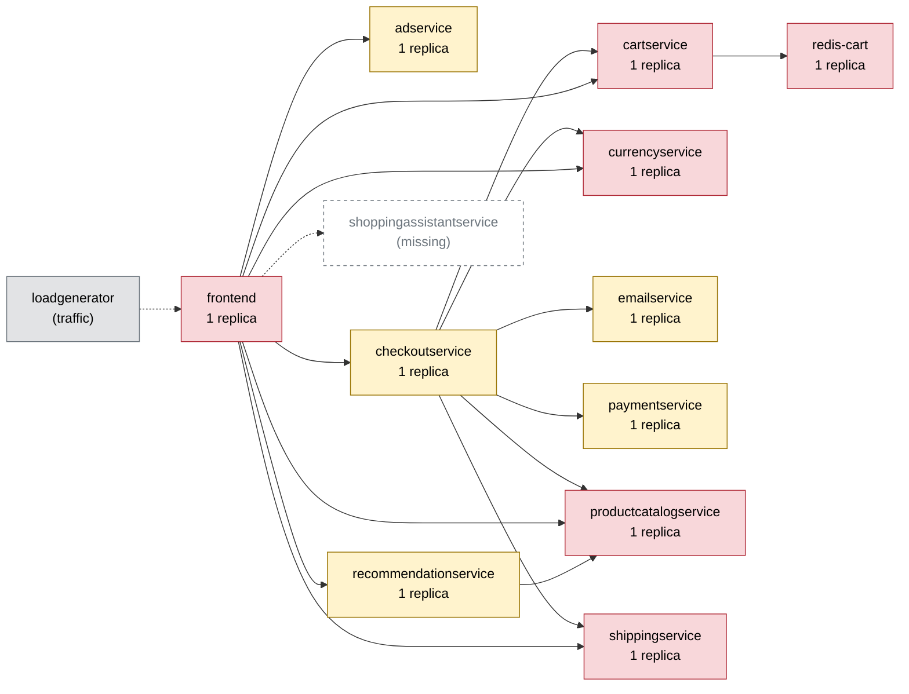

# Chaos Engineering Findings Report — Online Boutique

Generated 2026-10-11T05:49:16+00:00 · scope: `20261011-054423-campaign` · 3 experiments · analyst model: gpt-6-luna · score version 1

## 1. Summary

- **Resilience score: 69 / 100 (grade D)** — given by the AI analyst against a fixed rubric, combined by code; code anchor: 69.
- Experiments: 3 · types: network_delay, pod_failure, pod_kill · failure classes: errors, recovery, slowdown.
- Planner predictions: 0 confirmed, 2 partly, 1 refuted.
- Safety: 1 experiment(s) stopped automatically or manually; baseline p95 16 ms, 0.0% errors.

*(AI analyst)* The cartservice pod failure caused a complete, user-visible outage across all five measured flows: every sampled request failed, and errors persisted during recovery after the guard stopped the fault. Killing redis-cart instead caused extreme but narrower latency and some home-flow errors, while the shipping delay produced a moderate checkout slowdown without errors. The planner identified the main risk areas, but missed important details about affected-flow scope and the cartservice fast-failure behavior. Only three services were directly tested, with short runs and small per-flow samples.

## 2. Findings, ranked by severity

### F1. [CRITICAL] Single cartservice replica outage fails every measured shopping flow

- **Services:** cartservice, frontend, checkoutservice
- **Evidence:** `20261011-054520-pod_failure-cartservice` — During the 10-second pod_failure experiment, all five flows had a 100% error rate (home 24/24, product 22/22, add_to_cart 20/20, view_cart 20/20, checkout 20/20 sampled requests). The run peaked at 100% errors and was aborted after 3.6 seconds of fault activity when the guard detected errors above its 20% threshold. Recovery took 23 seconds and cartservice restarted twice. Peak p95 was 56.9 ms, but requests were failing quickly rather than completing successfully.
- **Root cause:** cartservice is a single-replica shared dependency of both frontend and checkoutservice. When it becomes unavailable, dependent requests fail rather than being served by another replica or gracefully degraded. The guard stopped the injected fault, but did not prevent the all-flow user impact while the service recovered.
- **Fix (`scale_replicas` on cartservice):** cartservice is stateless in the dependency map, so a second replica can keep the service available during a pod-level failure and remove the single-pod outage mechanism. This does not protect against a single-node failure or Redis unavailability.

```
kubectl -n boutique scale deployment/cartservice --replicas=2
```
- **Expected improvement:** On rerun, a failure of one cartservice pod should leave another replica serving requests, substantially reducing errors across home, product, cart, and checkout flows and shortening recovery-dependent disruption.
- **Verify by re-running:** `chaos-agent run --type pod_failure --target cartservice --duration 10`

### F2. [HIGH] redis-cart pod replacement causes extreme latency on home and product flows

- **Services:** redis-cart, cartservice, frontend
- **Evidence:** `20261011-054423-pod_kill-redis-cart` — The run had a 4% impact error rate and peak p95 of 1579.5 ms, or 96.22x baseline, breaching the 1500 ms guard threshold. Home p95 was 1645.4 ms versus 17.1 ms baseline (96.22x) with 12.5% errors; product p95 was 469.4 ms versus 14.0 ms (33.53x) with no sampled errors. add_to_cart, view_cart, and checkout showed no material impact in their small samples. Recovery took 8.1 seconds and the replacement pod became ready in 2.1 seconds.
- **Root cause:** redis-cart is a single-replica stateful dependency behind cartservice. During its replacement, frontend pages that depend on cart data can be delayed while that dependency is unavailable; the observed home and product latency indicates those requests lack an effective bounded-wait or graceful-degradation path.
- **Fix (`code_change` on frontend):** A bounded read and page-level fallback address the measured home/product stalls without claiming to restore Redis or preserve cart operations during its outage. The change limits how long an unavailable cart dependency can delay these pages.

```
# code change in frontend: Add a 250 ms deadline to frontend -> cartservice gRPC cart reads; if the call times out or is unavailable, render home and product pages without cart contents rather than blocking the page. Keep cart mutations, view-cart, and checkout behavior explicit rather than presenting unavailable cart data as current.
```
- **Expected improvement:** On rerun, home and product responses should avoid the observed multi-hundred-millisecond to 1.6-second stalls and should have fewer errors while redis-cart recovers. Cart-dependent operations may still be unavailable, and the small samples make exact error-rate improvement uncertain.
- **Verify by re-running:** `chaos-agent run --type pod_kill --target redis-cart -p grace_period_s=0 --duration 30`

### F3. [MEDIUM] Added shippingservice latency slows checkout and view-cart responses

- **Services:** shippingservice, checkoutservice, frontend
- **Evidence:** `20261011-054629-network_delay-shippingservice` — With 15 ms added latency and 5 ms jitter for 45 seconds, the run had no errors and recovered immediately after the fault. Checkout p95 rose from 21.6 ms to 65.0 ms (3.01x baseline); view_cart rose from 15.3 ms to 32.4 ms (2.12x). The run's peak p95 was 62.3 ms and it had no guard breaches.
- **Root cause:** shippingservice is called on the checkout and view-cart paths, so its added network latency contributes directly to response time on those flows. The experiment shows moderate slowdown, but does not establish the precise call sequencing or any latency amplification beyond the measured impact.
- **Fix (`code_change` on checkoutservice):** A deadline bounds the effect of slower shipping responses on checkout if delays grow beyond this experiment's level. It is a tail-latency safeguard; it is not expected to eliminate the measured 15 ms network delay.

```
# code change in checkoutservice: Set a 250 ms gRPC deadline on checkoutservice -> shippingservice quote calls and cancel the in-flight call when the deadline expires, returning a controlled checkout error rather than waiting without a bound.
```
- **Expected improvement:** On the same mild delay rerun, errors should remain negligible and checkout p95 should remain well below the 250 ms bound. The change should cap more severe shipping delays rather than necessarily returning checkout to its 21.6 ms baseline.
- **Verify by re-running:** `chaos-agent run --type network_delay --target shippingservice -p latency_ms=15 -p jitter_ms=5 --duration 45`

_Findings text: *(AI analyst)*. Numbers: measured by the probe / Prometheus._

## 3. Resilience score per service (worst first)

| Service | Score (AI) | Code anchor | Grade | Availability | Latency | Recovery | Containment | Posture | Weight | Tested | Justification (AI) |
|---|---|---|---|---|---|---|---|---|---|---|---|
| cartservice | **50** | 50 | F | 0 | 100 | 80 | 30 | 60 | 3 | yes | In 20261011-054520-pod_failure-cartservice, all five flows had 100% sampled errors, though failures returned quickly; recovery took 23 seconds and the guard aborted the run. Its shared, single-replica position explains the very low availability and containment scores. |
| adservice | **60** | 60 | D | 60 | 60 | 60 | 60 | 60 | 0.7 | no | Untested. Scores stay at the posture-based anchor: one replica, probes, and limits; its home/product reach is relevant but lower business criticality than checkout or cart. |
| checkoutservice | **60** | 60 | D | 60 | 60 | 60 | 60 | 60 | 2.7 | no | Untested directly; scores remain at the posture-based anchor. It is on the revenue path, but the cartservice experiment does not isolate checkoutservice behavior from its failed dependency. |
| currencyservice | **60** | 60 | D | 60 | 60 | 60 | 60 | 60 | 2.4 | no | Untested directly; scores remain at the posture-based anchor. Its broad flow reach and checkout dependency warrant meaningful business weight, but no run isolates its resilience. |
| emailservice | **60** | 60 | D | 60 | 60 | 60 | 60 | 60 | 1.2 | no | Untested directly; scores remain at the posture-based anchor. It is limited to checkout-related dependency reach, and no run isolates its behavior. |
| frontend | **60** | 60 | D | 60 | 60 | 60 | 60 | 60 | 3 | no | Untested directly; scores remain at the posture-based anchor. It is the single-replica entrypoint for every user flow, so its business impact is high, but the observed downstream faults do not isolate frontend resilience. |
| paymentservice | **60** | 60 | D | 60 | 60 | 60 | 60 | 60 | 2.5 | no | Untested directly; scores remain at the posture-based anchor. Its checkout-path role gives it high business importance, but no experiment isolates it. |
| productcatalogservice | **60** | 60 | D | 60 | 60 | 60 | 60 | 60 | 3 | no | Untested directly; scores remain at the posture-based anchor. It is a shared dependency with reach across all flows, but the measured experiments do not isolate its behavior. |
| recommendationservice | **60** | 60 | D | 60 | 60 | 60 | 60 | 60 | 1 | no | Untested directly; scores remain at the posture-based anchor. Its recommendation feature has lower business criticality than core cart, product, and checkout paths. |
| redis-cart | **71** | 71 | C | 90 | 28 | 93 | 80 | 60 | 3 | yes | In 20261011-054423-pod_kill-redis-cart, overall impact errors were 4% and recovery took 8.1 seconds, but peak p95 reached 1579.5 ms (96.22x baseline), with severe home and product slowdowns. The high containment score reflects the limited observed flow/error scope, not absence of severe latency. |
| shippingservice | **93** | 93 | A | 100 | 88 | 100 | 100 | 60 | 2.2 | yes | In 20261011-054629-network_delay-shippingservice, errors remained at 0%, the worst flow was checkout at 3.01x baseline p95, and recovery was immediate. The delay affected checkout and view-cart latency without spreading to other measured flows. |

Rubric weights: availability 35%, latency 25%, recovery 20%, containment 10%, posture 10%. AI dimension scores are limited to ±15 of the code anchor; the overall score is the criticality-weighted mean of the tested services.

*(AI analyst)* Scores for directly tested services stay at their supplied anchor dimensions, rounded to integers where needed. For untested dimensions and services, I used the posture anchor of 60 rather than infer fault performance from runs that targeted another service; their one-replica configuration with probes and resource limits supports that posture score. Posture scores are 60 because each listed service has one replica and has readiness/liveness probes and CPU/memory limits. Criticality weights emphasize the entrypoint, product, and cart path, give checkout dependencies substantial weight, and discount ads and recommendations. Weights are capped at 3.0, within the requested range.

## 4. Experiments

| Run | Type | Target | Params | Origin | Status | Peak errors | Peak p95 | Worst slowdown | Affected flows | Recovery | Prediction |
|---|---|---|---|---|---|---|---|---|---|---|---|
| `20261011-054423-pod_kill-redis-cart` | pod_kill | redis-cart | {'grace_period_s': 0} | planner | COMPLETED | 7.7% | 1580 ms | 96.2x | home, product | 8 s (pod Ready 2 s) | refuted |
| `20261011-054520-pod_failure-cartservice` | pod_failure | cartservice | - | planner | ABORTED (guard: error rate 60% > 20%) | 100.0% | 57 ms | 0.5x | home, product, add_to_cart, view_cart, checkout | 23 s | partly |
| `20261011-054629-network_delay-shippingservice` | network_delay | shippingservice | {'latency_ms': 15, 'jitter_ms': 5} | planner | COMPLETED | 0.0% | 62 ms | 3.0x | none | 0 s | partly |

## 5. How the AI decided

**Plan `20261011-054420-plan`** (ai, model gpt-6-luna). Strategy: Run a short, stateful-service recovery test first, followed by a bounded cart-service outage and a lower-intensity checkout-path slowdown. This covers recovery, errors, and slowdown while prioritizing single-replica dependencies with broad shopper impact; the shipping delay is last because prior tests suggest it remains far below the p95 guard.

| Rank | Experiment | Reason | Prediction |
|---|---|---|---|
| 1 | pod_kill on redis-cart {'grace_period_s': 0} 30s | Ranked first because redis-cart is a single-replica stateful service holding cart data, is on the checkout path, and has reach 1.0 across all five flows. A prior 15-second pod_failure made the frontend unresponsive and was aborted, so this tests the distinct recovery behavior of a pod kill rather than repeating an already-known outcome. | flows home, product, add_to_cart, view_cart, checkout; errors high; slowdown severe; ABORTED |
| 2 | pod_failure on cartservice 10s | cartservice has one replica, is a shared dependency of checkoutservice and frontend, and reaches every user flow. Prior cartservice pod kills caused high errors across all flows; this brief unavailability test checks whether the error blast radius differs when the pod stays unavailable rather than being immediately replaced. | flows home, product, add_to_cart, view_cart, checkout; errors high; slowdown severe; ABORTED |
| 3 | network_delay on shippingservice {'latency_ms': 15, 'jitter_ms': 5} 45s | shippingservice is a single-replica high-risk dependency used by checkoutservice and frontend, with reach 0.4 on view_cart and checkout. Prior delays of 20 ms plus 5 ms jitter and 40 ms plus 5 ms jitter affected checkout without errors (p95 79.7 ms and 139.8 ms respectively); this lower intensity probes shopper-visible slowdown below the guard threshold. | flows checkout; errors none; slowdown moderate; COMPLETED |

Ideas the planner considered and dropped:

- Repeat 100 ms network delay on productcatalogservice. — Repeated runs already show this adds roughly 700 ms across all flows; the outcome is well established and less informative than an untested target.
- Increase traffic_spike on frontend toward 300 users. — Repeated 300-user runs have crossed the 1500 ms p95 guard, while prior runs already establish that this load produces broad slowdown.
- Memory stress cartservice near its memory limit. — A prior 110 MB stress test already caused high errors across all flows and guard abort; repeating it would add risk without answering a new question.

**Adapter decisions** (campaign `20261011-054423-campaign`, stopped: budget used (3 experiments)):

- after `20261011-054423-pod_kill-redis-cart`: **continue** — The redis-cart pod kill completed and the shop recovered in 8.1s; impact was limited to home and product, while cart-related flows stayed near baseline. Peak error rate was 7.7%, and p95 reached 1579.5ms (above the 1500ms guard), but this was an instant fault and did not abort. The cartservice pod_failure is a distinct outage probe with prior evidence of broad impact, and it passes the validator at 10s; the shippingservice delay then adds network-failure coverage. _(plan unchanged)_
- after `20261011-054520-pod_failure-cartservice`: **continue** — The cartservice pod_failure was aborted after the guard observed errors above 20%; all five flows reached 100% error, confirming a broad outage, while p95 decreased rather than slowing because requests failed quickly. Recovery took 23 s and cartservice restarted twice; the shop is now healthy, and the remaining shippingservice delay remains a useful, lower-intensity third failure-class test. _(plan unchanged)_
- after `20261011-054629-network_delay-shippingservice`: **insert_followup** — The 15 ms delay completed with no errors and no guard breaches, but checkout p95 rose 3.01× (21.6→65.0 ms) and view_cart 2.12×, despite the reported affected_flows being empty. A bounded packet-loss test can probe whether this dependency’s impact is latency-only or also causes shopper-visible errors; the validator confirms it is within caps and policy. _(follow-up inserted: network_loss on shippingservice {'loss_pct': 5, 'correlation_pct': 25})_

*(AI analyst)* The planner correctly anticipated all-flow impact, high errors, and an abort for the cartservice failure; the slowdown prediction missed because failed requests returned quickly (peak p95 56.9 ms). The Redis prediction was refuted on affected-flow scope, error band, and outcome: only home and product were materially affected, errors were low overall, and the pod-kill run completed, although its severe slowdown prediction matched. For shippingservice, the predicted absence of errors, moderate slowdown, and completion were borne out; checkout latency rose about 3x, but the affected_flows classifier was empty despite the measured checkout and view-cart slowdowns. Overall, the planner ranked meaningful risks but was less reliable on flow scope and distinguishing fast failures from slow successful responses.

## 6. Safety record

Guard (deterministic code, checked every 1 s): abort when the error rate > 20% or p95 > max(3× baseline, 1500 ms) for 2 checks in a row, the frontend is silent for 3 s, or a non-target pod becomes NotReady. Every fault is validated against hard caps (and the AI policy for AI-proposed ones), dry-run by the Kubernetes API server, and carries a Chaos Mesh `duration` (auto-revert).

| Run | Reason | Fault active | Kill switch |
|---|---|---|---|
| `20261011-054520-pod_failure-cartservice` | guard: error rate 60% > 20% | 3.6 s | kill switch took 0.5s from decision to fault removed |

## 7. Dependency map

Red = high risk (single replica and critical), yellow = medium, green = low.



| Service | Replicas | Risk | Reach (share of user flows) | Dependents |
|---|---|---|---|---|
| cartservice | 1 | high | 100% (home, product, add_to_cart, view_cart, checkout) | checkoutservice, frontend |
| frontend | 1 | high | 100% (home, product, add_to_cart, view_cart, checkout) | - |
| productcatalogservice | 1 | high | 100% (home, product, add_to_cart, view_cart, checkout) | checkoutservice, frontend, recommendationservice |
| redis-cart | 1 | high | 100% (home, product, add_to_cart, view_cart, checkout) | cartservice, checkoutservice, frontend |
| currencyservice | 1 | high | 80% (home, product, view_cart, checkout) | checkoutservice, frontend |
| recommendationservice | 1 | medium | 60% (product, view_cart, checkout) | frontend |
| adservice | 1 | medium | 40% (home, product) | frontend |
| shippingservice | 1 | high | 40% (view_cart, checkout) | checkoutservice, frontend |
| checkoutservice | 1 | medium | 20% (checkout) | frontend |
| emailservice | 1 | medium | 20% (checkout) | checkoutservice, frontend |
| paymentservice | 1 | medium | 20% (checkout) | checkoutservice, frontend |

## 8. Method and limitations

- Users are simulated by a 4-user probe (home, product, add to cart, view cart, checkout) measured in rolling 5 s windows; resources come from Prometheus.
- Rubric: **availability** — Did users keep getting successful responses? 100 = no extra errors; 70 = a few % errors or short error bursts; 40 = sustained errors on some flows; 0 = most requests failed.; **latency** — How much slower did user flows get (worst p95 vs baseline)? 100 = < 1.5x; 80 = ~3x; 60 = ~10x; 30 = ~50x; 0 = several seconds / timeouts.; **recovery** — How fast were users back to normal after the fault ended? 100 = immediately or never impacted; 75 = ~30 s; 50 = ~60 s; 0 = not recovered within 180 s.; **containment** — Did the failure stay contained? 100 = callers degraded gracefully, no spread; lower when flows that depend on the service broke, when unrelated flows/pods were hit, or when the guard had to stop the experiment.; **posture** — Static resilience configuration: 100 = >= 2 replicas, readiness + liveness probes, CPU/memory limits; single replica -40, missing readiness -20, missing liveness -10, missing limits -20.
- *(AI analyst)* The system ran on a single Kubernetes node, so replica-based resilience would not protect against loss of that node.
- *(AI analyst)* The baseline and experiments use a small synthetic probe; several affected-flow estimates are based on only 4 to 24 requests, and should not be treated as precise production error rates.
- *(AI analyst)* Experiments were short, covering only pod kill, pod failure, and network delay; most services and other fault classes were not directly tested.
- *(AI analyst)* No distributed traces or call-level timings were provided, so the exact source of latency within downstream call paths and whether calls are sequential cannot be established.
- *(AI analyst)* The service scores for untested services are posture- and dependency-based estimates, not measured fault outcomes.
