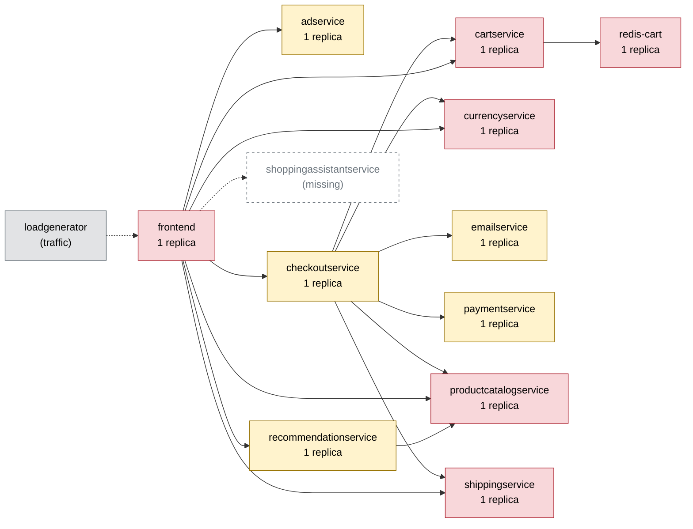

# Chaos Engineering Findings Report — Online Boutique

Generated 2026-10-11T06:14:20+00:00 · scope: `20261011-061018-campaign` · 2 experiments · analyst model: gpt-6-luna · score version 1

## 1. Summary

- **Resilience score: 62 / 100 (grade D)** — given by the AI analyst against a fixed rubric, combined by code; code anchor: 61.
- Experiments: 2 · types: pod_kill, traffic_spike · failure classes: recovery, resource exhaustion.
- Planner predictions: 0 confirmed, 2 partly, 0 refuted.
- Safety: 1 experiment(s) stopped automatically or manually; baseline p95 16 ms, 0.0% errors.

*(AI analyst)* Two experiments exposed distinct resilience weaknesses. Killing the sole cartservice replica caused near-total errors across every measured shopping flow, with recovery taking about 29 seconds. A 200-user traffic spike drove the frontend to its CPU limit and caused all five flows to become severely slow before the guard stopped the run. The cart outage is the most severe finding; the frontend capacity issue is high severity, and the other service scores are cautious estimates because they were not directly tested.

## 2. Findings, ranked by severity

### F1. [CRITICAL] Loss of the sole cartservice replica causes a shop-wide outage

- **Services:** cartservice, frontend, checkoutservice
- **Evidence:** `20261011-061018-pod_kill-cartservice` — The impact error rate was 97.41%, with peak error rate 100%; home, product, add_to_cart, and checkout each had 100% errors, while view_cart had 87.5%. All five flows were affected. Recovery took 29.1 s and the replacement pod became ready after 23.1 s; the guard recorded error rate above its 20% threshold. Failed requests had low measured p95 values, so this run shows widespread fast failures rather than a latency increase.
- **Root cause:** cartservice is a single replica shared by frontend and checkoutservice and is on every listed flow. Killing that one pod removes cart operations across the shop until Kubernetes starts and readies its replacement; the instantaneous kill cannot be undone by the guard.
- **Fix (`scale_replicas` on cartservice):** cartservice is stateless, so a second replica can keep cart requests available when one pod is killed and reduce dependence on replacement startup before service resumes.

```
kubectl -n boutique scale deployment/cartservice --replicas=2
```
- **Expected improvement:** With one cartservice pod killed, the surviving replica should continue serving most cart-dependent requests, substantially lowering errors across all five flows and avoiding a shop-wide outage during pod replacement.
- **Verify by re-running:** `chaos-agent run --type pod_kill --target cartservice -p grace_period_s=0 --duration 30`

### F2. [HIGH] Frontend CPU saturation makes every flow severely slow under a traffic spike

- **Services:** frontend
- **Evidence:** `20261011-061132-traffic_spike-frontend` — At 200 users, the run reached 104.1 rps over 7,714 requests with no failed requests, but the peak p95 was 1,578.5 ms (75.16× the overall baseline p95 of 16.5 ms) and the guard aborted after 74.6 s. All five flows slowed: p95 was 1,184.5 ms for home, 743.5 ms for product, 207.6 ms for add_to_cart, 1,149.9 ms for view_cart, and 948.1 ms for checkout. Frontend CPU peaked at 0.199 cores against a 0.2-core limit (99.4%) with 97.7% peak throttling.
- **Root cause:** The single frontend entrypoint is constrained by a 200m CPU limit. Under concurrency it reached that limit and was heavily throttled, creating queueing and broad latency amplification across its user-facing flows.
- **Fix (`set_resources` on frontend):** Raising the CPU limit directly addresses the measured CPU saturation and throttling. The VM CPU peak was 38.1%, so the run does not show the host itself reaching CPU saturation.

```
kubectl -n boutique set resources deployment/frontend -c server --limits=cpu=500m,memory=128Mi
```
- **Expected improvement:** The frontend should experience less CPU throttling at this load, reducing p95 latency across flows and making a guard-triggering p95 breach less likely. This change does not establish behavior at loads above the tested level.
- **Verify by re-running:** `chaos-agent run --type traffic_spike --target frontend -p users=200 -p ramp_s=30 -p think_ms=1000 -p checkout_pct=20 --duration 90`

_Findings text: *(AI analyst)*. Numbers: measured by the probe / Prometheus._

## 3. Resilience score per service (worst first)

| Service | Score (AI) | Code anchor | Grade | Availability | Latency | Recovery | Containment | Posture | Weight | Tested | Justification (AI) |
|---|---|---|---|---|---|---|---|---|---|---|---|
| cartservice | **51** | 51 | F | 0 | 100 | 76 | 50 | 60 | 3 | yes | In 20261011-061018-pod_kill-cartservice, the impact error rate was 97.41% across all five flows and recovery took 29.1 s. The flow p95s were not elevated because failed requests were fast; posture reflects one replica despite readiness/liveness probes and resource limits. |
| checkoutservice | **68** | 60 | D | 70 | 70 | 70 | 65 | 60 | 2.8 | no | Untested directly. It is a single-replica checkout-path service dependent on cartservice and several other services; the cartservice kill affected checkout, but does not isolate checkoutservice behavior. |
| currencyservice | **68** | 60 | D | 70 | 70 | 70 | 65 | 60 | 2.5 | no | Untested directly. The dependency map places this single-replica service in home, product, view_cart, and checkout paths; its impact scores are conservative estimates rather than measured results. |
| productcatalogservice | **68** | 60 | D | 70 | 70 | 70 | 65 | 60 | 3 | no | Untested directly. The map shows a single replica shared across all listed flows and used by checkoutservice and recommendationservice, so it has broad potential impact but no measured service-specific result. |
| redis-cart | **68** | 60 | D | 70 | 70 | 70 | 65 | 60 | 3 | no | Untested directly. The map identifies redis-cart as a single-replica stateful cart-data dependency with reach across all flows; its potential impact is high, but no run measures a Redis failure. |
| adservice | **69** | 60 | D | 70 | 70 | 70 | 70 | 60 | 0.7 | no | Untested. The dependency map shows adservice is a single replica used by frontend on home and product, but it is not on the checkout path; scores for impact dimensions are cautious dependency-based estimates, not run measurements. |
| emailservice | **69** | 60 | D | 70 | 70 | 70 | 70 | 60 | 1.2 | no | Untested. The map shows a single replica used by checkoutservice on checkout, a narrower reach than shared shop dependencies; no run isolates its behavior. |
| paymentservice | **69** | 60 | D | 70 | 70 | 70 | 70 | 60 | 2.5 | no | Untested. It is a single-replica checkout dependency with limited flow reach in the map; these impact scores are estimates and no run isolates payment behavior. |
| recommendationservice | **69** | 60 | D | 70 | 70 | 70 | 70 | 60 | 1 | no | Untested. It is a single replica, but recommendations are a narrower, non-checkout-path feature in the dependency map; impact scores remain estimates. |
| shippingservice | **69** | 60 | D | 70 | 70 | 70 | 70 | 60 | 2 | no | Untested. The map shows a single replica used by view_cart and checkout; the scores for impact dimensions are cautious estimates, not measured results. |
| frontend | **72** | 72 | C | 100 | 32 | 100 | 30 | 60 | 3 | yes | In 20261011-061132-traffic_spike-frontend there were no failed requests, but flow p95s reached 207.6–1,184.5 ms and the overall peak p95 reached 1,578.5 ms before the guard stopped the run. The frontend has one replica, probes, and limits; the guard contained further exposure but had to abort. |

Rubric weights: availability 35%, latency 25%, recovery 20%, containment 10%, posture 10%. AI dimension scores are limited to ±15 of the code anchor; the overall score is the criticality-weighted mean of the tested services.

*(AI analyst)* The tested services use their supplied anchor dimensions, including the unusually high cartservice latency score: its failed requests had low p95 latency, but availability was near zero. Frontend availability remained intact during the spike, while its severe slowdown and guard-triggered abort are reflected in latency and containment. For untested services, impact-dimension scores are conservative dependency-based estimates near the 60-point posture anchor; they should not be read as experimental measurements. Criticality is highest for the entrypoint, cart path, and broad checkout/product dependencies, and lower for narrower or optional services such as ads and recommendations.

## 4. Experiments

| Run | Type | Target | Params | Origin | Status | Peak errors | Peak p95 | Worst slowdown | Affected flows | Recovery | Prediction |
|---|---|---|---|---|---|---|---|---|---|---|---|
| `20261011-061018-pod_kill-cartservice` | pod_kill | cartservice | {'grace_period_s': 0} | planner | COMPLETED | 100.0% | 89 ms | 0.6x | home, product, add_to_cart, view_cart, checkout | 29 s (pod Ready 23 s) | partly |
| `20261011-061132-traffic_spike-frontend` | traffic_spike | frontend | {'users': 200, 'ramp_s': 30, 'think_ms': 1000, 'checkout_pct': 20} | planner | ABORTED (guard: p95 1578ms > 1500ms) | 0.0% | 1578 ms | 75.2x | home, product, add_to_cart, view_cart, checkout | 0 s | partly |

## 5. How the AI decided

**Plan `20261011-061014-plan`** (ai, model gpt-6-luna). Strategy: Test cartservice loss first: its single replica is a shared dependency on all five flows and the checkout path, and prior kills caused shopper-visible errors followed by roughly 22–31 seconds of recovery. Once cartservice is ready and all flows have returned to baseline, apply the frontend load spike as a distinct fault on a different service; 200 users probes resource pressure below the repeated 300-user guard-abort region. Together the runs expose errors and recovery as well as resource-driven slowdown.

| Rank | Experiment | Reason | Prediction |
|---|---|---|---|
| 1 | pod_kill on cartservice {'grace_period_s': 0} 30s | Ranked first for its broad, high-risk blast radius: cartservice has one replica, reach 1.0 across home, product, add_to_cart, view_cart, and checkout, and is shared by frontend and checkoutservice on the revenue path. Prior cartservice kills affected all five flows, with impact error rates around 83–96% and recovery around 22–31 seconds, making this a direct live-site test of errors and replacement recovery. | flows home, product, add_to_cart, view_cart, checkout; errors high; slowdown severe; COMPLETED |
| 2 | traffic_spike on frontend {'users': 200, 'ramp_s': 30, 'think_ms': 1000, 'checkout_pct': 20} 90s | The frontend is a single-replica entrypoint for every user request and has a 200m CPU limit. Prior 150-user spikes visibly slowed all five flows while completing without errors; repeated 300-user spikes crossed the p95 guard. At 200 users this probes frontend resource pressure between those observed levels, on a different service and with a different fault type from the cartservice kill. | flows home, product, add_to_cart, view_cart, checkout; errors none; slowdown severe; COMPLETED |

Ideas the planner considered and dropped:

- network_delay productcatalogservice, 300 ms for 60 s — Prior +100 ms runs already raised page p95 by roughly 700–757 ms, consistent with the repeated catalog calls; 300 ms risks crossing the p95 guard and yielding only a short aborted slowdown test.
- memory_stress cartservice, 110 MB for 30 s — A prior 110 MB cartservice run OOM-killed the pod, produced errors across all flows, and required about 42 seconds to recover. The selected cartservice kill already gives a live, broad cart-failure and recovery test; the spike adds a different service and failure type.
- network_loss cartservice, 20% for 30 s — A prior run was stopped by the p95 guard after about 6.6 seconds, so it is likely to reproduce an abrupt guard abort rather than provide a useful second demonstration.

**Adapter decisions** (campaign `20261011-061018-campaign`, stopped: budget used (2 experiments)):

- after `20261011-061018-pod_kill-cartservice`: **continue** — The cartservice kill completed and exposed high impact errors across all five flows (97.41% overall; peak 100%), with the pod ready in 23.1 s and recovery in 29.1 s. The predicted severe slowdown was not observed (slowdown factor 0.61; flow p95s were below baseline), but the planned, policy-checked 200-user frontend spike is a distinct test of resource-driven slowdown on another service; the shop is confirmed healthy again. _(plan unchanged)_
- after `20261011-061132-traffic_spike-frontend`: **insert_followup** — The frontend spike aborted at p95 1578.5 ms after affecting all five flows, with 97.7% peak CPU throttling and no errors; this exposed frontend saturation but not the cartservice network-failure behavior in the campaign strategy. A short, moderate packet-loss test on cartservice probes that distinct failure class and helps bring coverage to three classes. _(follow-up inserted: network_loss on cartservice {'loss_pct': 10, 'correlation_pct': 25})_

*(AI analyst)* Both predictions were partly correct. For 20261011-061018-pod_kill-cartservice, the planner correctly predicted all five affected flows, high errors, and completion, but incorrectly predicted severe slowdown: requests failed quickly, so measured p95 did not rise. For 20261011-061132-traffic_spike-frontend, affected flows, no errors, and severe slowdown matched the prediction, but the run aborted rather than completing because p95 crossed the 1,500 ms guard. Overall, the planner identified the impact patterns but did not reliably predict the final outcome under the guard.

## 6. Safety record

Guard (deterministic code, checked every 1 s): abort when the error rate > 20% or p95 > max(3× baseline, 1500 ms) for 2 checks in a row, the frontend is silent for 3 s, or a non-target pod becomes NotReady. Every fault is validated against hard caps (and the AI policy for AI-proposed ones), dry-run by the Kubernetes API server, and carries a Chaos Mesh `duration` (auto-revert).

| Run | Reason | Fault active | Kill switch |
|---|---|---|---|
| `20261011-061132-traffic_spike-frontend` | guard: p95 1578ms > 1500ms | 74.6 s | kill switch took 0.4s from decision to fault removed |

## 7. Dependency map

Red = high risk (single replica and critical), yellow = medium, green = low.



| Service | Replicas | Risk | Reach (share of user flows) | Dependents |
|---|---|---|---|---|
| cartservice | 1 | high | 100% (home, product, add_to_cart, view_cart, checkout) | checkoutservice, frontend |
| frontend | 1 | high | 100% (home, product, add_to_cart, view_cart, checkout) | - |
| productcatalogservice | 1 | high | 100% (home, product, add_to_cart, view_cart, checkout) | checkoutservice, frontend, recommendationservice |
| redis-cart | 1 | high | 100% (home, product, add_to_cart, view_cart, checkout) | cartservice, checkoutservice, frontend |
| currencyservice | 1 | high | 80% (home, product, view_cart, checkout) | checkoutservice, frontend |
| recommendationservice | 1 | medium | 60% (product, view_cart, checkout) | frontend |
| adservice | 1 | medium | 40% (home, product) | frontend |
| shippingservice | 1 | high | 40% (view_cart, checkout) | checkoutservice, frontend |
| checkoutservice | 1 | medium | 20% (checkout) | frontend |
| emailservice | 1 | medium | 20% (checkout) | checkoutservice, frontend |
| paymentservice | 1 | medium | 20% (checkout) | checkoutservice, frontend |

## 8. Method and limitations

- Users are simulated by a 4-user probe (home, product, add to cart, view cart, checkout) measured in rolling 5 s windows; resources come from Prometheus.
- Rubric: **availability** — Did users keep getting successful responses? 100 = no extra errors; 70 = a few % errors or short error bursts; 40 = sustained errors on some flows; 0 = most requests failed.; **latency** — How much slower did user flows get (worst p95 vs baseline)? 100 = < 1.5x; 80 = ~3x; 60 = ~10x; 30 = ~50x; 0 = several seconds / timeouts.; **recovery** — How fast were users back to normal after the fault ended? 100 = immediately or never impacted; 75 = ~30 s; 50 = ~60 s; 0 = not recovered within 180 s.; **containment** — Did the failure stay contained? 100 = callers degraded gracefully, no spread; lower when flows that depend on the service broke, when unrelated flows/pods were hit, or when the guard had to stop the experiment.; **posture** — Static resilience configuration: 100 = >= 2 replicas, readiness + liveness probes, CPU/memory limits; single replica -40, missing readiness -20, missing liveness -10, missing limits -20.
- *(AI analyst)* The system runs on a single-node Kubernetes installation, so results do not establish behavior across independent nodes or availability zones.
- *(AI analyst)* Only two experiments were run, covering a cartservice pod kill and a frontend traffic spike; most services and failure classes remain untested.
- *(AI analyst)* The cart flow samples were small (20–24 requests per flow). The traffic run had many total requests, but per-flow samples at the reported impact point were much smaller.
- *(AI analyst)* The cartservice experiment lasted 30 seconds and its recovery was observed for a short period; the frontend spike was stopped by the guard after 74.6 seconds.
- *(AI analyst)* The cartservice kill and frontend spike test different failure mechanisms, so their outcomes should not be treated as directly comparable.
- *(AI analyst)* The dependency map reports shoppingassistantservice as missing; its runtime behavior and any effect of that reference were not assessed.
