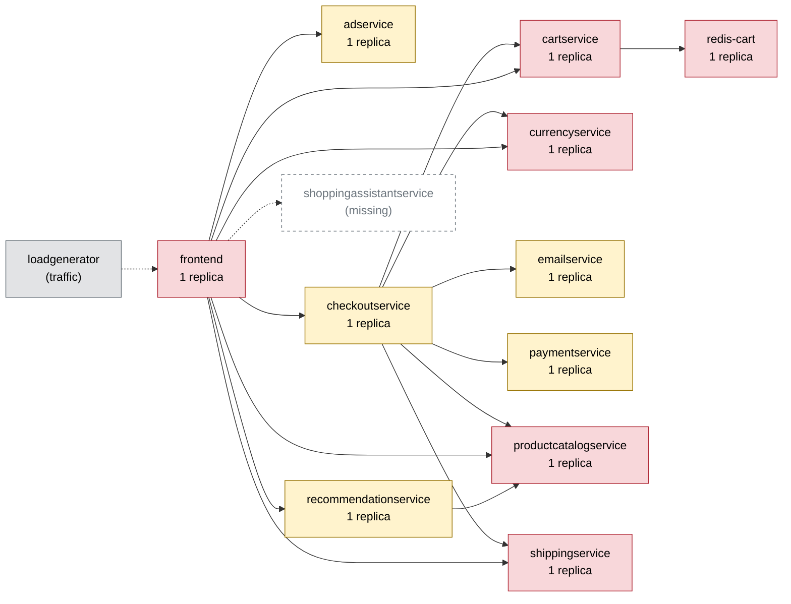

# Chaos Engineering Findings Report — Online Boutique

Generated 2026-10-11T06:45:25+00:00 · scope: `20261011-064201-campaign` · 2 experiments · analyst model: gpt-6-luna · score version 1

## 1. Summary

- **Resilience score: 47 / 100 (grade F)** — given by the AI analyst against a fixed rubric, combined by code; code anchor: 45.
- Experiments: 2 · types: pod_failure, pod_kill · failure classes: errors, recovery.
- Planner predictions: 1 confirmed, 1 partly, 0 refuted.
- Safety: 1 experiment(s) stopped automatically or manually; baseline p95 16 ms, 0.0% errors.

*(AI analyst)* The cartservice pod kill caused broad, severe shopper impact: 90.48% impact error rate across all five flows, with the guard unable to stop the instantaneous fault and recovery taking 27.6 seconds. The paymentservice failure broke checkout for 75% of sampled checkout requests and coincided with a severe add-to-cart latency spike; the guard did abort that experiment. Both tested services are single replicas, making redundancy the clearest catalog fix. Confidence is limited by two short experiments and the small per-flow samples.

## 2. Findings, ranked by severity

### F1. [CRITICAL] Single cartservice replica outage disrupts every shopping flow

- **Services:** cartservice
- **Evidence:** `20261011-064201-pod_kill-cartservice` — The run reached a 100% peak error rate and 90.48% impact error rate; all five flows were affected. Per-flow error rates were home 87%, product 90.9%, add_to_cart 95%, view_cart 80%, and checkout 100%. The worst flow, view_cart, had p95 431.6 ms (28.21x its 15.3 ms baseline); peak p95 was 711.7 ms. Recovery took 27.6 s and the replacement pod became ready in 22.6 s. The guard reported an error-rate breach above 20% but did not abort the instantaneous pod kill.
- **Root cause:** cartservice has one replica and serves both frontend and checkoutservice across all five flows. Killing that sole instance leaves callers without a serving cartservice until Kubernetes replaces and readies a pod.
- **Fix (`scale_replicas` on cartservice):** Adding replicas removes the tested single-instance failure mode for this stateless service, so a single pod kill should not take cart operations offline while replacement is underway.

```
kubectl -n boutique scale deployment/cartservice --replicas=3
```
- **Expected improvement:** With one replica killed, the remaining replicas should continue serving cart requests; error rates across the five flows should fall substantially, view_cart latency should be closer to baseline, and recovery should no longer depend on waiting for a replacement pod.
- **Verify by re-running:** `chaos-agent run --type pod_kill --target cartservice -p grace_period_s=0 --duration 30`

### F2. [HIGH] Paymentservice failure breaks checkout and coincides with severe add-to-cart latency

- **Services:** paymentservice, checkoutservice, frontend
- **Evidence:** `20261011-064314-pod_failure-paymentservice` — The run peaked at a 25% error rate and 729.2 ms p95 (110.48x the 6.6 ms add_to_cart baseline); the impact error rate was 15%. Checkout had a 75% flow error rate, while add_to_cart had 0% errors but p95 of 729.2 ms. The guard aborted the fault after 19.7 s when error rate exceeded 20%; recovery was reported as 1.0 s after the kill switch removed the fault.
- **Root cause:** paymentservice is a single replica on the revenue-critical checkout path, so its unavailability causes checkout requests to fail. The add_to_cart latency spike is also measured in this run, but the dependency map does not establish a direct paymentservice dependency for that flow, so its precise mechanism is uncertain.
- **Fix (`scale_replicas` on paymentservice):** paymentservice is stateless and has no redundancy. A second replica addresses the tested single-instance failure mode and should preserve payment availability when one pod is unavailable.

```
kubectl -n boutique scale deployment/paymentservice --replicas=2
```
- **Expected improvement:** A single paymentservice pod failure should cause fewer checkout errors and reduce the checkout interruption that triggered the guard. Whether the observed add_to_cart latency spike also improves should be checked, since its mechanism is not established by the available dependency data.
- **Verify by re-running:** `chaos-agent run --type pod_failure --target paymentservice --duration 30`

_Findings text: *(AI analyst)*. Numbers: measured by the probe / Prometheus._

## 3. Resilience score per service (worst first)

| Service | Score (AI) | Code anchor | Grade | Availability | Latency | Recovery | Containment | Posture | Weight | Tested | Justification (AI) |
|---|---|---|---|---|---|---|---|---|---|---|---|
| cartservice | **39** | 39 | F | 0 | 49 | 77 | 50 | 60 | 3 | yes | In 20261011-064201-pod_kill-cartservice, impact errors were 90.48% across all five flows, worst-flow p95 was 28.21x baseline, and recovery took 27.6 s. These scores retain the supplied anchors; posture reflects one replica with probes and limits. |
| paymentservice | **56** | 56 | F | 65 | 25 | 99 | 10 | 60 | 2.8 | yes | In 20261011-064314-pod_failure-paymentservice, checkout errors reached 75%, peak p95 was 729.2 ms, and the guard aborted after 19.7 s; the supplied dimension anchors are retained to reflect that measured run and its quick post-abort recovery. |
| adservice | **60** | 60 | D | 60 | 60 | 60 | 60 | 60 | 1 | no | Untested; one replica with readiness/liveness probes and CPU/memory limits gives posture 60. Its home/product reach is lower business impact than cart or checkout, but no measured impact supports changing the anchor dimensions. |
| checkoutservice | **60** | 60 | D | 60 | 60 | 60 | 60 | 60 | 2.6 | no | Untested directly; it is a single-replica checkout-path service with several downstream dependencies. Dimensions remain at the anchor because no experiment measured its isolated behavior; posture is 60. |
| currencyservice | **60** | 60 | D | 60 | 60 | 60 | 60 | 60 | 2.4 | no | Untested; it is a single-replica shared dependency reaching home, product, view_cart, and checkout. No measured currencyservice failure supports a dimension adjustment; posture is 60. |
| emailservice | **60** | 60 | D | 60 | 60 | 60 | 60 | 60 | 1.4 | no | Untested; it is a single replica on the checkout path, with probes and limits. The anchor is retained because no run measured emailservice behavior. |
| frontend | **60** | 60 | D | 60 | 60 | 60 | 60 | 60 | 3 | no | Untested directly; it is the single-replica entrypoint for every flow. The two runs show user-facing effects from backend faults, not a frontend fault, so its dimensions remain at the untested anchor; posture is 60. |
| productcatalogservice | **60** | 60 | D | 60 | 60 | 60 | 60 | 60 | 3 | no | Untested; it is a single-replica dependency with reach across all five flows and is on the checkout path. No productcatalogservice fault was measured, so dimensions remain at the anchor; posture is 60. |
| recommendationservice | **60** | 60 | D | 60 | 60 | 60 | 60 | 60 | 1.2 | no | Untested; it is a single replica and depends on productcatalogservice. No recommendationservice impact was measured, so dimensions remain at the anchor; posture is 60. |
| redis-cart | **60** | 60 | D | 60 | 60 | 60 | 60 | 60 | 3 | no | Untested; it is a single stateful replica holding cart data and has reach across all flows. Its failure behavior was not tested, so dimensions remain at the anchor; posture is 60. |
| shippingservice | **60** | 60 | D | 60 | 60 | 60 | 60 | 60 | 2.2 | no | Untested; it is a single-replica dependency for view_cart and checkout. No shippingservice fault was measured, so dimensions remain at the anchor; posture is 60. |

Rubric weights: availability 35%, latency 25%, recovery 20%, containment 10%, posture 10%. AI dimension scores are limited to ±15 of the code anchor; the overall score is the criticality-weighted mean of the tested services.

*(AI analyst)* The two tested services retain the supplied dimension anchors, rounded to integers where required. For all untested services, availability, latency, recovery, and containment remain at 60 rather than treating dependency reach as measured failure behavior; their one-replica posture with probes and limits is also 60. Criticality weights reflect business impact and reach: frontend, cartservice, productcatalogservice, and redis-cart are highest, while emailservice, adservice, and recommendationservice are lower because their listed flow reach is narrower or their role is less directly revenue-critical. Weights are capped at 3 as requested, even where the anchor table's default exceeds that value.

## 4. Experiments

| Run | Type | Target | Params | Origin | Status | Peak errors | Peak p95 | Worst slowdown | Affected flows | Recovery | Prediction |
|---|---|---|---|---|---|---|---|---|---|---|---|
| `20261011-064201-pod_kill-cartservice` | pod_kill | cartservice | {'grace_period_s': 0} | planner | COMPLETED | 100.0% | 712 ms | 28.2x | home, product, add_to_cart, view_cart, checkout | 28 s (pod Ready 23 s) | confirmed |
| `20261011-064314-pod_failure-paymentservice` | pod_failure | paymentservice | - | planner | ABORTED (guard: error rate 25% > 20%) | 25.0% | 729 ms | 110.5x | add_to_cart, checkout | 1 s | partly |

## 5. How the AI decided

**Plan `20261011-064156-plan`** (ai, model gpt-6-luna). Strategy: Run the broad cartservice recovery test first, then—after the shop has recovered—test the narrower checkout-only payment failure. The two-experiment budget cannot cover three distinct failure classes; these experiments cover recovery and errors while using different experiment types and services.

| Rank | Experiment | Reason | Prediction |
|---|---|---|---|
| 1 | pod_kill on cartservice {'grace_period_s': 0} 30s | Ranked first because cartservice is a single replica, has high risk, is shared by frontend and checkoutservice, and reaches all five flows. Prior cartservice pod kills affected all flows with peak errors near 90–100% and recovery around 22–31 seconds, making this the broadest shopper-visible test. | flows home, product, add_to_cart, view_cart, checkout; errors high; slowdown severe; COMPLETED |
| 2 | pod_failure on paymentservice 30s | Ranked second because paymentservice is a single replica on the revenue-critical checkout path, but its reach is limited to checkout. Prior 30-second paymentservice failures affected checkout; observed peak error rates around 21% show this failure is visible and may activate the guard. | flows checkout; errors high; slowdown none; ABORTED |

Ideas the planner considered and dropped:

- network_delay on productcatalogservice at 300 ms for 60 s — Prior +100 ms already made pages roughly 700 ms slower across all flows, and the service is called sequentially multiple times; this stronger slowdown risks tripping the p95 guard rather than providing a controlled shopper-visible slowdown test.
- traffic_spike on frontend at 200 users — A prior 200-user run reached p95 1578 ms and was guard-aborted. The frontend is also the single-replica entrypoint, so this recipe risks broadly disrupting shoppers.
- memory_stress on cartservice at 110 MB — A prior run at this intensity was guard-aborted with high errors across all flows and a cartservice restart; the selected cartservice test already provides the broad cart-path failure measurement.

**Adapter decisions** (campaign `20261011-064201-campaign`, stopped: budget used (2 experiments)):

- after `20261011-064201-pod_kill-cartservice`: **continue** — The cartservice pod kill completed as predicted and affected all five flows, with 90.48% impact error rate, a 28.21× worst-flow slowdown, and 27.6 s recovery; the shop is now healthy. The planned 30 s paymentservice pod_failure is validator-approved and probes the distinct, checkout-limited failure mode. _(plan unchanged)_
- after `20261011-064314-pod_failure-paymentservice`: **insert_followup** — The paymentservice pod_failure aborted at a 25% peak error rate, with 75% checkout errors; unexpectedly, add_to_cart also reached 729.2 ms p95 (110.48× baseline) despite zero errors. Probe paymentservice with a moderate delay to see whether a less disruptive fault reproduces latency or cross-flow impact. _(follow-up inserted: network_delay on paymentservice {'latency_ms': 100, 'jitter_ms': 0})_

*(AI analyst)* The cartservice prediction was confirmed in 20261011-064201-pod_kill-cartservice: all five predicted flows were affected, the error and slowdown bands matched, and the run completed as predicted. The paymentservice prediction was partly confirmed in 20261011-064314-pod_failure-paymentservice: the run was aborted by the guard as predicted and checkout errors occurred, but the predicted absence of severe slowdown was wrong; measured peak p95 was 729.2 ms, a 110.48x factor, and add_to_cart was also listed among the affected flows. The latency miss shows that the planner did not anticipate this measured latency impact; the available data does not establish its exact mechanism.

## 6. Safety record

Guard (deterministic code, checked every 1 s): abort when the error rate > 20% or p95 > max(3× baseline, 1500 ms) for 2 checks in a row, the frontend is silent for 3 s, or a non-target pod becomes NotReady. Every fault is validated against hard caps (and the AI policy for AI-proposed ones), dry-run by the Kubernetes API server, and carries a Chaos Mesh `duration` (auto-revert).

| Run | Reason | Fault active | Kill switch |
|---|---|---|---|
| `20261011-064314-pod_failure-paymentservice` | guard: error rate 25% > 20% | 19.7 s | kill switch took 0.5s from decision to fault removed |

## 7. Dependency map

Red = high risk (single replica and critical), yellow = medium, green = low.



| Service | Replicas | Risk | Reach (share of user flows) | Dependents |
|---|---|---|---|---|
| cartservice | 1 | high | 100% (home, product, add_to_cart, view_cart, checkout) | checkoutservice, frontend |
| frontend | 1 | high | 100% (home, product, add_to_cart, view_cart, checkout) | - |
| productcatalogservice | 1 | high | 100% (home, product, add_to_cart, view_cart, checkout) | checkoutservice, frontend, recommendationservice |
| redis-cart | 1 | high | 100% (home, product, add_to_cart, view_cart, checkout) | cartservice, checkoutservice, frontend |
| currencyservice | 1 | high | 80% (home, product, view_cart, checkout) | checkoutservice, frontend |
| recommendationservice | 1 | medium | 60% (product, view_cart, checkout) | frontend |
| adservice | 1 | medium | 40% (home, product) | frontend |
| shippingservice | 1 | high | 40% (view_cart, checkout) | checkoutservice, frontend |
| checkoutservice | 1 | medium | 20% (checkout) | frontend |
| emailservice | 1 | medium | 20% (checkout) | checkoutservice, frontend |
| paymentservice | 1 | medium | 20% (checkout) | checkoutservice, frontend |

## 8. Method and limitations

- Users are simulated by a 4-user probe (home, product, add to cart, view cart, checkout) measured in rolling 5 s windows; resources come from Prometheus.
- Rubric: **availability** — Did users keep getting successful responses? 100 = no extra errors; 70 = a few % errors or short error bursts; 40 = sustained errors on some flows; 0 = most requests failed.; **latency** — How much slower did user flows get (worst p95 vs baseline)? 100 = < 1.5x; 80 = ~3x; 60 = ~10x; 30 = ~50x; 0 = several seconds / timeouts.; **recovery** — How fast were users back to normal after the fault ended? 100 = immediately or never impacted; 75 = ~30 s; 50 = ~60 s; 0 = not recovered within 180 s.; **containment** — Did the failure stay contained? 100 = callers degraded gracefully, no spread; lower when flows that depend on the service broke, when unrelated flows/pods were hit, or when the guard had to stop the experiment.; **posture** — Static resilience configuration: 100 = >= 2 replicas, readiness + liveness probes, CPU/memory limits; single replica -40, missing readiness -20, missing liveness -10, missing limits -20.
- *(AI analyst)* The system runs on a single-node Kubernetes deployment, so results do not establish resilience to node or availability-zone failure.
- *(AI analyst)* Only two short experiments were run, covering pod_kill and pod_failure; most services and fault classes, including traffic spikes, network faults, CPU stress, and memory stress, were not tested.
- *(AI analyst)* Per-flow samples were small (roughly 16–23 requests in the reported runs), so error rates and p95 values may be noisy.
- *(AI analyst)* The missing shoppingassistantservice entry in the dependency map and the absence of direct tests for most services limit conclusions about the full dependency graph.
