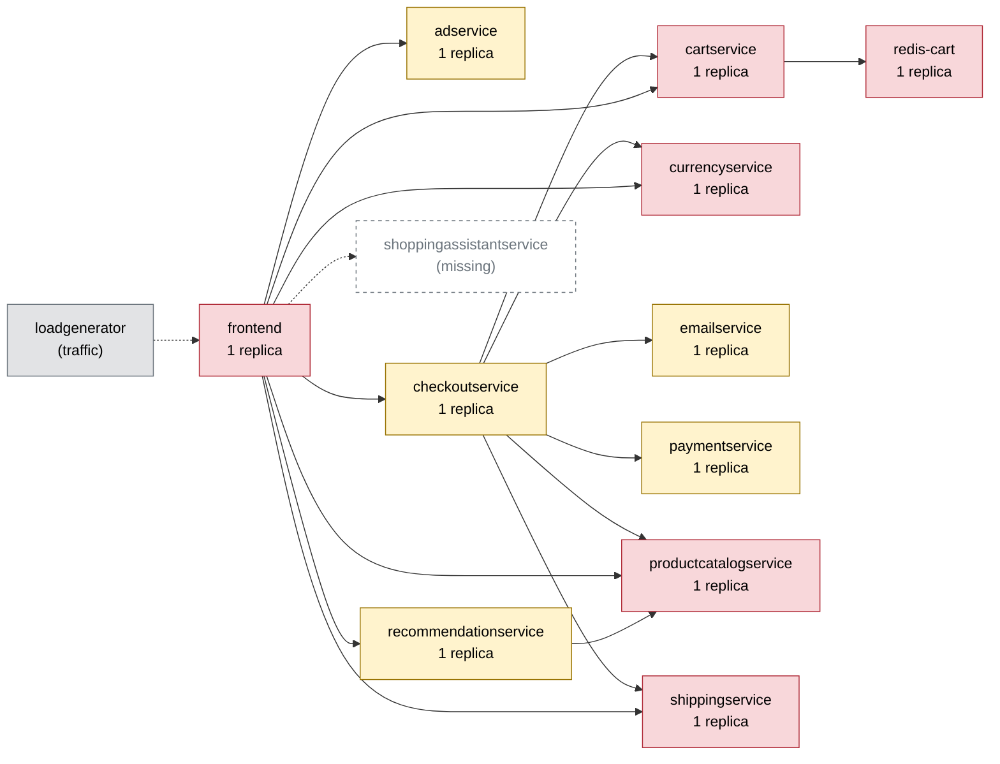

# Chaos Engineering Findings Report — Online Boutique

Generated 2026-10-11T07:31:04+00:00 · scope: `20261011-072847-campaign` · 1 experiments · analyst model: gpt-6-luna · score version 1

## 1. Summary

- **Resilience score: 33 / 100 (grade F)** — given by the AI analyst against a fixed rubric, combined by code; code anchor: 33.
- Experiments: 1 · types: memory_stress · failure classes: resource exhaustion.
- Planner predictions: 1 confirmed, 0 partly, 0 refuted.
- Safety: 1 experiment(s) stopped automatically or manually; baseline p95 16 ms, 0.0% errors.

*(AI analyst)* A single memory-stress experiment on cartservice caused near-total failure across all five shopper flows, including checkout. The injected fault was removed after 3.6 seconds, but errors persisted until recovery at about 41 seconds, and cartservice restarted once. The external guard stopped the experiment; the application-level failure was not contained. Evidence is limited to one short run, so other services remain largely untested.

## 2. Findings, ranked by severity

### F1. [CRITICAL] Cartservice resource exhaustion causes a broad shopper-flow outage

- **Services:** cartservice, frontend, checkoutservice
- **Evidence:** `20261011-072847-memory_stress-cartservice` — With 110 MB memory stress for one worker, overall impact error rate was 95.93%, peak error rate was 100%, peak p95 was 1127.5 ms, and the run was aborted by the error-rate guard. All five flows were affected: error rates were 88.9% on add_to_cart, 94.4% on product, 97.2% on home, and 100% on view_cart and checkout. cartservice restarted once; the fault was active for 3.6 seconds, but recovery took 41 seconds. Its configured memory limit was 128 Mi and peak CPU throttling was 77.3%.
- **Root cause:** The single cartservice replica has little resource headroom under memory pressure. Its restart and unavailability break requests that depend on cart operations; because cartservice is shared by frontend and checkoutservice, failures propagate across every shopper flow. The low p95 values in some individual flows coincide with very high error rates and therefore do not indicate successful fast responses.
- **Fix (`set_resources` on cartservice):** Increasing cartservice's memory limit addresses the demonstrated resource-exhaustion mechanism while retaining the existing CPU limit. This is a targeted mitigation for the memory-stress failure; it does not provide replica redundancy.

```
kubectl -n boutique set resources deployment/cartservice -c server --limits=cpu=300m,memory=256Mi
```
- **Expected improvement:** On the same stress experiment, expect no cartservice restart, substantially fewer cart-dependent request failures, and recovery closer to baseline without a prolonged post-fault error period.
- **Verify by re-running:** `chaos-agent run --type memory_stress --target cartservice -p size_mb=110 -p workers=1 --duration 30`

_Findings text: *(AI analyst)*. Numbers: measured by the probe / Prometheus._

## 3. Resilience score per service (worst first)

| Service | Score (AI) | Code anchor | Grade | Availability | Latency | Recovery | Containment | Posture | Weight | Tested | Justification (AI) |
|---|---|---|---|---|---|---|---|---|---|---|---|
| frontend | **29** | 60 | F | 0 | 32 | 66 | 20 | 60 | 3 | no | Although frontend was not the fault target, all five user flows failed heavily in 20261011-072847-memory_stress-cartservice; overall impact error rate was 95.93% and peak p95 was 1127.5 ms versus a 16.5 ms baseline. The scores reflect this measured user-facing impact and 41-second recovery, while posture 60 reflects one replica with probes and limits. |
| cartservice | **33** | 33 | F | 0 | 43 | 66 | 30 | 60 | 3 | yes | In 20261011-072847-memory_stress-cartservice, impact error rate reached 95.93%, peak p95 was 1127.5 ms, recovery took 41 seconds, and cartservice restarted once. These scores retain the supplied tested anchors; its single replica, readiness/liveness probes, and resource limits yield posture 60. |
| checkoutservice | **34** | 60 | F | 0 | 50 | 60 | 35 | 60 | 3 | no | No experiment targeted checkoutservice directly, but the checkout flow had a 100% error rate during 20261011-072847-memory_stress-cartservice. The flow's 3.2 ms p95 is not evidence of usable fast checkout because the requests failed; other dimensions are inferred cautiously from its cartservice dependency and static posture. |
| adservice | **60** | 60 | D | 60 | 60 | 60 | 60 | 60 | 1 | no | No direct experiment targeted adservice, so the untested dimensions remain near the anchor using the supplied posture and dependency map. It is a single replica with probes and limits, and its home/product reach is lower than checkout-critical services. |
| currencyservice | **60** | 60 | D | 60 | 60 | 60 | 60 | 60 | 2.5 | no | No direct currencyservice fault test or service-specific impact measurement was provided. Scores remain near the untested anchor; the dependency map shows it is shared and checkout-relevant, with a single replica, probes, and limits. |
| emailservice | **60** | 60 | D | 60 | 60 | 60 | 60 | 60 | 1.5 | no | No direct emailservice experiment or service-specific impact measurement was provided, so untested dimensions remain near the anchor. It is a single-replica checkout dependency with probes and limits. |
| paymentservice | **60** | 60 | D | 60 | 60 | 60 | 60 | 60 | 2 | no | No direct paymentservice fault test or service-specific measurement was provided, so scores remain near the untested anchor. The map places it on the checkout path, but the observed checkout errors arose during a cartservice fault. |
| productcatalogservice | **60** | 60 | D | 60 | 60 | 60 | 60 | 60 | 2.8 | no | No direct productcatalogservice fault test or service-specific measurement was provided. Scores remain near the untested anchor; it is a shared, checkout-relevant dependency with one replica, probes, and limits. |
| recommendationservice | **60** | 60 | D | 60 | 60 | 60 | 60 | 60 | 1.2 | no | No direct recommendationservice experiment or service-specific impact measurement was provided, so untested dimensions remain near the anchor. Its single replica and dependency on productcatalogservice are noted, but the measured fault targeted cartservice. |
| redis-cart | **60** | 60 | D | 60 | 60 | 60 | 60 | 60 | 3 | no | redis-cart was not directly tested, so service-level dimensions remain near the untested anchor. It is a single-replica stateful dependency on the checkout path; the observed restart and flow failures were attributed to cartservice, not a measured redis-cart fault. |
| shippingservice | **60** | 60 | D | 60 | 60 | 60 | 60 | 60 | 2 | no | No direct shippingservice experiment or service-specific impact measurement was provided, so untested dimensions remain near the anchor. It is a single-replica checkout dependency with probes and limits. |

Rubric weights: availability 35%, latency 25%, recovery 20%, containment 10%, posture 10%. AI dimension scores are limited to ±15 of the code anchor; the overall score is the criticality-weighted mean of the tested services.

*(AI analyst)* Criticality weights range from 0.5 to 3.0 and reflect shopper-flow reach and revenue impact: frontend and checkout/cart paths are highest, while ads, recommendations, and email are lower. Tested cartservice scores retain the supplied anchors. For untested services, null dimension anchors required judgment; scores generally remain near 60, with frontend and checkoutservice reduced for their measured indirect user-flow impact during the cartservice run. Posture is 60 throughout the scored services because each has one replica, readiness and liveness probes, and CPU/memory limits.

## 4. Experiments

| Run | Type | Target | Params | Origin | Status | Peak errors | Peak p95 | Worst slowdown | Affected flows | Recovery | Prediction |
|---|---|---|---|---|---|---|---|---|---|---|---|
| `20261011-072847-memory_stress-cartservice` | memory_stress | cartservice | {'size_mb': 110, 'workers': 1} | planner | ABORTED (guard: error rate 55% > 20%) | 100.0% | 1128 ms | 40.6x | home, product, add_to_cart, view_cart, checkout | 41 s | confirmed |

## 5. How the AI decided

**Plan `20261011-072841-plan`** (ai, model gpt-6-luna). Strategy: Run the cartservice memory-exhaustion test first because it has the broadest shopper blast radius; wait for the pod and flows to recover before starting the second test. Then take paymentservice offline to demonstrate a distinct, checkout-specific error mode. These two experiments cover two failure classes; the two-experiment budget does not allow the general three-class coverage goal.

| Rank | Experiment | Reason | Prediction |
|---|---|---|---|
| 1 | memory_stress on cartservice {'size_mb': 110, 'workers': 1} 30s | Ranked first because cartservice is a single replica with a 128 Mi limit, reach 1.0 across all five flows, and is shared by frontend and checkoutservice on the revenue path. A prior 110 MB cartservice stress run caused errors across all flows, was guard-aborted, and restarted the pod, so this is a directly shopper-visible, high-blast-radius resource-exhaustion demonstration. The validator accepted this configuration. | flows home, product, add_to_cart, view_cart, checkout; errors high; slowdown severe; ABORTED |
| 2 | pod_failure on paymentservice 30s | Ranked second to test a distinct failure type on a narrower but revenue-critical path: paymentservice is a single replica used by checkoutservice, and its reach is limited to checkout. Past 30-second paymentservice failures produced checkout errors, with peak error rates around 21%; the validator accepted this configuration. Run only after cartservice has recovered so the shopper-visible effects remain attributable to this fault. | flows checkout; errors high; slowdown none; ABORTED |

Ideas the planner considered and dropped:

- network_delay productcatalogservice at 300 ms for 60 seconds — The service is a single-replica dependency on every flow, and prior runs at only 100 ms already raised p95 to roughly 716–757 ms. The proposed intensity is likely to drive the slowdown guard, making it a poor choice for this short demo.
- network_loss cartservice at 20% for 30 seconds — A prior run at this intensity was guard-aborted after p95 exceeded 1500 ms; cartservice's broad blast radius makes this a less controlled demo than the selected pair.
- pod_kill cartservice for 30 seconds — Prior runs showed severe, all-flow shopper impact and roughly 22–24 seconds for the pod to become ready. The selected cartservice memory test already demonstrates its broad impact while providing a different failure class from the payment outage.

*(AI analyst)* The planner's prediction was confirmed: it predicted all five affected flows, high errors, severe slowdown, and an aborted run, and all were observed. The run also showed a cartservice restart and 41-second recovery, consistent with the predicted resource-exhaustion risk. The guard stopped the injected fault after 3.6 seconds, but the prolonged error period shows that this external safety mechanism did not ensure rapid application recovery.

## 6. Safety record

Guard (deterministic code, checked every 1 s): abort when the error rate > 20% or p95 > max(3× baseline, 1500 ms) for 2 checks in a row, the frontend is silent for 3 s, or a non-target pod becomes NotReady. Every fault is validated against hard caps (and the AI policy for AI-proposed ones), dry-run by the Kubernetes API server, and carries a Chaos Mesh `duration` (auto-revert).

| Run | Reason | Fault active | Kill switch |
|---|---|---|---|
| `20261011-072847-memory_stress-cartservice` | guard: error rate 55% > 20% | 3.6 s | kill switch took 0.5s from decision to fault removed |

## 7. Dependency map

Red = high risk (single replica and critical), yellow = medium, green = low.



| Service | Replicas | Risk | Reach (share of user flows) | Dependents |
|---|---|---|---|---|
| cartservice | 1 | high | 100% (home, product, add_to_cart, view_cart, checkout) | checkoutservice, frontend |
| frontend | 1 | high | 100% (home, product, add_to_cart, view_cart, checkout) | - |
| productcatalogservice | 1 | high | 100% (home, product, add_to_cart, view_cart, checkout) | checkoutservice, frontend, recommendationservice |
| redis-cart | 1 | high | 100% (home, product, add_to_cart, view_cart, checkout) | cartservice, checkoutservice, frontend |
| currencyservice | 1 | high | 80% (home, product, view_cart, checkout) | checkoutservice, frontend |
| recommendationservice | 1 | medium | 60% (product, view_cart, checkout) | frontend |
| adservice | 1 | medium | 40% (home, product) | frontend |
| shippingservice | 1 | high | 40% (view_cart, checkout) | checkoutservice, frontend |
| checkoutservice | 1 | medium | 20% (checkout) | frontend |
| emailservice | 1 | medium | 20% (checkout) | checkoutservice, frontend |
| paymentservice | 1 | medium | 20% (checkout) | checkoutservice, frontend |

## 8. Method and limitations

- Users are simulated by a 4-user probe (home, product, add to cart, view cart, checkout) measured in rolling 5 s windows; resources come from Prometheus.
- Rubric: **availability** — Did users keep getting successful responses? 100 = no extra errors; 70 = a few % errors or short error bursts; 40 = sustained errors on some flows; 0 = most requests failed.; **latency** — How much slower did user flows get (worst p95 vs baseline)? 100 = < 1.5x; 80 = ~3x; 60 = ~10x; 30 = ~50x; 0 = several seconds / timeouts.; **recovery** — How fast were users back to normal after the fault ended? 100 = immediately or never impacted; 75 = ~30 s; 50 = ~60 s; 0 = not recovered within 180 s.; **containment** — Did the failure stay contained? 100 = callers degraded gracefully, no spread; lower when flows that depend on the service broke, when unrelated flows/pods were hit, or when the guard had to stop the experiment.; **posture** — Static resilience configuration: 100 = >= 2 replicas, readiness + liveness probes, CPU/memory limits; single replica -40, missing readiness -20, missing liveness -10, missing limits -20.
- *(AI analyst)* Only one experiment was run, targeting cartservice with memory stress; other services and failure classes were not directly tested.
- *(AI analyst)* The experiment ran on a single-node Kubernetes setup, so results do not establish multi-node behavior or resilience to node failure.
- *(AI analyst)* The probe was small and the fault was short; flow-level request counts were limited.
- *(AI analyst)* The run reports a 110 MB stress allocation and one cartservice restart, but its recorded cartservice peak memory was 55.5 MiB against a 128 Mi limit; the exact termination mechanism is not established by the supplied measurements.
