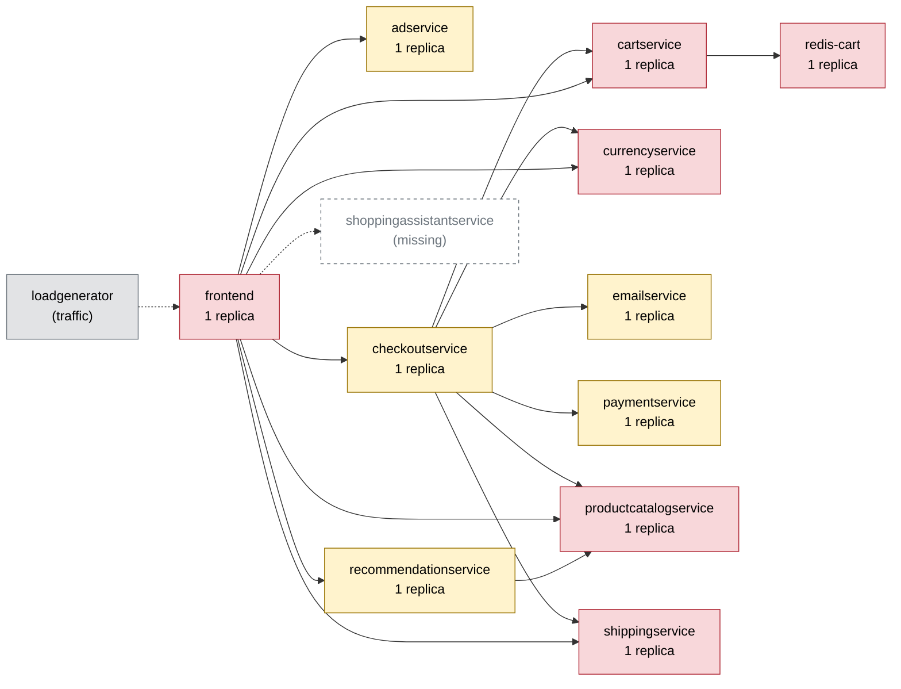

# Chaos Engineering Findings Report — Online Boutique

Generated 2026-10-11T07:35:37+00:00 · scope: `20261011-073307-campaign` · 2 experiments · analyst model: gpt-6-luna · score version 1

## 1. Summary

- **Resilience score: 52 / 100 (grade F)** — given by the AI analyst against a fixed rubric, combined by code; code anchor: 54.
- Experiments: 2 · types: pod_failure, pod_kill · failure classes: errors, recovery.
- Planner predictions: 1 confirmed, 1 partly, 0 refuted.
- Safety: 1 experiment(s) stopped automatically or manually; baseline p95 16 ms, 0.0% errors.

*(AI analyst)* The cartservice pod kill caused broad, severe customer impact: 74.79% of requests failed across all five flows, with a 129.12× worst-flow p95 slowdown and a guard breach. The failure is consistent with cartservice being a single replica shared across the shop and checkout paths; scaling this stateless service is the recommended mitigation. The paymentservice experiment does not establish whether checkout is resilient: the fault lasted only 1.1 seconds and no checkout requests were recorded, although paymentservice is also a single replica on the revenue path. Most other services were not directly tested, so their resilience scores remain conservative estimates based on anchors and configuration.

## 2. Findings, ranked by severity

### F1. [CRITICAL] Cartservice pod loss causes severe failures across every shopping flow

- **Services:** cartservice, frontend, checkoutservice
- **Evidence:** `20261011-073307-pod_kill-cartservice` — During the cartservice pod-kill run, impact error rate was 74.79% and peak error rate was 100%; all five flows were affected. Per-flow error rates were home 80.0%, product 83.3%, add_to_cart 70.8%, view_cart 66.7%, and checkout 72.7%. The worst p95 was 940.4 ms (129.12× baseline); add_to_cart p95 was 852.2 ms versus a 6.6 ms baseline. Recovery took 31.1 s and the pod became Ready after 22.1 s. The error-rate guard breached its 20% threshold.
- **Root cause:** cartservice is a single replica shared by frontend and checkoutservice and is reached by every flow. Killing its only pod removes cart operations until a replacement becomes Ready, propagating errors and slow requests across the shop; the guard did not contain the instantaneous pod kill.
- **Fix (`scale_replicas` on cartservice):** cartservice is stateless and uses redis-cart for cart data, so additional replicas can provide service capacity while one pod is unavailable. This directly addresses the single-pod failure mechanism and provides redundancy during replacement or disruption.

```
kubectl -n boutique scale deployment/cartservice --replicas=3
```
- **Expected improvement:** On re-run, a cartservice pod kill should leave healthy replicas serving requests, substantially reducing errors across all five flows, avoiding the observed severe add_to_cart/view_cart slowdown, and reducing recovery dependence on replacement-pod startup.
- **Verify by re-running:** `chaos-agent run --type pod_kill --target cartservice -p grace_period_s=0 --duration 30`

### F2. [LOW] Paymentservice is a single point of failure on checkout, but the experiment did not measure checkout impact

- **Services:** paymentservice, checkoutservice
- **Evidence:** `20261011-073422-pod_failure-paymentservice` — The dependency map reports one paymentservice replica, and paymentservice is on the checkout path. The run's fault was active for only 1.1 s before an external kill switch removed it; it recorded 0% impact error rate, a 28.5 ms peak p95, and no checkout requests (0 requests, no p95). Thus these measurements do not establish checkout availability during paymentservice failure.
- **Root cause:** With only one paymentservice replica, checkout has no replica-level redundancy if that pod becomes unavailable. The brief, externally aborted experiment provides no checkout traffic evidence to quantify the user impact.
- **Fix (`scale_replicas` on paymentservice):** paymentservice is stateless, and scaling it to two replicas addresses the single-replica failure risk on the checkout path. This is a configuration-risk mitigation, not a fix for an impact demonstrated by this inconclusive run.

```
kubectl -n boutique scale deployment/paymentservice --replicas=2
```
- **Expected improvement:** A repeated failure test should be able to assess checkout under pod loss with another paymentservice replica available; checkout errors should be lower than in a single-replica outage if the remaining replica serves requests. The current run supplies no checkout baseline for quantifying that improvement.
- **Verify by re-running:** `chaos-agent run --type pod_failure --target paymentservice --duration 30`

_Findings text: *(AI analyst)*. Numbers: measured by the probe / Prometheus._

## 3. Resilience score per service (worst first)

| Service | Score (AI) | Code anchor | Grade | Availability | Latency | Recovery | Containment | Posture | Weight | Tested | Justification (AI) |
|---|---|---|---|---|---|---|---|---|---|---|---|
| cartservice | **32** | 32 | F | 0 | 23 | 74 | 50 | 60 | 3 | yes | In 20261011-073307-pod_kill-cartservice, 74.79% of requests failed across all five flows, worst p95 reached 940.4 ms (129.12× baseline), and recovery took 31.1 s; these align with the supplied anchors. It has one replica but readiness/liveness probes and CPU/memory limits. |
| adservice | **60** | 60 | D | 60 | 60 | 60 | 60 | 60 | 1 | no | Untested. The anchor has null impact dimensions; the single replica is balanced by configured probes and limits, so neutral estimates are used. Ads affect home/product flows but are not on checkout. |
| checkoutservice | **60** | 60 | D | 60 | 60 | 60 | 60 | 60 | 2.7 | no | Untested directly. The cartservice run showed checkout-flow errors, but does not isolate checkoutservice behavior; neutral estimates are retained from the anchor. It is single-replica and on the revenue path, with probes and limits configured. |
| currencyservice | **60** | 60 | D | 60 | 60 | 60 | 60 | 60 | 2.7 | no | Untested; the anchor impact dimensions are null, so neutral estimates are used. Its shared role and checkout reach make it important, but no supplied run isolates its resilience. |
| emailservice | **60** | 60 | D | 60 | 60 | 60 | 60 | 60 | 1.5 | no | Untested, with null anchor impact dimensions; neutral estimates are used. It is single-replica and checkout-related, but the supplied runs do not isolate email delivery. |
| frontend | **60** | 60 | D | 60 | 60 | 60 | 60 | 60 | 3 | no | Untested directly; neutral estimates follow the anchor because no run targets frontend. Its entrypoint role makes it highly important, and its probes and limits are configured, but it has one replica. |
| productcatalogservice | **60** | 60 | D | 60 | 60 | 60 | 60 | 60 | 3 | no | Untested directly; impact anchors are null and neutral estimates are used. The service has broad dependency-map reach, including checkout, but no supplied experiment isolates its behavior. |
| recommendationservice | **60** | 60 | D | 60 | 60 | 60 | 60 | 60 | 1.3 | no | Untested; neutral estimates follow the anchor. It depends on productcatalogservice and reaches several flows, but recommendations are not on the checkout path and no supplied run tests it. |
| redis-cart | **60** | 60 | D | 60 | 60 | 60 | 60 | 60 | 3 | no | Untested directly; the cartservice pod-kill run does not isolate Redis behavior, so neutral impact estimates are retained. Redis is single-replica, stateful, and on every flow, making it highly business-critical despite the lack of direct evidence. |
| shippingservice | **60** | 60 | D | 60 | 60 | 60 | 60 | 60 | 2 | no | Untested; the anchor impact dimensions are null, so neutral estimates are used. It is single-replica and checkout-related, but no supplied run isolates its effect. |
| paymentservice | **82** | 96 | B | 85 | 85 | 85 | 85 | 60 | 2 | yes | 20261011-073422-pod_failure-paymentservice recorded no errors, but the fault lasted only 1.1 s and checkout had zero requests, so the 100-point impact anchors are discounted by 15 for inadequate exposure rather than treated as proof of resilience. It has one replica with probes and limits. |

Rubric weights: availability 35%, latency 25%, recovery 20%, containment 10%, posture 10%. AI dimension scores are limited to ±15 of the code anchor; the overall score is the criticality-weighted mean of the tested services.

*(AI analyst)* Scores follow the supplied anchors where experiments provide evidence: cartservice retains its measured anchor dimensions. Paymentservice is discounted by 15 points on the impact dimensions because its run ended after 1.1 seconds with no checkout requests, making the perfect anchor result too uncertain to interpret as demonstrated resilience. For untested services, impact dimensions are neutral estimates near their anchors, informed by the dependency map rather than attributed failures; posture is 60 throughout because services have one replica while probes and limits are configured. Criticality weights are capped at 3 as requested: entrypoint, shared checkout-path, and cart-data services receive the highest weights, while ads and recommendations receive lower weights.

## 4. Experiments

| Run | Type | Target | Params | Origin | Status | Peak errors | Peak p95 | Worst slowdown | Affected flows | Recovery | Prediction |
|---|---|---|---|---|---|---|---|---|---|---|---|
| `20261011-073307-pod_kill-cartservice` | pod_kill | cartservice | {'grace_period_s': 0} | planner | COMPLETED | 100.0% | 940 ms | 129.1x | home, product, add_to_cart, view_cart, checkout | 31 s (pod Ready 22 s) | confirmed |
| `20261011-073422-pod_failure-paymentservice` | pod_failure | paymentservice | - | planner | ABORTED (kill switch: chaos resource was deleted externally) | 0.0% | 28 ms | 1.4x | none | 0 s | partly |

## 5. How the AI decided

**Plan `20261011-073302-plan`** (ai, model gpt-6-luna). Strategy: Run the cartservice pod kill first because its single replica serves every shopper flow, then wait for the pod to be Ready and flows to return to baseline before testing paymentservice. The two experiments cover different catalog failure classes (recovery and errors) and use different services; a third class cannot fit the exact two-experiment budget.

| Rank | Experiment | Reason | Prediction |
|---|---|---|---|
| 1 | pod_kill on cartservice {'grace_period_s': 0} 30s | Ranked first because cartservice is a single replica, is shared by frontend and checkoutservice, and reaches all five flows. Prior 30-second cartservice pod-kill runs visibly affected all flows, with high errors and recovery taking about 22–31 seconds. Validator accepted this configuration. | flows home, product, add_to_cart, view_cart, checkout; errors high; slowdown severe; COMPLETED |
| 2 | pod_failure on paymentservice 30s | Ranked second because paymentservice is a single replica on the revenue-critical checkout path, but its map reach is limited to checkout, reducing the blast radius compared with cartservice. Prior paymentservice pod-failure runs visibly affected checkout and reached a 21–25% peak error rate; a short guard abort is expected and useful for measuring this failure. Validator accepted this configuration. | flows checkout; errors high; slowdown none; ABORTED |

Ideas the planner considered and dropped:

- Add a third experiment from a third failure class. — The plan is constrained to exactly two experiments, so it cannot cover three distinct catalog failure classes while assigning one class to each experiment.
- Add 300 ms network delay to productcatalogservice. — Prior evidence shows even 100 ms caused roughly 700 ms page latency through sequential calls; 300 ms risks tripping the p95 guard rather than providing a controlled slowdown demonstration.

**Adapter decisions** (campaign `20261011-073307-campaign`, stopped: manual abort (kill switch: chaos resource was deleted externally)):

- after `20261011-073307-pod_kill-cartservice`: **continue** — The cartservice pod kill confirmed the predicted broad blast radius: all five flows were affected, with a 74.79% impact error rate and severe slowdown, and the shop is now healthy again. The planned paymentservice pod failure remains a useful, distinct probe of the checkout-only dependency path and adds a second failure class. _(plan unchanged)_

*(AI analyst)* The cartservice prediction was confirmed: it predicted all five affected flows, high errors, severe slowdown, and completion, all of which matched the run. The paymentservice prediction was only partly assessable: the outcome was ABORTED as predicted, but the external kill switch removed the fault after 1.1 seconds and the run recorded no checkout requests, so predicted checkout errors were neither confirmed nor meaningfully disproved. Overall, the cartservice ranking and blast-radius hypothesis were supported; paymentservice needs a valid, adequately sampled rerun before its impact prediction can be judged.

## 6. Safety record

Guard (deterministic code, checked every 1 s): abort when the error rate > 20% or p95 > max(3× baseline, 1500 ms) for 2 checks in a row, the frontend is silent for 3 s, or a non-target pod becomes NotReady. Every fault is validated against hard caps (and the AI policy for AI-proposed ones), dry-run by the Kubernetes API server, and carries a Chaos Mesh `duration` (auto-revert).

| Run | Reason | Fault active | Kill switch |
|---|---|---|---|
| `20261011-073422-pod_failure-paymentservice` | kill switch: chaos resource was deleted externally | 1.1 s | kill switch took 0.0s from decision to fault removed |

## 7. Dependency map

Red = high risk (single replica and critical), yellow = medium, green = low.



| Service | Replicas | Risk | Reach (share of user flows) | Dependents |
|---|---|---|---|---|
| cartservice | 1 | high | 100% (home, product, add_to_cart, view_cart, checkout) | checkoutservice, frontend |
| frontend | 1 | high | 100% (home, product, add_to_cart, view_cart, checkout) | - |
| productcatalogservice | 1 | high | 100% (home, product, add_to_cart, view_cart, checkout) | checkoutservice, frontend, recommendationservice |
| redis-cart | 1 | high | 100% (home, product, add_to_cart, view_cart, checkout) | cartservice, checkoutservice, frontend |
| currencyservice | 1 | high | 80% (home, product, view_cart, checkout) | checkoutservice, frontend |
| recommendationservice | 1 | medium | 60% (product, view_cart, checkout) | frontend |
| adservice | 1 | medium | 40% (home, product) | frontend |
| shippingservice | 1 | high | 40% (view_cart, checkout) | checkoutservice, frontend |
| checkoutservice | 1 | medium | 20% (checkout) | frontend |
| emailservice | 1 | medium | 20% (checkout) | checkoutservice, frontend |
| paymentservice | 1 | medium | 20% (checkout) | checkoutservice, frontend |

## 8. Method and limitations

- Users are simulated by a 4-user probe (home, product, add to cart, view cart, checkout) measured in rolling 5 s windows; resources come from Prometheus.
- Rubric: **availability** — Did users keep getting successful responses? 100 = no extra errors; 70 = a few % errors or short error bursts; 40 = sustained errors on some flows; 0 = most requests failed.; **latency** — How much slower did user flows get (worst p95 vs baseline)? 100 = < 1.5x; 80 = ~3x; 60 = ~10x; 30 = ~50x; 0 = several seconds / timeouts.; **recovery** — How fast were users back to normal after the fault ended? 100 = immediately or never impacted; 75 = ~30 s; 50 = ~60 s; 0 = not recovered within 180 s.; **containment** — Did the failure stay contained? 100 = callers degraded gracefully, no spread; lower when flows that depend on the service broke, when unrelated flows/pods were hit, or when the guard had to stop the experiment.; **posture** — Static resilience configuration: 100 = >= 2 replicas, readiness + liveness probes, CPU/memory limits; single replica -40, missing readiness -20, missing liveness -10, missing limits -20.
- *(AI analyst)* The experiments ran on a single-node Kubernetes environment, so results do not measure multi-node failure behavior or node-level redundancy.
- *(AI analyst)* The probe was small; the paymentservice run had only four requests each for home, product, and add_to_cart, and no checkout requests.
- *(AI analyst)* The paymentservice fault was active for only 1.1 seconds and was removed by an external kill switch, preventing meaningful failure and recovery measurement.
- *(AI analyst)* The experiments were short and covered only pod_kill and pod_failure; load, network, memory, and other failure modes remain untested.
- *(AI analyst)* Untested-service impact scores are cautious estimates from anchors, configuration, and dependencies, not direct experimental measurements.
