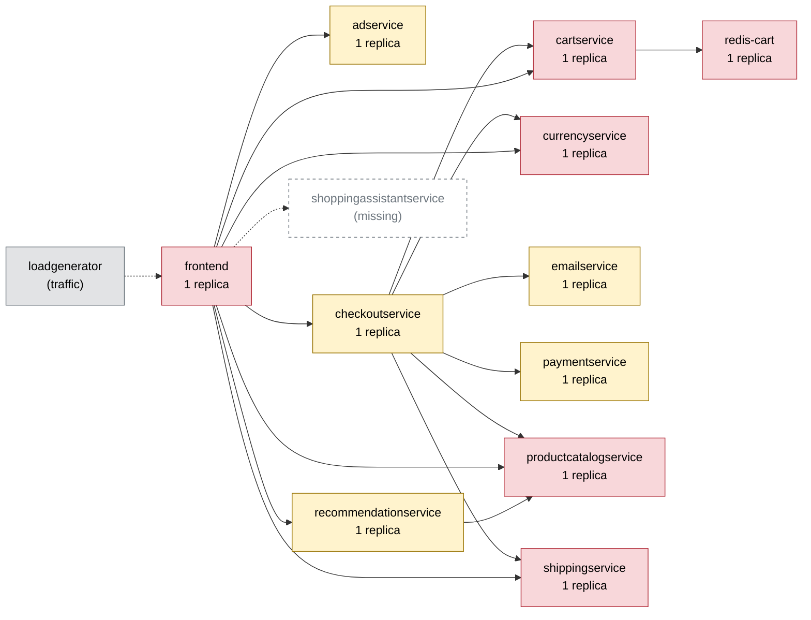

# Chaos Engineering Findings Report — Online Boutique

Generated 2026-10-11T07:42:15+00:00 · scope: `20261011-073800-campaign` · 2 experiments · analyst model: gpt-6-luna · score version 1

## 1. Summary

- **Resilience score: 62 / 100 (grade D)** — given by the AI analyst against a fixed rubric, combined by code; code anchor: 61.
- Experiments: 2 · types: memory_stress, network_delay · failure classes: resource exhaustion, slowdown.
- Planner predictions: 0 confirmed, 2 partly, 0 refuted.
- Safety: 1 experiment(s) stopped automatically or manually; baseline p95 16 ms, 0.0% errors.

*(AI analyst)* A 110 MB memory stress on the single-replica cartservice caused near-total failures across all five shopper flows; the test guard stopped the fault, but the service took about 25 seconds to recover. This is the principal resilience weakness because cartservice is shared across the shop and checkout path. A 100 ms paymentservice network delay slowed checkout to 119.1 ms p95, but caused no errors and affected no other flow. The two runs provide limited coverage and do not establish resilience under traffic spikes or pod failures.

## 2. Findings, ranked by severity

### F1. [CRITICAL] Cartservice memory pressure causes near-total shop outage

- **Services:** cartservice, frontend, checkoutservice
- **Evidence:** `20261011-073801-memory_stress-cartservice` — With a 110 MB allocation against cartservice's 128 Mi limit, impact error rate was 97.35%, peak error rate reached 100%, and all five flows were affected: home 95.8%, product 100%, add_to_cart 100%, view_cart 95.5%, and checkout 95.0% errors. The pod restarted once; the guard aborted after an error-rate breach, the fault was active for 3.6 seconds, and recovery took 25 seconds. Peak p95 was 121.6 ms (2.69x the reported baseline); the harness kill switch removed the fault 0.5 seconds after its decision, but errors persisted during recovery.
- **Root cause:** The 128 Mi single cartservice pod has no replica redundancy. Memory pressure caused a restart and made the shared cart dependency unavailable to frontend and checkoutservice, propagating failures across all five flows. The test guard stopped the injected fault, but there was no service-level failover to contain the shopper impact.
- **Fix (`set_resources` on cartservice):** Increasing cartservice memory from 128 Mi to 256 Mi provides headroom for the injected allocation and normal process usage, addressing the observed memory-pressure/restart mechanism without changing the current CPU limit.

```
kubectl -n boutique set resources deployment/cartservice -c server --limits=cpu=300m,memory=256Mi
```
- **Expected improvement:** On rerun, the 110 MB allocation should be less likely to exceed the container limit; expect no OOM-related restart, substantially fewer errors across the five flows, and faster recovery. The experiment should not trigger the error-rate guard.
- **Verify by re-running:** `chaos-agent run --type memory_stress --target cartservice -p size_mb=110 -p workers=1 --duration 30`

_Findings text: *(AI analyst)*. Numbers: measured by the probe / Prometheus._

## 3. Resilience score per service (worst first)

| Service | Score (AI) | Code anchor | Grade | Availability | Latency | Recovery | Containment | Posture | Weight | Tested | Justification (AI) |
|---|---|---|---|---|---|---|---|---|---|---|---|
| cartservice | **47** | 47 | F | 0 | 89 | 79 | 30 | 60 | 3 | yes | In 20261011-073801-memory_stress-cartservice, errors affected every flow (95.0–100%), the pod restarted once, and recovery took 25 seconds; the anchor dimensions are retained. It is a single-replica, shared checkout-path service with a 128 Mi memory limit. |
| frontend | **56** | 60 | F | 45 | 60 | 75 | 45 | 60 | 3 | no | The entrypoint's flows all failed at 95.0–100% during 20261011-073801-memory_stress-cartservice, and the reported overall peak p95 was 121.6 ms; recovery was about 25 seconds. These estimates reflect indirect impact from the cart dependency, not an isolated frontend fault; the frontend itself has one replica with probes and limits. |
| adservice | **60** | 60 | D | 60 | 60 | 60 | 60 | 60 | 0.8 | no | Untested. The dependency map shows one replica with readiness and liveness probes and CPU/memory limits, giving the static posture score of 60; there is no direct run evidence to move the other dimensions from the neutral estimate. |
| checkoutservice | **60** | 60 | D | 45 | 75 | 75 | 45 | 60 | 2.5 | no | Not directly faulted, but the checkout flow had 95.0% errors and 58.1 ms p95 (2.69x baseline) during 20261011-073801-memory_stress-cartservice, with the run recovering in about 25 seconds. These are conservative, indirect flow-impact estimates; its static posture is one replica with probes and limits. |
| currencyservice | **60** | 60 | D | 60 | 60 | 60 | 60 | 60 | 2.5 | no | Untested. The dependency map shows one replica with readiness and liveness probes and CPU/memory limits; no run isolates this service, so the other dimensions remain at the neutral estimate. |
| emailservice | **60** | 60 | D | 60 | 60 | 60 | 60 | 60 | 1 | no | Untested. It has one replica with readiness and liveness probes and CPU/memory limits; there is no direct experimental evidence to adjust the neutral performance estimates. |
| productcatalogservice | **60** | 60 | D | 60 | 60 | 60 | 60 | 60 | 3 | no | Untested. It has one replica with readiness and liveness probes and CPU/memory limits; the cartservice run does not isolate product-catalog behavior, so the neutral estimate is retained. |
| recommendationservice | **60** | 60 | D | 60 | 60 | 60 | 60 | 60 | 0.8 | no | Untested. The dependency map shows one replica with readiness and liveness probes and CPU/memory limits; no direct run evidence supports changing the neutral performance estimates. |
| redis-cart | **60** | 60 | D | 60 | 60 | 60 | 60 | 60 | 3 | no | Untested. It is a single-replica stateful cart dependency with probes and resource limits; neither run directly faults Redis, so performance dimensions remain estimates. |
| shippingservice | **60** | 60 | D | 60 | 60 | 60 | 60 | 60 | 1.8 | no | Untested. It has one replica with readiness and liveness probes and CPU/memory limits; no run isolates this service, so the neutral performance estimate is retained. |
| paymentservice | **85** | 85 | B | 100 | 77 | 100 | 50 | 60 | 2 | yes | In 20261011-073920-network_delay-paymentservice, checkout p95 rose from 21.6 ms to 119.1 ms (5.51x), but error rate remained 0% and recovery was immediate. The anchor dimensions are retained; the single-replica posture remains 60. |

Rubric weights: availability 35%, latency 25%, recovery 20%, containment 10%, posture 10%. AI dimension scores are limited to ±15 of the code anchor; the overall score is the criticality-weighted mean of the tested services.

*(AI analyst)* Posture is 60 for each mapped deployment: each has one replica, readiness and liveness probes, and CPU/memory limits. For untested services, null anchor dimensions are estimated at the neutral 60 and should not be read as measured performance. Checkoutservice and frontend availability, latency, recovery, and containment reflect indirect user-flow impact during the cartservice run, kept within 15 points of the neutral estimate; they are not evidence of isolated faults in those services. Tested cartservice and paymentservice dimensions stay at their supplied anchors. Criticality is highest for the entrypoint, cart path, and shared/core product and cart data services; optional ads and recommendations receive lower weights.

## 4. Experiments

| Run | Type | Target | Params | Origin | Status | Peak errors | Peak p95 | Worst slowdown | Affected flows | Recovery | Prediction |
|---|---|---|---|---|---|---|---|---|---|---|---|
| `20261011-073801-memory_stress-cartservice` | memory_stress | cartservice | {'size_mb': 110, 'workers': 1} | planner | ABORTED (guard: error rate 55% > 20%) | 100.0% | 122 ms | 2.7x | home, product, add_to_cart, view_cart, checkout | 25 s | partly |
| `20261011-073920-network_delay-paymentservice` | network_delay | paymentservice | {'latency_ms': 100, 'jitter_ms': 0} | adapter | COMPLETED | 0.0% | 118 ms | 5.5x | checkout | 0 s | partly |

## 5. How the AI decided

**Plan `20261011-073756-plan`** (ai, model gpt-6-luna). Strategy: Run the cartservice memory-exhaustion test first, then wait for recovery and a healthy baseline before testing paymentservice failure; do not overlap faults. The two distinct experiment types cover resource exhaustion and errors, but the exact two-experiment budget does not allow a third failure class.

| Rank | Experiment | Reason | Prediction |
|---|---|---|---|
| 1 | memory_stress on cartservice {'size_mb': 110, 'workers': 1} 30s | cartservice is a single replica with 1.0 reach across all five flows, is shared by frontend and checkoutservice, and has a 128 Mi memory limit. A prior 110 MB run caused errors across all flows, guard abort, and a 41-second recovery, so this is a high-risk, shopper-visible test of OOM behavior. | flows home, product, add_to_cart, view_cart, checkout; errors high; slowdown severe; ABORTED |
| 2 | pod_failure on paymentservice 30s | paymentservice is a single replica on the checkout path. Past 30-second failures visibly affected checkout and reached 21–25% peak error rates, sometimes triggering the guard; this tests the shopper impact of losing payment processing, on a different service and with a different fault type from the first experiment. | flows checkout; errors high; slowdown none; ABORTED |

Ideas the planner considered and dropped:

- Add a third experiment from a third failure class, such as a controlled slowdown test. — The plan is limited to exactly two experiments, so a third distinct failure class cannot fit the budget.
- Add 300 ms network delay to productcatalogservice. — Past evidence shows even 100 ms adds roughly 700 ms to pages through sequential calls; the stronger delay risks a guard-triggering slowdown that teaches little.
- Use 20% network loss on cartservice. — A prior run already tripped the p95 guard after a few seconds, so it is likely to produce a brief, guard-limited slowdown rather than a useful additional result.

**Adapter decisions** (campaign `20261011-073800-campaign`, stopped: budget used (2 experiments)):

- after `20261011-073801-memory_stress-cartservice`: **insert_followup** — The cartservice memory-stress run was aborted after error rate reached 55% (peak 100%); all five flows were affected, cartservice restarted, and recovery took 25 seconds. Add a distinct network-fault class before the planned paymentservice pod failure to broaden coverage; the validator confirms this experiment is within policy. _(follow-up inserted: network_delay on paymentservice {'latency_ms': 100, 'jitter_ms': 0})_
- after `20261011-073920-network_delay-paymentservice`: **continue** — The paymentservice delay completed with no errors or guard breaches; checkout was the only affected flow and slowed 5.51× (peak p95 117.8 ms), while the prediction correctly anticipated its impact and slowdown but overpredicted errors. The remaining paymentservice pod_failure test probes a distinct failure class and the checkout dependency, complementing the memory_stress and network_delay runs. _(plan unchanged)_

*(AI analyst)* Both runs were rated partly correct. For cartservice, the predicted affected flows, high error band, and abort outcome matched, but the predicted severe slowdown missed the observed 2.69x slowdown band. For paymentservice, the affected checkout flow, moderate slowdown, and completed outcome matched; the predicted low error band missed because observed errors were zero. Overall, predictions captured scope and run outcome reasonably well, while the cart slowdown estimate was off. Coverage is only two runs: resource exhaustion and network delay.

## 6. Safety record

Guard (deterministic code, checked every 1 s): abort when the error rate > 20% or p95 > max(3× baseline, 1500 ms) for 2 checks in a row, the frontend is silent for 3 s, or a non-target pod becomes NotReady. Every fault is validated against hard caps (and the AI policy for AI-proposed ones), dry-run by the Kubernetes API server, and carries a Chaos Mesh `duration` (auto-revert).

| Run | Reason | Fault active | Kill switch |
|---|---|---|---|
| `20261011-073801-memory_stress-cartservice` | guard: error rate 55% > 20% | 3.6 s | kill switch took 0.5s from decision to fault removed |

## 7. Dependency map

Red = high risk (single replica and critical), yellow = medium, green = low.



| Service | Replicas | Risk | Reach (share of user flows) | Dependents |
|---|---|---|---|---|
| cartservice | 1 | high | 100% (home, product, add_to_cart, view_cart, checkout) | checkoutservice, frontend |
| frontend | 1 | high | 100% (home, product, add_to_cart, view_cart, checkout) | - |
| productcatalogservice | 1 | high | 100% (home, product, add_to_cart, view_cart, checkout) | checkoutservice, frontend, recommendationservice |
| redis-cart | 1 | high | 100% (home, product, add_to_cart, view_cart, checkout) | cartservice, checkoutservice, frontend |
| currencyservice | 1 | high | 80% (home, product, view_cart, checkout) | checkoutservice, frontend |
| recommendationservice | 1 | medium | 60% (product, view_cart, checkout) | frontend |
| adservice | 1 | medium | 40% (home, product) | frontend |
| shippingservice | 1 | high | 40% (view_cart, checkout) | checkoutservice, frontend |
| checkoutservice | 1 | medium | 20% (checkout) | frontend |
| emailservice | 1 | medium | 20% (checkout) | checkoutservice, frontend |
| paymentservice | 1 | medium | 20% (checkout) | checkoutservice, frontend |

## 8. Method and limitations

- Users are simulated by a 4-user probe (home, product, add to cart, view cart, checkout) measured in rolling 5 s windows; resources come from Prometheus.
- Rubric: **availability** — Did users keep getting successful responses? 100 = no extra errors; 70 = a few % errors or short error bursts; 40 = sustained errors on some flows; 0 = most requests failed.; **latency** — How much slower did user flows get (worst p95 vs baseline)? 100 = < 1.5x; 80 = ~3x; 60 = ~10x; 30 = ~50x; 0 = several seconds / timeouts.; **recovery** — How fast were users back to normal after the fault ended? 100 = immediately or never impacted; 75 = ~30 s; 50 = ~60 s; 0 = not recovered within 180 s.; **containment** — Did the failure stay contained? 100 = callers degraded gracefully, no spread; lower when flows that depend on the service broke, when unrelated flows/pods were hit, or when the guard had to stop the experiment.; **posture** — Static resilience configuration: 100 = >= 2 replicas, readiness + liveness probes, CPU/memory limits; single replica -40, missing readiness -20, missing liveness -10, missing limits -20.
- *(AI analyst)* The system runs on a single-node Kubernetes VM; results do not establish behavior across nodes or zones.
- *(AI analyst)* Runs were short (30 seconds), with roughly 20 requests per flow in the measured windows, so estimates are sensitive to a small probe and may miss intermittent behavior.
- *(AI analyst)* Only memory stress on cartservice and network delay on paymentservice were tested; there was no traffic-spike, pod-failure, network-loss, or direct Redis experiment.
- *(AI analyst)* Several service scores are untested estimates based on posture and dependency-map facts; frontend and checkoutservice impact scores are indirect flow-level observations from the cartservice run.
- *(AI analyst)* shoppingassistantservice is referenced by frontend but marked missing in the dependency map.
