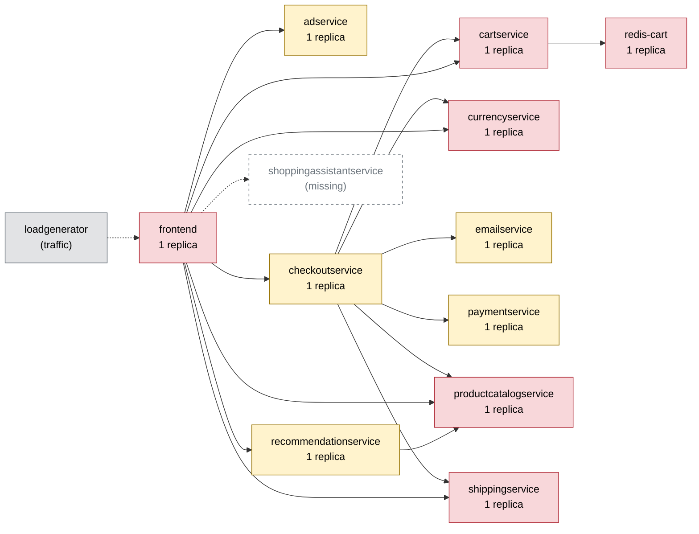

# Chaos Engineering Findings Report — Online Boutique

Generated 2026-10-11T07:49:30+00:00 · scope: `20261011-074759-campaign` · 1 experiments · analyst model: gpt-6-luna · score version 1

## 1. Summary

- **Resilience score: 30 / 100 (grade F)** — given by the AI analyst against a fixed rubric, combined by code; code anchor: 30.
- Experiments: 1 · types: pod_kill · failure classes: recovery.
- Planner predictions: 1 confirmed, 0 partly, 0 refuted.
- Safety: 0 experiment(s) stopped automatically or manually; baseline p95 16 ms, 0.0% errors.

*(AI analyst)* The cartservice pod-kill caused a broad, severe shopper-facing outage: all five flows were affected, and 96.55% of requests failed during impact. Checkout p95 reached 5003.2 ms versus a 21.6 ms baseline, while other flows also had 100% error rates in the sampled requests. The main demonstrated weakness is that cartservice is a single point of failure shared across every flow. The planner correctly predicted the affected flows, severity bands, and run outcome.

## 2. Findings, ranked by severity

### F1. [CRITICAL] Single cartservice replica creates a shop-wide outage when the pod is killed

- **Services:** cartservice, frontend, checkoutservice
- **Evidence:** `20261011-074759-pod_kill-cartservice` — Killing the sole cartservice pod affected home, product, add_to_cart, view_cart, and checkout. Overall impact error rate was 96.55% and peak error rate was 100%; home, product, add_to_cart, and view_cart each had 100% errors in 12 requests, while checkout had 80% errors in 10 requests and p95 5003.2 ms versus 21.6 ms baseline (231.63x). Recovery was 24.6 s; the frontend was reported unresponsive for 3.6 s, and the p95 guard breached 1500 ms. The fault was an instantaneous pod kill, so the guard reported breaches rather than aborting it.
- **Root cause:** cartservice has one replica and is a shared dependency for frontend and checkoutservice. With that sole pod unavailable, requests across the dependent shopping flows could not rely on cart operations; there was no surviving replica to serve requests during replacement and readiness recovery.
- **Fix (`scale_replicas` on cartservice):** cartservice is stateless according to the dependency map, so scaling it to three replicas adds redundancy. A single pod kill should then leave other replicas available to serve callers instead of taking cart-dependent flows offline while Kubernetes replaces the only pod.

```
kubectl -n boutique scale deployment/cartservice --replicas=3
```
- **Expected improvement:** Re-running the pod kill should no longer produce a shop-wide outage: most requests should succeed through surviving cartservice replicas, checkout should avoid the observed multi-second p95 spike, and recovery should be faster or not user-visible.
- **Verify by re-running:** `chaos-agent run --type pod_kill --target cartservice -p grace_period_s=0 --duration 30`

_Findings text: *(AI analyst)*. Numbers: measured by the probe / Prometheus._

## 3. Resilience score per service (worst first)

| Service | Score (AI) | Code anchor | Grade | Availability | Latency | Recovery | Containment | Posture | Weight | Tested | Justification (AI) |
|---|---|---|---|---|---|---|---|---|---|---|---|
| cartservice | **30** | 30 | F | 0 | 13 | 80 | 50 | 60 | 3 | yes | In 20261011-074759-pod_kill-cartservice, impact error rate was 96.55%, all five flows were affected, checkout p95 reached 5003.2 ms, and recovery took 24.6 s. It has one replica, probes, and resource limits. |
| adservice | **60** | 60 | D | 60 | 60 | 60 | 60 | 60 | 1 | no | Untested. Its single replica gives a posture score of 60; it is called by frontend on home and product, but is not on the checkout path. No service-specific impact was measured. |
| checkoutservice | **60** | 60 | D | 60 | 60 | 60 | 60 | 60 | 2.5 | no | Untested directly. It has one replica and is on the revenue path; the cartservice run showed checkout errors and a 5003.2 ms p95 when its cart dependency was killed, but does not isolate checkoutservice behavior. |
| currencyservice | **60** | 60 | D | 60 | 60 | 60 | 60 | 60 | 2.5 | no | Untested. Its single replica gives a posture score of 60; it is shared by frontend and checkoutservice and is on the checkout path. No currencyservice fault was measured. |
| emailservice | **60** | 60 | D | 60 | 60 | 60 | 60 | 60 | 1.5 | no | Untested. Its single replica gives a posture score of 60; its mapped reach is limited to checkout. No emailservice fault was measured. |
| frontend | **60** | 60 | D | 60 | 60 | 60 | 60 | 60 | 3 | no | Untested directly. It is the single-replica entrypoint for all flows; the cartservice run recorded a 3.6 s unresponsive period and broad flow errors, but does not isolate a frontend fault. |
| paymentservice | **60** | 60 | D | 60 | 60 | 60 | 60 | 60 | 1.5 | no | Untested. Its single replica gives a posture score of 60; it is on the checkout path but has limited mapped reach. No paymentservice fault was measured. |
| productcatalogservice | **60** | 60 | D | 60 | 60 | 60 | 60 | 60 | 3 | no | Untested. Its single replica gives a posture score of 60; it is shared by frontend, checkoutservice, and recommendationservice with reach across all flows. No productcatalogservice fault was measured. |
| recommendationservice | **60** | 60 | D | 60 | 60 | 60 | 60 | 60 | 1.5 | no | Untested. Its single replica gives a posture score of 60; its mapped impact is narrower than the entrypoint and checkout dependencies. No recommendationservice fault was measured. |
| redis-cart | **60** | 60 | D | 60 | 60 | 60 | 60 | 60 | 3 | no | Untested. Its single-replica posture is 60; it is stateful and underpins cartservice and all mapped shopping flows. The cartservice pod-kill did not test Redis failure behavior. |
| shippingservice | **60** | 60 | D | 60 | 60 | 60 | 60 | 60 | 2 | no | Untested. Its single replica gives a posture score of 60; its mapped reach is view_cart and checkout. No shippingservice fault was measured. |

Rubric weights: availability 35%, latency 25%, recovery 20%, containment 10%, posture 10%. AI dimension scores are limited to ±15 of the code anchor; the overall score is the criticality-weighted mean of the tested services.

*(AI analyst)* The tested cartservice scores follow the supplied anchor dimensions, rounded to integers: the run showed near-total request failure, a multi-second checkout p95, and recovery in about 25 seconds. For untested services, availability, latency, recovery, and containment are held at 60 as conservative, anchor-proximate estimates rather than measured results; posture is 60 for the mapped single-replica services with readiness and liveness probes and CPU/memory limits. Criticality weights are constrained to 0.5–3: the entrypoint and broad-reach cart/product dependencies receive the highest weights, checkout-path dependencies are next, and narrower or less central services receive lower weights.

## 4. Experiments

| Run | Type | Target | Params | Origin | Status | Peak errors | Peak p95 | Worst slowdown | Affected flows | Recovery | Prediction |
|---|---|---|---|---|---|---|---|---|---|---|---|
| `20261011-074759-pod_kill-cartservice` | pod_kill | cartservice | {'grace_period_s': 0} | planner | COMPLETED | 100.0% | 5003 ms | 231.6x | home, product, add_to_cart, view_cart, checkout | 25 s (pod Ready 23 s) | confirmed |

## 5. How the AI decided

**Plan `20261011-074754-plan`** (ai, model gpt-6-luna). Strategy: Run the cartservice pod kill first to expose the widest, highest-risk user impact and measure recovery; then run a lower-than-200-user frontend load spike to test capacity without repeating the known guard breach. Together, the experiments probe shopper-visible errors and recovery, plus resource pressure and slowdown, while using different experiment types and targets.

| Rank | Experiment | Reason | Prediction |
|---|---|---|---|
| 1 | pod_kill on cartservice {'grace_period_s': 0} 30s | Ranked first because cartservice is a single replica, a shared dependency of checkoutservice and frontend, and has reach across all five flows. Prior 30-second cartservice pod-kill runs showed errors across all flows and recovery around 22–31 seconds, making this a direct test of both the shopper-visible error blast radius and recovery. | flows home, product, add_to_cart, view_cart, checkout; errors high; slowdown severe; COMPLETED |
| 2 | traffic_spike on frontend {'users': 150, 'ramp_s': 30, 'think_ms': 1000, 'checkout_pct': 20} 60s | Frontend is a single-replica entrypoint with 200m CPU and 128Mi memory limits, so load is visible across every user flow. A previous 150-user, 30-second-ramp run completed with p95 around 1094 ms, while 200 users has previously breached the 1500 ms guard; 150 users provides visible slowdown while staying below that observed breach point. | flows home, product, add_to_cart, view_cart, checkout; errors none; slowdown severe; COMPLETED |

Ideas the planner considered and dropped:

- network_delay on productcatalogservice at 300 ms for 60 seconds — Prior evidence shows that even 100 ms added latency makes pages about 700 ms slower; the higher intensity risks simply tripping the slowdown guard and teaches less than the controlled load test.
- memory_stress on cartservice at 110 MB — Prior runs at this intensity caused broad shopper-visible errors and guard aborts. The cartservice pod kill already probes broad outage impact and recovery, so this would add destructive risk without enough distinct learning.
- pod_failure on paymentservice — It would expose checkout errors, but its impact is limited to the checkout path and overlaps the error-class learning from the broader cartservice outage.

*(AI analyst)* The prediction was confirmed for the only run: the predicted and observed affected-flow sets matched, the high error and severe slowdown bands matched, and the run completed as predicted. The hypothesis also correctly anticipated a single-pod dependency outage and recovery taking tens of seconds. The planner's success here is evidence for this cartservice pod-kill scenario only, not for other fault types or services.

## 6. Safety record

Guard (deterministic code, checked every 1 s): abort when the error rate > 20% or p95 > max(3× baseline, 1500 ms) for 2 checks in a row, the frontend is silent for 3 s, or a non-target pod becomes NotReady. Every fault is validated against hard caps (and the AI policy for AI-proposed ones), dry-run by the Kubernetes API server, and carries a Chaos Mesh `duration` (auto-revert).

## 7. Dependency map

Red = high risk (single replica and critical), yellow = medium, green = low.



| Service | Replicas | Risk | Reach (share of user flows) | Dependents |
|---|---|---|---|---|
| cartservice | 1 | high | 100% (home, product, add_to_cart, view_cart, checkout) | checkoutservice, frontend |
| frontend | 1 | high | 100% (home, product, add_to_cart, view_cart, checkout) | - |
| productcatalogservice | 1 | high | 100% (home, product, add_to_cart, view_cart, checkout) | checkoutservice, frontend, recommendationservice |
| redis-cart | 1 | high | 100% (home, product, add_to_cart, view_cart, checkout) | cartservice, checkoutservice, frontend |
| currencyservice | 1 | high | 80% (home, product, view_cart, checkout) | checkoutservice, frontend |
| recommendationservice | 1 | medium | 60% (product, view_cart, checkout) | frontend |
| adservice | 1 | medium | 40% (home, product) | frontend |
| shippingservice | 1 | high | 40% (view_cart, checkout) | checkoutservice, frontend |
| checkoutservice | 1 | medium | 20% (checkout) | frontend |
| emailservice | 1 | medium | 20% (checkout) | checkoutservice, frontend |
| paymentservice | 1 | medium | 20% (checkout) | checkoutservice, frontend |

## 8. Method and limitations

- Users are simulated by a 4-user probe (home, product, add to cart, view cart, checkout) measured in rolling 5 s windows; resources come from Prometheus.
- Rubric: **availability** — Did users keep getting successful responses? 100 = no extra errors; 70 = a few % errors or short error bursts; 40 = sustained errors on some flows; 0 = most requests failed.; **latency** — How much slower did user flows get (worst p95 vs baseline)? 100 = < 1.5x; 80 = ~3x; 60 = ~10x; 30 = ~50x; 0 = several seconds / timeouts.; **recovery** — How fast were users back to normal after the fault ended? 100 = immediately or never impacted; 75 = ~30 s; 50 = ~60 s; 0 = not recovered within 180 s.; **containment** — Did the failure stay contained? 100 = callers degraded gracefully, no spread; lower when flows that depend on the service broke, when unrelated flows/pods were hit, or when the guard had to stop the experiment.; **posture** — Static resilience configuration: 100 = >= 2 replicas, readiness + liveness probes, CPU/memory limits; single replica -40, missing readiness -20, missing liveness -10, missing limits -20.
- *(AI analyst)* Only one experiment was run, and it tested a cartservice pod kill; other services, fault types, and traffic conditions remain untested.
- *(AI analyst)* The environment is a single-node Kubernetes deployment, so these results do not establish resilience to node or zone failures.
- *(AI analyst)* Per-flow samples during the run were small (10–12 requests), and the baseline was also a short probe; measured rates and percentiles may be noisy.
- *(AI analyst)* The cartservice failure affected dependent flows, but this run does not isolate the behavior of each caller or prove the behavior of Redis, other dependencies, or fallback mechanisms.
